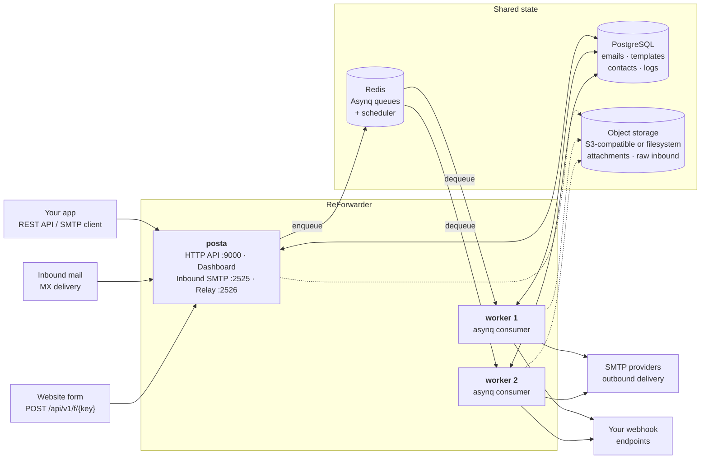
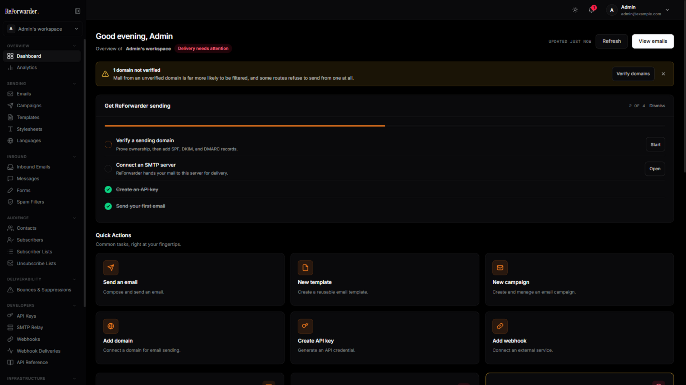
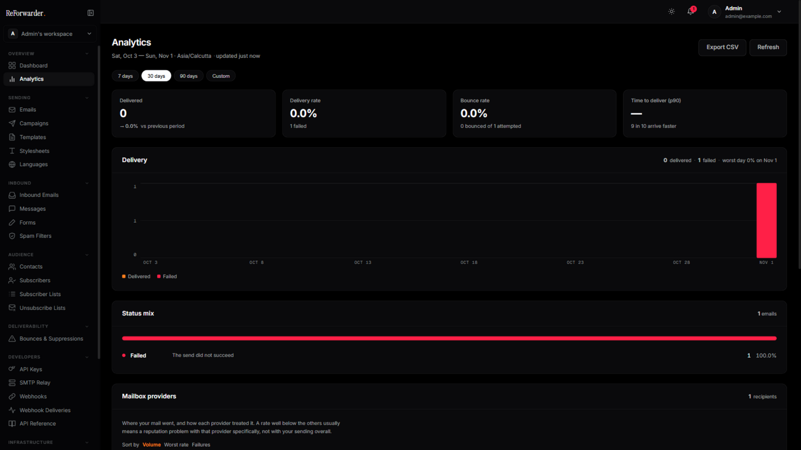
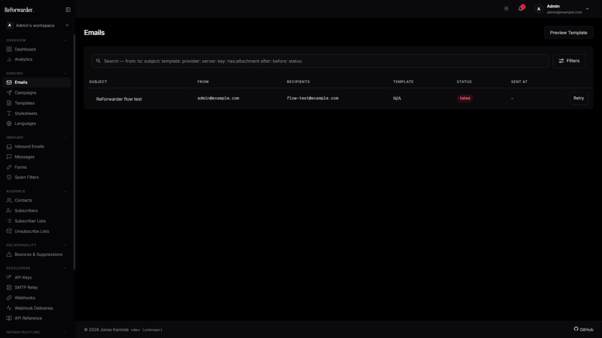
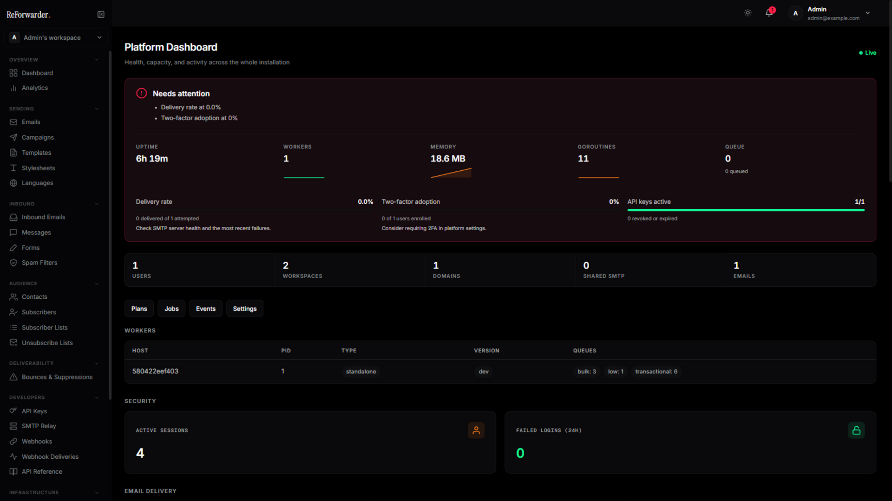

# ReForwarder

<p align="center">
  
</p>

<p align="center">
Self-hosted email platform for sending, receiving, and relaying email through a unified API and SMTP.
</p>
<p align="center">
  <a href="#overview">Overview</a> ·
  <a href="#quick-start">Quick Start</a> ·
  <a href="#core-features">Features</a> ·
  <a href="#architecture">Architecture</a> ·
  <a href="#api-documentation">API</a> ·
  <a href="#dashboard">Dashboard</a> ·
  <a href="#sdks">SDKs</a> ·
  <a href="#license">License</a> ·
  <a href="#acknowledgments">Acknowledgments</a>
</p>

[](https://github.com/ReForwarder/ReForwarder/actions/workflows/ci.yml)
[](https://go.dev/)
[](https://github.com/ReForwarder/ReForwarder/releases)

---

## Overview

**ReForwarder** is a self-hosted, developer-first email platform that handles **outbound**, **inbound**, and **relayed** email — driven by a single HTTP API, with SMTP available for the paths that need it.

- **Outbound** — send transactional and marketing email over your own SMTP, with templates, localization, campaigns, subscriber lists, bounce and complaint handling, and delivery analytics.
- **Inbound** — receive email at your domains, parse messages and attachments, and forward the structured payloads to your application via webhooks.
- **Relay** — point an existing SMTP client at ReForwarder and its mail flows through the same outbound pipeline as the API, so you can migrate to the HTTP API at your own pace.
- **Forms** — let a website contact form post straight to ReForwarder, scan each submission for spam, and reply to the sender from the dashboard through the same domains and suppression list as everything else.

It is designed as a fully self-hostable alternative to services like SendGrid, Mailgun, and Postmark — giving you complete ownership of your email infrastructure, data, and deliverability.

[](https://reforwarder.com/)
[](https://github.com/ReForwarder/ReForwarder)
[](#license)

---

## Quick Example

Send your first email:

```bash
curl -X POST http://localhost:9000/api/v1/emails/send \
  -H "Authorization: Bearer YOUR_API_KEY" \
  -H "Content-Type: application/json" \
  -d '{
    "from": "Acme <hello@example.com>",
    "to": ["Jonas Kaninda <jonas@example.com>","bob@example.com"],
    "subject": "Hello from ReForwarder",
    "html": "<h1>Hello!</h1>"
  }'
```

> The `from`, `to`, and other address fields accept a plain address (`hello@example.com`)
> or RFC 5322 display-name format (`Acme <hello@example.com>`).

Response:

```json
{
  "id": "0ae4b04e-5c64-4b2f-bad6-460f8d5d98b3",
  "status": "queued"
}
```

Receive a website form submission — no JavaScript, no backend of your own:

```html
<form action="http://localhost:9000/api/v1/f/YOUR_FORM_KEY" method="POST">
  <input type="email" name="email" required>
  <textarea name="message" required></textarea>
  <button type="submit">Send</button>
</form>
```

The submission is scanned, stored, and shown in the dashboard, where a person
replies to the sender. There is no auto-responder.

---

## Core Features

### Email Delivery

* REST API for transactional, batch, and templated emails
* Attachments, custom headers, and unsubscribe support
* Web view ("view in browser") with signed, expiring links
* Scheduled sending and preview mode
* Email address verification (syntax, MX, disposable & role-account checks)
* Async processing with Redis and Asynq
* Automatic retries and priority queues

### Inbound Email

* Built-in SMTP receiver with TLS
* HTTP webhook ingest with HMAC verification
* Raw message, headers & attachment storage
* Forwarding with status tracking
* Spam scoring & retry on failure
* Real-time SSE stream for inbound notifications

### Web Form Messages

* Public ingest endpoint per form — `POST /api/v1/f/{key}`, no API key on the page
* Accepts plain HTML form posts, JSON, and multipart uploads; works without JavaScript
* Origin allowlist, honeypot field, single-use nonces, and per-IP, per-form, per-sender and per-workspace rate limits
* Spam scanning with a score, the reasons behind it, and an action ladder — allow, flag, quarantine, reject
* Workspace spam filters by keyword, phrase, regex, email, domain, or IP, with a dry-run before you commit
* Manual replies from the dashboard through the normal sending pipeline — no auto-responder
* Inbox states, assignment, attachments, and a live event stream
* Immediate, hourly, or daily digest notifications to the addresses each form nominates
* Off by default behind `POSTA_MESSAGES_ENABLED`

### Email Relay

* Point an existing SMTP client at ReForwarder — no code changes
* Relays into the same pipeline as the send API
* Domain verification, suppression & rate limits still apply
* Workspace-scoped credentials with IP allowlist
* Instant revocation, no redeploy
* Off by default — built for private networks

### Templates

* Versioned and multi-language templates
* Drag-and-drop visual email builder, or a code editor with syntax highlighting and a live preview
* Variable substitution and stylesheet inlining
* System variables for web view and one-click unsubscribe links
* Import/export, HTML file import, and desktop/mobile preview

### Campaigns

* Bulk email campaigns with scheduling and subscriber targeting
* Draft, scheduled, sending, paused, and cancelled lifecycle states
* A/B testing with multi-variant splits and per-variant performance metrics

### SMTP & Domains

* Multiple SMTP providers with TLS support
* Shared SMTP pools for teams
* Domain verification (SPF, DKIM, DMARC)
* Verified sender enforcement

### Security

* API keys with expiration, hashing, and IP allowlisting
* JWT authentication and RBAC
* Two-factor authentication (TOTP)
* OAuth / SSO login (Google, Keycloak, authentik, and more)
* Rate limiting and session management

### Contacts & Subscribers

* Auto-tracked contacts with per-recipient send/failure stats
* Subscriber management with static and dynamic (segmented) lists
* Bulk import via JSON or CSV with column mapping
* Subscriber lifecycle (active, bounced, unsubscribed)
* Hard/soft bounce and complaint handling with automatic suppression

### Unsubscribe Lists

* RFC 8058 one-click unsubscribe scoped per list
* ReForwarder-minted signed URLs and `List-Unsubscribe` header
* Scoped opt-outs so receipts and password resets keep flowing
* Management API and dashboard for CRUD and opt-out browsing
* `email.unsubscribed` webhook event
* Resubscribe individual addresses without lifting a global block

### Tracking

* Pixel-based open tracking
* Click tracking with link rewriting
* Per-email engagement metrics

### Workspaces

* Multi-tenant architecture with isolated workspaces
* Role-based access control (owner, admin, editor, viewer)
* Member invitations and scoped API keys
* Data export/import and GDPR contact/log deletion

### Webhooks & Events

* Event-driven architecture with webhook delivery
* Retry strategies and delivery tracking
* Audit logs and real-time event streaming

### Analytics & Monitoring

* Email delivery, open, and click metrics, compared against the preceding period
* Delivery and bounce trends, plus time-to-deliver percentiles
* Deliverability broken down by recipient mailbox provider — Gmail, Outlook, Yahoo, and the rest
* CSV export of any report
* Prometheus integration
* Health endpoints and daily reports

### Admin Platform

* User and API key management
* Platform dashboard, metrics, and logs
* Domains across every workspace, with a manual ownership override for the cases DNS cannot settle
* Announcements broadcast to every user's in-app inbox, retractable after the fact
* SMTP pool management
* Usage plans with quotas and per-workspace assignment
* OAuth/SSO provider configuration
* Platform configuration and retention policies

### Dashboard

* Vue-based UI for managing all resources
* Analytics, templates, SMTP, domains, contacts, campaigns, messages, and logs
* Per-user notification inbox with dismissible workspace health alerts
* Dark/light mode and user preferences

---

## Architecture

ReForwarder ships as a single binary that runs in two modes: `posta` serves the HTTP API,
dashboard, and SMTP listeners; `posta worker` consumes the job queue. Both modes are
stateless — all state lives in the shared PostgreSQL, Redis, and object storage — so you
can run as many workers as your send volume needs.



Running the API without a dedicated worker works for evaluation, but production
deployments should split them so sending, retries, campaigns, and scheduled jobs scale
independently of request traffic — see
[`examples/docker-compose-full.yml`](examples/docker-compose-full.yml).

Object storage is optional (dashed above). With `POSTA_BLOB_PROVIDER` unset, attachments
and raw inbound messages stay in the database; point it at `s3` or `fs` to move them out.
Any multi-node deployment should use `s3` — a local `fs` path is not shared between the
server and its workers.

### Stack

* Backend: Go (Okapi framework)
* Frontend: Vue 3 + Vite
* Database: PostgreSQL
* Queue: Redis + Asynq
* Metrics: Prometheus

---

## Project Roadmap

Planning details live in `docs/project/`: [FEATURE_INVENTORY.md](docs/project/FEATURE_INVENTORY.md) is the detailed registry, [BACKLOG.md](docs/project/BACKLOG.md) the operational backlog, and the [ReForwarder Backlog](https://github.com/ReForwarder/ReForwarder/projects) board the task board.

### To-dos

- [ ] [RF-F023] DNS record guidance depth (SPF/DMARC parsing, MX records, drift re-verification)
- [ ] [RF-F029] Custom tracking domain
- [ ] [RF-F040] Per-domain inbound routing rules (alias/catch-all/forward targets)
- [ ] [RF-F048] Transactional scheduled send (API send_at) — broken end-to-end
- [ ] [RF-F056] Webhook test-fire endpoint
- [ ] [RF-F057] Bounce classification analytics surface (classification counts)
- [ ] [RF-F061] UTM auto-tagging of campaign links
- [ ] [RF-F071] Automation workflow dry-run / test tooling
- [ ] [RF-F073] Preference center (multi-list subscription management)
- [ ] [RF-F074] Subscriber signup forms (form-to-subscriber capture)
- [ ] [RF-F075] Double opt-in (DOI) confirmation flow
- [ ] [RF-F076] Subscriber tags
- [ ] [RF-F091] Security-events retention enforcement
- [ ] [RF-F092] Admin-console IP allowlisting
- [ ] [RF-F097] Error-monitoring hook
- [ ] [RF-F099] Delivered-state analytics, email.delivered emission, and dead delivered UI paths
- [ ] [RF-F100] Tracking toggle symmetry
- [ ] [RF-F101] Contact Lists pages — dead end-to-end (handler never registered, views unrouted)
- [ ] [RF-F103] Backend endpoints with no UI consumer / dead client functions (segments contacts, message analytics & assign, automation custom-event ingest, admin provider breakdown)

### In Progress

- [ ] [RF-F104] Campaign duplication UI wired (2026-11-07); residual: campaign-level failed-recipient retry
- [ ] [RF-F005] 2FA recovery codes
- [ ] [RF-F014] Passkeys / WebAuthn
- [ ] [RF-F015] Admin impersonation
- [ ] [RF-F026] Domain deliverability health / diagnostics
- [ ] [RF-F027] Domain-sending policy (strict verified-domain mode, R-23)
- [ ] [RF-F028] DMARC aggregate report ingestion (rua)
- [ ] [RF-F053] Legacy bounce webhook (/webhooks/bounce)
- [ ] [RF-F081] System-info endpoint feature flags (Section-11 gate)
- [ ] [RF-F082] API route contract gate (golden file + frontend spec)
- [ ] [RF-B120] Option B Phase 3 — mailbox & storage foundation (ADR-003): storage core landed in wave W1 (2026-11-07) — Postgres mailstore models + migration, append/fetch/copy/move/flags-CAS/expunge service, blob ref-counting seam, concurrent-access suites; quotas + retention landed in wave W4 (2026-11-07) — full ADR-003 §5 quota enforcement (per-mailbox bytes + message count + workspace aggregate ceiling, lock-and-check in the append tx, typed `*QuotaError`) and the §7 retention sweep in the unified cron (per-mailbox/per-folder age+count policies, counters synced, blob refs at ≤0 reclaimed with their objects); Postgres FTS search landed in wave W3 (2026-11-07) — `mailstore.PostgresSearcher` over the `search_tsv` generated column (websearch syntax, weighted subject/from/to/body ranking, per-user isolation + folder scoping, paged ranked ids), plus the admin-gated `POST /admin/mailstore/search/reindex` raw-SQL rebuild; the content-addressed encrypted blob layer landed in wave W2 (2026-11-07) — `mailstore.ZstdBlobCodec` (zstd >4 KiB + AES-256-GCM via the crypto service, SHA-256 content addressing, SF-78/SF-83), reserve-then-write append under a per-hash advisory lock, grace-perioded ref-count GC with the audited `mail_blob_gc` cron event, and dedup-aware per-mailbox blob-byte usage reporting; the ingestion seam (flow F13) landed in wave W5 (2026-11-08) — inbound messages whose matched route action is `deliver` file into the recipient's hosted INBOX via `mailstore.Append` (`internal/services/inbound/mailbox_delivery.go`, wired on both ingest paths), auto-provisioning the recipient mailbox on first delivery to a verified domain bound to the tenant user (`POSTA_MAILSTORE_AUTO_PROVISION`, default true; off → archive only), quota-enforced with over-quota deliveries quarantined under the typed `mailbox_quota_exceeded` reason (release re-runs routing and re-delivers); no mailbox → archive-only exactly as before; transactional `Email`/subscriber paths untouched; backup/restore tooling and orphan-object enumeration remain

### In Review

_None._

### Done

- [x] [RF-F001] Email + password registration and login
- [x] [RF-F002] Per-IP login rate limiting
- [x] [RF-F003] Session lifecycle (JWT sessions, revocation, device list)
- [x] [RF-F004] Two-factor authentication (TOTP)
- [x] [RF-F006] two_factor_required policy enforcement (GAP-12) — marker + forced-enrollment redirect; admins not exempt (2026-11-07)
- [x] [RF-F007] Workspace RBAC (owner/admin/editor/viewer)
- [x] [RF-F008] Workspaces / tenants (CRUD, system workspace, personal provisioning, default workspace)
- [x] [RF-F009] Workspace invitations
- [x] [RF-F010] API keys (scopes, workspace binding, IP allowlist, expiry, quota)
- [x] [RF-F011] Per-API-key rate limits
- [x] [RF-F012] Per-API-key usage analytics
- [x] [RF-F013] API-key credential transport restriction
- [x] [RF-F016] Self-service password reset
- [x] [RF-F017] Email verification
- [x] [RF-F018] OAuth login, account linking, provider admin, workspace SSO
- [x] [RF-F019] Account lifecycle (self-service deletion scheduling)
- [x] [RF-F020] Admin user administration
- [x] [RF-F021] Domain CRUD (workspace + admin)
- [x] [RF-F022] Domain ownership + DNS verification (TXT token, SPF/DKIM/DMARC checks)
- [x] [RF-F024] Managed DKIM signing on the send path
- [x] [RF-F025] DKIM key lifecycle: generate / rotate / verify-dns / retire / delete
- [x] [RF-F030] SMTP relay listener (:2526)
- [x] [RF-F031] SMTP relay submission auth and relay-to-send pipeline
- [x] [RF-F032] STARTTLS/TLS modes for both SMTP listeners
- [x] [RF-F033] SMTP relay credentials (bcrypt, legacy-SHA-256 migration, IP allowlists, CRUD API+UI)
- [x] [RF-F034] Inbound SMTP receiver (:2525)
- [x] [RF-F035] Inbound webhook ingest (POST /api/v1/inbound/webhook)
- [x] [RF-F036] Inbound SSE stream (GET /workspaces/current/inbound-stream)
- [x] [RF-F037] Website form messages (public form ingest + inbox)
- [x] [RF-F038] Form thread replies via inbound email (msg+token@ domain)
- [x] [RF-F039] Messages SSE stream (GET /workspaces/current/message-stream)
- [x] [RF-F041] Email send pipeline (API send → asynq enqueue → worker SMTP delivery)
- [x] [RF-F042] Asynq queues + deterministic TaskIDs (transactional/bulk/low)
- [x] [RF-F043] Retry layer 1 — asynq task retries + exhausted-error handler
- [x] [RF-F044] Retry layer 2 — DB retry worker (bounded jittered sweep)
- [x] [RF-F045] Manual retry (POST /emails/{id}/retry + dashboard retry button)
- [x] [RF-F046] queue_reconcile — lost-task healing cron
- [x] [RF-F047] Campaign scheduled sends (scheduled_at + campaign-scheduler cron)
- [x] [RF-F049] Campaign pause / cancel / resume with send-time re-check
- [x] [RF-F050] Queue administration (admin API, dashboard Jobs view, dead-letter gauge)
- [x] [RF-F051] Bounce handling — 14-class failure classifier + SMTP-path hard-bounce chain
- [x] [RF-F052] Provider events ingestion (SES/SNS, SendGrid, Postmark, Mailgun)
- [x] [RF-F054] Suppression list (scoped CRUD, send-time filtering, auto-suppress chain)
- [x] [RF-F055] Webhook delivery history and operator replay
- [x] [RF-F058] Campaign lifecycle & fan-out sending engine
- [x] [RF-F059] Campaign A/B testing with hold-back and winner selection
- [x] [RF-F060] Timezone-aware sending
- [x] [RF-F062] Segments — SegmentCondition SQL builder, preview and campaign targeting
- [x] [RF-F063] Subscriber management (marketing audience CRUD, custom fields, bulk import)
- [x] [RF-F064] Dual audience models: Contact (transactional) vs Subscriber (marketing)
- [x] [RF-F065] Subscriber lists — static + dynamic filter-rule lists with subscribe/unsubscribe APIs
- [x] [RF-F066] Templates — CRUD, preview, send-test, HTML import, JSON export/import
- [x] [RF-F067] Template versions with activation
- [x] [RF-F068] Template localizations (per-language content)
- [x] [RF-F069] Automation execution engine (journeys, node executors, triggers, schedules)
- [x] [RF-F070] Automation visual builder (vue-flow canvas, palette, config panel, execution drawer)
- [x] [RF-F072] Unsubscribe — campaign list opt-out + RFC 8058 one-click transactional
- [x] [RF-F077] Workspace data export/import (audience + settings JSON)
- [x] [RF-F078] Admin platform core (users, workspaces, domains, plans, servers, events, metrics, announcements, updates)
- [x] [RF-F079] Scheduled-jobs admin endpoint (GET /admin/jobs)
- [x] [RF-F080] Platform settings engine (GET/PUT /admin/settings + seeded security rules)
- [x] [RF-F083] Webhooks engine (scoped dispatch, HMAC signatures, bounded exponential retries, per-attempt history)
- [x] [RF-F084] Webhook SSRF guard (static policy, resolve-and-reject, pinned dial, redirect block, sanitized errors)
- [x] [RF-F085] Webhook egress proxy with destination pinning (http/https/socks5, double opt-in)
- [x] [RF-F086] Open/click/unsubscribe tracking with HMAC-signed tokens
- [x] [RF-F087] Analytics APIs (admin + workspace daily counts, status breakdown, dashboard trends, provider breakdown)
- [x] [RF-F088] Security engine — ban service (tiered escalation, allowlist-wins, multi-replica propagation)
- [x] [RF-F089] Fail2ban-style detectors (7 sliding-window signals, weighted scoring, instant-ban thresholds)
- [x] [RF-F090] Security admin surface (overview, bans, events, tunable rules, allowlist, SSE streams)
- [x] [RF-F093] Encryption at rest for credentials and signing keys (AES-256-GCM)
- [x] [RF-F094] Retention cron and GDPR tooling (multi-store cleanup, blob purge, GDPR message erase, account cleanup, data export)
- [x] [RF-F095] Database backups (pg_dump cron with retention and restore runbook, R-11)
- [x] [RF-F096] Prometheus metrics and health probes
- [x] [RF-F098] REST API response envelope and OpenAPI documentation
- [x] [RF-F105] Core dashboard integration surface (verified end-to-end at contract level)
- [x] [RF-F102] Dead admin API client methods removed (listApiKeys / revokeApiKey / listEmails — CA-02, 2026-11-07)

---

## Requirements

* Go 1.27+
* PostgreSQL
* Redis

---

## Quick Start

### Docker Compose

```bash
docker compose up -d
```

Access the dashboard:

```
http://localhost:9000
```

Default credentials:

```
Email: admin@example.com
Password: admin1234
```

---

### Local Development

```bash
git clone https://github.com/ReForwarder/ReForwarder.git
cd ReForwarder

make dev-deps
make dev
make dev-worker
```

---

## API Documentation

Every ReForwarder instance serves its own interactive API documentation:

* API Reference: `/docs` on your ReForwarder instance
* OpenAPI Spec: `/openapi.json` on your ReForwarder instance

Running locally with the default port, that is [http://localhost:9000/docs](http://localhost:9000/docs).
---

# Dashboard

ReForwarder includes a web dashboard for managing templates, SMTP servers, domains, contacts, API keys, and analytics.

<p align="center">
  
</p>

### Email Analytics

<p align="center">
  
</p>

### Emails

<p align="center">
  
</p>

### Admin Platform Metrics

<p align="center">
  
</p>

---

## SDKs

The official Posta SDKs are compatible with ReForwarder's API:

* Go: [https://github.com/goposta/posta-go](https://github.com/goposta/posta-go)
* PHP: [https://github.com/goposta/posta-php](https://github.com/goposta/posta-php)
* Java: [https://github.com/goposta/posta-java](https://github.com/goposta/posta-java)
* Node: [https://github.com/goposta/posta-node](https://github.com/goposta/posta-node)
* .NET: [https://github.com/goposta/posta-dotnet](https://github.com/goposta/posta-dotnet)

### Go Example

```go
package main

import (
    "fmt"
    "log"

    posta "github.com/goposta/posta-go"
)

func main() {
    client := posta.New("https://reforwarder.example.com", "your-api-key")

    resp, err := client.Emails.Send(&posta.SendEmailRequest{
        From:    "sender@example.com",
        To:      []string{"recipient@example.com"},
        Subject: "Hello from ReForwarder",
        HTML:    "<h1>Hello!</h1><p>This is a test email.</p>",
    })
    if err != nil {
        log.Fatal(err)
    }
    fmt.Printf("Email sent: id=%s status=%s\n", resp.ID, resp.Status)
}
```

---

## Contributing

Contributions are welcome. Please open an issue before submitting a pull request.

---

## License

ReForwarder is free and open-source software licensed under the
GNU Affero General Public License v3.0 or later ([AGPL-3.0-or-later](LICENSE)).

## Copyright

Copyright (c) 2026 Jonas Kaninda and contributors — the original [Posta](https://github.com/goposta/posta) project.
ReForwarder changes and additions by the ReForwarder contributors.

---

## Acknowledgments

ReForwarder is a rebranded distribution built on top of the excellent work of the
Posta project and its community.

* Upstream project: [goposta/posta](https://github.com/goposta/posta)
* Author: [Jonas Kaninda](https://github.com/jkaninda)
* Support upstream: [Ko-fi](https://ko-fi.com/jkaninda)

If ReForwarder is useful to you, starring both the
[ReForwarder repository](https://github.com/ReForwarder/ReForwarder) and the
[upstream Posta repository](https://github.com/goposta/posta) is the best way to
say thanks.
