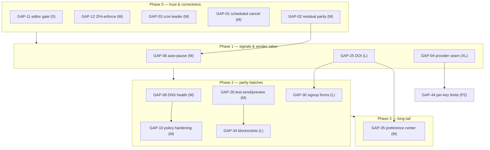

# 05 — Implementation Roadmap: Prioritized Plan and Sequence

> **Doc 5 of 7** in the ReForwarder product-roadmap documentation suite. This document turns the gap register (`04-feature-gap-analysis.md`) into the prioritized, scored, and phase-ordered plan that future implementation phases execute from. Gap evidence, file-level proof, and competitor matrices live in doc 04 and `02-competitor-comparison.md`; architecture consequences live in `06-architecture-impact.md`.

- **Date:** 2026-11-05.
- **Baseline statement:** the research baseline is HEAD `a6f1681` ("Add SMTP timeouts, DKIM signing, and delivery-queue administration"; scheduler commit `347ebb4` at parent), as frozen in doc 04 and `synthesis.md`. **The repo moved during research:** three commits landed on 2026-11-05 — `347ebb4` (scheduled-campaign scheduler + list segment preview fix), `a6f1681` (SMTP dial timeouts, DKIM signing + rotation, delivery-queue admin + `queue_reconcile`), and `6d2d7c0` ("Add provider event ingestion, A/B winner logic, timezone sending, and webhook replay", 36 new tests). Every roadmap item below is individually reconciled against that commit scope: items fully covered are marked **DONE — committed** and kept for the record only; items whose core landed keep a reduced **RESIDUAL** scope in the sequence. The registry (`registry.md` v1.0.0) stays frozen; re-statuses here apply to roadmap items only.
- **Method:** weighted scoring per synthesis §4 (six 1–5 dimensions, formula in §2, security/reliability override rule) applied to the 53 gaps of doc 04; phase sequence per synthesis §5 (P0 → P3) with dependency edges, parallelizable tracks, and batch groupings — **excluding already-delivered items**.
- **Inputs:** `synthesis.md` §4–§6 (authoritative for scoring and sequence), `04-feature-gap-analysis.md` §2 (53 gap records — evidence pointers, missing requirements, approaches, and acceptance criteria quoted or condensed from there), `registry.md` (registry IDs only).
- **Gap-ID note:** `GAP-01…GAP-53`, `D1–D9` (duplicates), and architecture-risk IDs `R1–R16` are taken verbatim from synthesis §1–§3 and consumed unchanged. **Do not confuse risk `R4` (delivery-signal integrity, `06-architecture-impact.md`) with tracker `R-04` (provider-event ingestion, the repo's own `docs/implementation/ROADMAP_IMPLEMENTATION.md`) — two unrelated ID series.**
- **Item counts:** 53 gaps = 5 P0 / 10 P1 / 22 P2 / 16 P3. After reconciliation: **1 fully closed** (GAP-39), **4 reduced to residual scope** (GAP-02, GAP-07, GAP-18, GAP-28), **48 open unchanged** → **52 items in the remaining-work sequence** (§8) plus one record-only item (§6, GAP-39).

## 1.1 Reconciliation alert (read first)

The four working-tree streams doc 04 records as "[in progress, pending commit]" were committed as **`6d2d7c0`** during this document's writing (verified from the commit message, diff stat, and targeted spot-checks of `internal/services/provider_events/` and the worker/handler diffs). Per-item outcomes:

| Stream (doc 04 §3) | Commit / tracker | Roadmap outcome |
|---|---|---|
| `provider_events` ESP event ingestion (+ bounce/failure classifier) | `6d2d7c0` (tracker R-04 + R-05) | **GAP-02 core DONE**; residual scope remains (§3, GAP-02). **GAP-07 core DONE**; analytics surface remains (§5, GAP-07) |
| A/B winner selection (campaign scope, incl. UI) | `6d2d7c0` (tracker R-08) | **GAP-28 campaign half DONE**; `AUT-008` automation outcome persistence remains (§5, GAP-28) |
| Timezone-aware sending | `6d2d7c0` (tracker R-09) | **GAP-39 DONE** — record only (§6); excluded from §8 |
| Webhook replay/redrive | `6d2d7c0` (tracker R-06) | **GAP-18 replay half DONE**; test-fire endpoint remains (§5, GAP-18) |

Caveat: this accounting is a commit-scope reconciliation, not a full re-audit at the new HEAD (doc 04 §3 re-verification note and audit I-J NV-6 request exactly that re-audit). Registry entries are not re-statused. The already-delivered record is §7; the sequence in §8 excludes all closed scope.

- **Priority legend:** **P0** critical trust/correctness hardening · **P1** high — signals and sender value · **P2** medium — competitor parity · **P3** future long tail. The P0 security/reliability override rule (§2) outranks numeric scores.
- **Complexity legend (doc-05 sizing, no calendar estimates):** **S** — single-site change (middleware, one endpoint, one cron call, a doc); **M** — bounded multi-file feature with tests; **L** — new entity/subsystem or cross-cutting surface; **XL** — new integration layer (provider clients + failover semantics).
- **Project codes** (per `01-oss-feature-inventory.md` profiles, `02-competitor-comparison.md` §0): LM Listmonk · BM BillionMail · PO Postal · US UseSend · NU Notifuse · SP SendPortal · KE Keila · MC MailCheap · SE Sessy · HR Hyvor Relay · WR Wraps · HP Hyvor Post. Flags: ✓ shipped · ◐ partial · ▲ partial/planned · ✗ absent.
- **Block format:** bold-label fields throughout; every field label appears per item ("04 §2.n" cites the source record in `04-feature-gap-analysis.md`; scores and dimension values are quoted verbatim from synthesis §4, §2 here). P0/P1 carry one field per line; P2/P3 merge the small fields onto shared lines for compactness.

---

## 2. Prioritization methodology

### 2.1 Dimensions (all scored 1–5)

| Dimension | Weight | Meaning |
|---|---|---|
| **UV** — user value | +0.20 | Direct value to the operator/marketer/integrator using the feature |
| **II** — infrastructure/platform importance | +0.25 | How much the platform's core loops (send, signal, operate) depend on it |
| **SR** — security & reliability importance | +0.30 | Correctness, trust, and failure-mode impact (dominant weight) |
| **CA** — competitive advantage | +0.10 | Parity or differentiation against the 12-project field (doc 02) |
| **CX** — implementation complexity | −0.10 | Penalty: build size and integration risk |
| **AD** — architectural dependency | −0.05 | Penalty: blocked-on or entangled-with other surfaces |

### 2.2 Formula (verbatim from synthesis §4)

```
score = 0.30*SR + 0.25*II + 0.20*UV + 0.10*CA − 0.10*CX − 0.05*AD
  UV = user value            II = infra/platform importance
  SR = security & reliability CA = competitive advantage
  CX = complexity (penalty)  AD = architectural dependency (penalty)
All dimensions 1–5. Draft priority (P0–P3) stands as assigned in synthesis §1;
where the numeric rank and draft priority disagree, the priority class wins and the discrepancy is noted.
```

**Override rule:** P0 security/reliability items override numeric rank — an item drafted P0 stays P0 even if its score would sort below P1 items (why GAP-11, score 2.85, sits in Phase 0 beside score-3.40 GAP-01; and why GAP-17 at 1.50 stays P3 despite a P2-level score — both noted in synthesis §4).

**Worked example — GAP-06 (auto-pause circuit breaker):** dimensions UV 4, II 4, SR 4, CA 4, CX 2, AD 1 →
`0.30×4 (=1.20) + 0.25×4 (=1.00) + 0.20×4 (=0.80) + 0.10×4 (=0.40) − 0.10×2 (=−0.20) − 0.05×1 (=−0.05) = 3.15` — top of P1. The AD penalty is small (one upstream dependency, GAP-02), while GAP-04 (the biggest build) pays CX 5 and AD 4, pulling a 5/5 value pair down to 2.55.

**Scoring discipline:** per-item dimension values and scores in §3–§6 are **transcribed verbatim from synthesis §4** and are not recomputed here; synthesis is authoritative (see §11 on subjectivity). Scores sort items within their priority class; the class itself governs phase placement.

---

## 3. P0 — Critical (Phase 0: trust & correctness hardening)

Five items, synthesis §4 score order. All are parallelizable (§8). Doc 04 §2.1–2.3 carries the full evidence records.

### GAP-01 · Scheduled transactional email: cancel + reconcile coverage
`INF-014` · **P0** · Complexity **M** · Score **3.40** (UV 3 · II 5 · SR 5 · CA 2 · CX 1 · AD 1) — top score in the register

- **Objective:** make scheduled transactional emails cancellable and durable — no silently lost or double future mail in the core money path.
- **Business value:** trustworthiness of the primary transactional surface; prevents silent SLA breaches. **User value:** senders can unsend future mail instead of waiting out an un-cancellable send.
- **Competitor inspiration:** INF-014 LM✓ BM✓ US✓ NU✓ SP✓ KE✓ MC✓ WR✓ HP✓ PO◐; exemplar Listmonk "Unschedule button; scheduled campaigns revert to draft" (04 §2.1).
- **Status:** **OPEN — unchanged.** The 2026-11-05 commits scheduled *campaigns* (`347ebb4`) but not transactional emails; `queue_reconcile` still scans `status='queued'` only (`queue_reconcile.go:93`). Evidence: audit-A row "Scheduling — transactional" (04 §2.1).
- **Dependencies:** none — extends the `a6f1681` reconcile pattern (tracker R-03).
- **Backend:** cancel path valid only while `status='scheduled'` (CAS transition pattern from `campaign_handler.go:391-464`); extend `queue_reconcile` to also claim `scheduled` rows past `scheduled_at` with deterministic-TaskID re-enqueue; delete the asynq task on cancel.
- **Frontend:** cancel affordance on scheduled emails in the emails views.
- **Database:** none (status column exists).
- **API:** `DELETE /emails/{id}` (or `/cancel`) restricted to `scheduled` rows.
- **Security:** cancel stays workspace-scoped (existing scope enforcement) and audited.
- **Testing:** cancel test + lost-scheduled-row reconcile test mirroring `queue_reconcile_test.go`; CAS race coverage against the scheduler claim.
- **Acceptance:** cancelling leaves the row `cancelled` and deletes the task; a scheduled row with no Redis task re-enqueues within one reconcile cycle; both tested.
- **Breaking changes:** none (new endpoint; reconcile extension additive). **Migration:** none.
- **Priority rationale:** P0 — silent double/lost sends and un-cancellable future mail are correctness defects in the core transactional path (04 §2.1; risk R5 in `06-architecture-impact.md`).

### GAP-12 · Enforce or remove `two_factor_required`; add recovery codes
`SEC-005` · **P0** · Complexity **M** · Score **2.85** (UV 3 · II 3 · SR 5 · CA 1 · CX 1 · AD 0)

- **Objective:** make the seeded `two_factor_required` setting do what it claims, with recovery codes as the lockout escape hatch — or remove it.
- **Business value:** repairs a false security promise — the worst failure mode for a control is silence. **User value:** account owners get a safe lockout path (single-use recovery codes).
- **Competitor inspiration:** SEC-005 — LM✗ (no TOTP at all), so RF's TOTP already leads; enforced-2FA is RF-specific hygiene (04 §2.3).
- **Status:** **OPEN — unchanged.** Setting seeded (`seeder/settings.go:52`), getter at `settings/provider.go:124`, zero consumers; login (`user_handler.go:459-510`) never reads it; no recovery codes (04 §2.3). Tracker R-10 (2FA recovery codes) is NOT STARTED in `docs/implementation/ROADMAP_IMPLEMENTATION.md`.
- **Dependencies:** TOTP service (exists, `twofactor/totp.go:27-42`).
- **Backend:** login-time enforcement after password success (force enrollment challenge when the setting is on and the user lacks TOTP); `user_recovery_codes` table (hashed, single-use burn) consumed in the 2FA challenge step; extend the admin reset flow (`admin_handler.go:601-606`, already audited).
- **Frontend:** recovery-code display at enrollment (once); recovery input in the 2FA challenge.
- **Database:** new `user_recovery_codes` table (hashed codes, used-at marker).
- **API:** recovery-code consume step in the 2FA challenge; admin reset extension.
- **Security:** codes stored hashed, single-use, audited; enrollment must not lock users out; keep the existing admin-reset audit trail.
- **Testing:** three paths — enforcement blocks session without enrollment; recovery code works exactly once; setting off restores current behavior.
- **Acceptance:** with the setting on, no session without enrollment or a valid code; burn + audit verified; off = current behavior.
- **Breaking changes:** behavioral only when the setting is enabled (previously a no-op) — release-note the activation. **Migration:** AutoMigrate for the new table (repo pattern).
- **Priority rationale:** P0 — "a control that silently does nothing" (audit-I) (04 §2.3; risk R2 in `06-architecture-impact.md`).

### GAP-03 · Multi-replica cron leader election
`OBS-019` · **P0** · Complexity **M** · Score **3.15** (UV 2 · II 5 · SR 5 · CA 1 · CX 1 · AD 0)

- **Objective:** exactly-one execution of the 10 cron jobs across server replicas via a distributed leader lease.
- **Business value:** multi-replica is a documented topology (`compose.yml` worker split); duplicate customer-facing alerts/digests are silent correctness bugs. **User value:** recipients stop receiving doubled bounce alerts and daily reports.
- **Competitor inspiration:** RF-specific — no competitor flag in the registry (04 §2.1).
- **Status:** **OPEN — unchanged.** `internal/cron/manager.go` has only in-process mutexes, no Redis lock (re-verified at HEAD; audit-J top gap). The landed `campaign_scheduler`/`queue_reconcile` jobs are idempotent by design but still run on every replica.
- **Dependencies:** Redis (already universal).
- **Backend:** Redis `SET NX PX` leader lease around the cron manager tick (pattern precedent: form nonces, `form_ingest_handler.go:77,131`); keep idempotent job design; additionally guard `bounce_alert`/`daily_report` per-recipient with a Redis dedup key.
- **Frontend:** none. **Database:** none. **API:** none.
- **Security:** lease key instance-scoped; no new auth surface.
- **Testing:** integration test with two managers sharing Redis — exactly one replica executes `campaign_scheduler`/`bounce_alert`/`daily_report` per tick; lease-loss failover within one interval (also resolves audit C-D NV-1 and I-J NV-2).
- **Acceptance:** as stated in testing.
- **Breaking changes:** none (single-replica behavior unchanged). **Migration:** none.
- **Priority rationale:** P0 — duplicate alert/report sends are a silent multi-replica correctness bug (04 §2.1; risk R3 in `06-architecture-impact.md`).

### GAP-02 · Delivery & complaint signal ingestion — RESIDUAL (core landed)
`ANA-003`, `ANA-005`, `INF-021`, `API-014` · **P0** · Complexity **M** (residual) · Score **2.85** (UV 5 · II 5 · SR 3 · CA 5 · CX 3 · AD 2)

- **Objective:** honest `delivered`/`complained` plumbing end-to-end so every reputation, complaint, and analytics feature stands on real signals, not SMTP-accept inference.
- **Business value:** the largest unlock in the register — enables honest delivery-rate reporting, complaint-rate analytics (GAP-06), and provider-grade automations. **User value:** senders see true delivery and complaint states; suppression happens automatically on provider verdicts.
- **Competitor inspiration:** API-014 LM✓ SP✓ US✓ NU✓ MC✓ SE✓ WR✓; exemplar Notifuse — provider webhooks set bounced/complained statuses that "always suppress from broadcasts"; UseSend tracks 21 event types (04 §2.1).
- **Status:** **CORE DONE — committed `6d2d7c0`** (tracker R-04 + R-05): `internal/services/provider_events/` with per-ESP adapters (SES SNS, SendGrid, Postmark, Mailgun) each with signature verification; `POST /webhooks/provider/{provider}` route; a provider `delivered` event now produces the previously-unreachable `EmailEventDelivered` with write-once `delivered_at`; the permanent-bounce chain mirrors the worker's `handlePermanentRejection` (hard bounce row, suppression upsert behind auto-suppress, subscriber marking, campaign `bounced_at`); the complaint chain records `BounceTypeComplaint` + `complained` timeline event + subscriber `complained` status; raw payloads captured into `incoming_webhook_events` post-verification. **RESIDUAL (kept in sequence, reduced scope):** (1) legacy `/webhooks/bounce` parity — still neither suppresses nor records a `bounces` row and rejects complaint semantics (hard/soft only, `bounce_webhook_handler.go:89-92`); (2) complaint → suppression with the complaint kind (the landed chain marks subscribers but does not upsert a suppression row — reuse `SuppressionKindComplaint`); (3) outbound webhook emission for provider-sourced events (`email.delivered`, `email.complained` — the `emailhistory` recorder does not fire the dispatcher); (4) analytics/automation integration — delivery-rate analytics distinguishing accept vs delivered; classification counts surfaced through an API endpoint (tracker R-05: query "wired but not yet surfaced through any API endpoint"); automation triggers consuming delivered/complained events; (5) retention wiring for provider-event rows (`incoming_webhook_events` raw payloads) verified against the retention matrix; (6) optional: per-workspace provider-config UI (landed config is install-wide env secrets; empty secret answers 501); ARF/FBL parsing (stretch).
- **Dependencies:** none upstream; **blocks** GAP-06 complaint-rate gates, GAP-07 analytics surface, and honest delivery-rate reporting (risk R4 in `06-architecture-impact.md`).
- **Backend:** residual items 1–5; make `/webhooks/bounce` reuse the authenticated `POST /bounces` side-effect chain (`bounce_handler.go:91-138`).
- **Frontend:** optional provider-config UI; classification/delivery-rate panels ride existing analytics views.
- **Database:** none required (classification lives in `email_events` metadata JSONB by design; verify retention coverage of `incoming_webhook_events`).
- **API:** classification-counts/delivery-rate analytics endpoints; outbound `email.delivered`/`email.complained` webhook events per the 11-event registry pattern.
- **Security:** preserve the landed posture — signature verification before parsing, constant-time secret compares, replay windows, 2 MiB cap, nothing unverifiable persisted; the generic bounce webhook must not weaken these.
- **Testing:** adapter/complaint-parity tests extending `provider_events_test.go`; analytics acceptance test that a delivered webhook moves delivery-rate off the accept proxy; automation-trigger integration test.
- **Acceptance (residual):** a complaint webhook produces suppression(kind=complaint) + `complained` email_event + `email.complained` webhook; the legacy bounce webhook suppresses exactly like the authenticated API; delivery-rate analytics distinguish accept vs delivered; retention covers provider-event rows.
- **Breaking changes:** none intended; `/webhooks/bounce` gains suppression behavior (release-note it). **Migration:** none.
- **Priority rationale:** P0 — every downstream reputation/complaint/analytics feature stood on an accept-only signal; the core landed 2026-11-05, the residual is the parity + integration half (04 §2.1, §3).

### GAP-11 · Server-side editor gate on automation write & event-ingest routes
`SEC-002` (note), `AUT-003` (note) · **P0** · Complexity **S** · Score **2.85** (UV 2 · II 3 · SR 5 · CA 1 · CX 1 · AD 0)

- **Objective:** close the intra-tenant privilege gap — automation write and event-ingest routes must require the Editor role server-side, not just hidden buttons.
- **Business value:** ten-minute fix to a real privilege-escalation path the codebase's own tests acknowledge. **User value:** workspace owners get the role separation the UI promises.
- **Competitor inspiration:** SEC-002 LM✓ KE✓ — server-side role checks everywhere (04 §2.3).
- **Status:** **OPEN — unchanged.** Route group carries only `auth + workspace` middleware (`automation_routes.go:35-37,186-201`); `workspace_rbac_test.go:101` documents "any member — including a viewer —" passing; commit `c0408dc` was UI-only. Reconciled verdict (synthesis §6.3): authenticated and tenant-scoped; editor gate pending.
- **Dependencies:** none — one middleware per route group.
- **Backend:** add `r.mw.RequireWorkspaceRole(models.RoleEditor)` to the automation write subgroup and `POST /automations/events`; align API-key scope requirements with the existing `requireWorkspaceScope` map.
- **Frontend:** none (buttons already hidden by `c0408dc`). **Database:** none.
- **API:** no shape change — 403 for viewer-role callers on mutating routes.
- **Security:** the fix itself; confirm no automation route bypasses the subgroup.
- **Testing:** viewer-denied cases in `workspace_rbac_test.go` (pattern at `:103,140,159`); API-key scope interaction.
- **Acceptance:** viewer JWT gets 403 on `POST /automations`, activate/pause/duplicate/delete, and `/automations/events`; editor+ passes; regression test pinned.
- **Breaking changes:** yes, deliberately — viewers/scripted viewer tokens lose write access (release-note). **Migration:** none.
- **Priority rationale:** P0 override (risk R1 in `06-architecture-impact.md`) — a ten-minute fix closing a real gap (04 §2.3).

---

## 4. P1 — High (Phase 1: signals & sender value)

Ten items, synthesis §4 score order. Tracks and parallelization in §8.

### GAP-06 · Circuit breaker / auto-pause on failure & complaint thresholds
`INF-016`, `DOM-011`, `ANA-010` · **P1** · Complexity **M** · Score **3.15** (UV 4 · II 4 · SR 4 · CA 4 · CX 2 · AD 1)

- **Objective:** auto-pause campaigns on consecutive-failure or bounce/complaint-rate thresholds instead of alerting only.
- **Business value:** protects the shared upstream relay's reputation — table stakes among competitors. **User value:** senders get automatic protection from runaway bad sends.
- **Competitor inspiration:** INF-016 NU✓ MC✓; exemplar MailCheap — pause at 2.5% bounce / 0.08% complaint, block at 5%/0.3%, Postmaster Gmail spam-rate monitoring (04 §2.2).
- **Status:** **OPEN — now unblocked.** INF-016 MISSING, DOM-011/ANA-010 alert-only (`bounce_alert.go`). The blocking dependency GAP-02's signal core landed in `6d2d7c0`; complaint-rate gates should consume the provider-event path.
- **Dependencies:** GAP-02 (core satisfied 2026-11-05); campaign pause/resume CAS (`campaign_handler.go:391-438`).
- **Backend:** extend `bounce_alert.go` evaluation into a pause action — on threshold breach call the existing pause CAS transition, emit audit event + workspace notification; per-workspace thresholds via settings.
- **Frontend:** threshold configuration in workspace settings; paused-by-circuit-breaker indicator on campaigns.
- **Database:** threshold settings (existing settings mechanism). **API:** none beyond the settings surface.
- **Security:** pause must be audited and manual-resume-only; never fire on accept-only data.
- **Testing:** threshold-trip tests (consecutive-failure and rate), resume-audit test, no-pause-on-accept-only guard.
- **Acceptance:** auto-pause trips on thresholds; resume manual and audited; thresholds per workspace; no pause when signals are accept-only.
- **Breaking changes:** none (off until thresholds configured). **Migration:** none.
- **Priority rationale:** P1 — shared-IP reputation protection; depends only on landed signals (04 §2.2).

### GAP-50 · Backup/restore tooling & guidance
`OBS-017` · **P1** · Complexity **S** · Score **3.00** (UV 4 · II 4 · SR 4 · CA 1 · CX 1 · AD 0)

- **Objective:** a documented, scripted backup/restore path — Postgres dump, Redis expendability, blob-store sync.
- **Business value:** existential for self-hosted data at trivial effort; closes seed R-11 and risk R13 (`06-architecture-impact.md`). **User value:** operators can actually recover from failure.
- **Competitor inspiration:** self-host hygiene; LM ships Helm via community (no registry flag) (04 §2.10).
- **Status:** **OPEN — unchanged** (no commit touches ops tooling).
- **Dependencies:** none.
- **Backend / Frontend:** none (ops-level) / none. **Database:** none (Postgres is the system of record; Redis is expendable queues). **API:** none.
- **Security:** scripts must not leak credentials into logs; document secret handling.
- **Testing:** a restore drill against compose reproducing a working instance.
- **Acceptance:** restore from backup reproduces a working instance via the documented procedure; blob restore covered; RPO/RTO expectations listed.
- **Breaking changes:** none. **Migration:** none.
- **Priority rationale:** P1 — trivial effort, existential value (04 §2.10).

### GAP-25 · Double opt-in (DOI)
`CON-004` · **P1** · Complexity **L** · Score **2.95** (UV 5 · II 3 · SR 4 · CA 4 · CX 3 · AD 2)

- **Objective:** per-list double opt-in — pending status, tokenized confirmation, expiry/resend, DOI-aware imports.
- **Business value:** removes the single largest EU-marketing compliance blocker (audit-C top gap). **User value:** lawful consent capture for list owners; a confirmation step for recipients.
- **Competitor inspiration:** CON-004 LM✓ BM✓ US✓ NU✓ KE✓ MC✓ WR✓ HP✓; exemplars: Listmonk per-list DOI toggle with `subscriber-optin` system template; Keila editable DOI + welcome emails 0.40.0 (04 §2.5).
- **Status:** **OPEN — unchanged** (entirely absent; `POST /subscriber-lists/subscribe` subscribes immediately, `subscriber_list_handler.go:373-460`).
- **Dependencies:** hosted unsubscribe/tracking pages (`tracking_pages.go`) as the token-page pattern; email sending. **Feeds** GAP-30 (signup forms DOI hook) and GAP-35 (preference center pages).
- **Backend:** `pending` subscriber status + per-list DOI setting; tokenized confirm endpoint modeled on `/t/u/{token}` HMAC tokens (`tracking.go:273-355`); confirm → `list.subscribed` trigger (feeds welcome automations); imports honor list DOI policy.
- **Frontend:** per-list DOI toggle; pending-state display; confirmation/resend flows.
- **Database:** pending status value; per-list DOI setting; confirmation-token storage.
- **API:** subscribe behaves per DOI policy; confirm endpoint (hosted route).
- **Security:** HMAC token scope; expiry error path on the hosted page; no enumeration.
- **Testing:** E2E subscribe → confirm → campaign eligibility; expired-token page path; single-opt-in lists unchanged; DOI-aware import test.
- **Acceptance:** subscribe creates `pending`, sends confirmation, only confirmed members receive campaigns; single-opt-in unchanged.
- **Breaking changes:** none when DOI is off (default). **Migration:** existing subscribers stay as-is (imported confirmed).
- **Priority rationale:** P1 — the compliance blocker; the rest of the funnel (GAP-30/35) builds on it (04 §2.5).

### GAP-05 · Caller-supplied idempotency keys
`INF-031` · **P1** · Complexity **M** · Score **2.85** (UV 3 · II 4 · SR 4 · CA 3 · CX 2 · AD 1)

- **Objective:** `Idempotency-Key` header on send/batch endpoints with a keyed dedup store and result replay, so client-level retries before enqueue cannot double-send.
- **Business value:** API reliability for the transactional product's most demanding integrators. **User value:** safe retries out of the box.
- **Competitor inspiration:** INF-031 US✓ HR✓ NU◐; exemplar Hyvor Relay/UseSend client-key dedup (04 §2.1).
- **Status:** **OPEN — unchanged.** Internal deterministic TaskID dedup landed `a6f1681` (`producer.go:47-101`); no `Idempotency-Key` handling anywhere (grep clean, audit-H).
- **Dependencies:** none; complements the internal TaskID dedup.
- **Backend:** persist `(workspace_id, key) → email_id/result` with a unique index; replay stored response on conflict; expire via the existing retention cron.
- **Frontend:** none.
- **Database:** idempotency-key table with unique index + TTL handling.
- **API:** `Idempotency-Key` on `POST /emails/send|send-template|batch`; replay semantics documented.
- **Security:** keys workspace-scoped; no cross-tenant replay.
- **Testing:** two concurrent identical-key requests return the same email_id; different key creates a new email; expiry per retention; TaskID-dedup interplay.
- **Acceptance:** as stated in testing.
- **Breaking changes:** none (opt-in header). **Migration:** none.
- **Priority rationale:** P1 — internal dedup does not protect caller-level retries before enqueue (04 §2.1).

### GAP-14 · Webhook signature replay protection
`API-010` · **P1** · Complexity **S** · Score **2.75** (UV 2 · II 3 · SR 4 · CA 3 · CX 1 · AD 0)

- **Objective:** signed timestamp + tolerance window on outbound webhook signatures so captured payloads cannot be replayed indefinitely.
- **Business value:** cheap cryptographic hygiene on an otherwise strong webhook system. **User value:** customer endpoints get Stripe-grade replay protection.
- **Competitor inspiration:** API-010 US✓ NU✓ HR✓; exemplar UseSend — timestamp header + 5-minute replay rejection (04 §2.3).
- **Status:** **OPEN — unchanged.** (Distinct from the landed inbound provider-webhook replay windows in `6d2d7c0`; this is the outbound `X-Posta-Signature` path, `dispatcher.go:485`, no timestamp today.)
- **Dependencies:** none; coordinate with SDK docs (GAP-23).
- **Backend:** add `X-Posta-Timestamp` into the HMAC input; reject deliveries older than 5 minutes against the dispatcher clock; document in `webhook_docs.go` payload examples.
- **Frontend:** none. **Database:** none.
- **API:** new signed header; version note for existing receivers.
- **Security:** the fix; document clock-skew tolerance.
- **Testing:** captured-valid-signature replay >5 min later is rejected; registry test pins the new header (11-event registry test pattern).
- **Acceptance:** as stated in testing.
- **Breaking changes:** receivers verifying signatures must adopt the timestamp (grace window advisable). **Migration:** none.
- **Priority rationale:** P1 — risk R9 in `06-architecture-impact.md` (04 §2.3).

### GAP-04 · Native ESP sending integrations, failover, per-send server selection
`INF-022`, `API-015`, `INF-023`, `INF-024` · **P1** · Complexity **XL** · Score **2.55** (UV 5 · II 5 · SR 3 · CA 5 · CX 5 · AD 4)

- **Objective:** a provider abstraction behind `Send` with API-mode ESP clients (SES/Postmark/Mailgun first), a failover chain, and per-message/per-campaign server override.
- **Business value:** the largest competitive-parity item in category A; the provider seam that unblocks genuine delivery signals and future IP/reputation work. **User value:** workspaces choose and pin ESPs; transient failures fail over instead of retrying into the same broken server.
- **Competitor inspiration:** INF-022 NU✓ SP✓ KE✓ BM✓ US✓ MC✓ WR✓; exemplar Notifuse — 7 providers (SES, Mailgun, Postmark, Mailjet, SparkPost, SendGrid, SMTP) with per-integration rate limits; Listmonk per-campaign SMTP selection (04 §2.1).
- **Status:** **OPEN — unchanged.** Generic SMTP only (`go.mod`: s3 only); retry re-queues against the same server (`handler.go:334-356`); send-time selection picks the first enabled server (`smtp_repo.go:119-125`). The `6d2d7c0` adapters cover *event ingestion*, not sending.
- **Dependencies:** pairs with GAP-02 — its landed event webhooks make API-mode sending worthwhile (and provide test signals). **Provider seam for** GAP-44 (per-key limits value rises) and future reputation work.
- **Backend:** extract the `Sender` interface implicit in `smtp_sender.go` (`Send`, `TestConnection`); add SES/Postmark/Mailgun API clients; extend server selection (`handler.go:197-250`) to ordered candidates + health-aware rotation (failure counters exist at `handler.go:336-341`); deterministic TaskIDs must prevent failover double-sends.
- **Frontend:** ESP-integration configuration UI (credentials, rate limits); campaign/server pin selector.
- **Database:** integration entity per workspace; credentials stored via `crypto.Encrypt` (AES-256-GCM; mind the base64 fallback caveat — production requires `POSTA_ENCRYPTION_KEY`, synthesis §6.4).
- **API:** integration CRUD; per-campaign server pin; test-connection per provider.
- **Security:** encrypted credentials; scope-gated CRUD; SSRF posture for API-mode calls.
- **Testing:** per-provider client contract tests; failover-within-one-retry test; no-double-send under failover; campaign-pin test.
- **Acceptance:** a workspace configures SES and sends via API with encrypted credentials; a failing primary fails over to the next candidate within one retry; campaigns can pin a server.
- **Breaking changes:** none if SMTP remains the default path behind the interface. **Migration:** none (new entity).
- **Priority rationale:** P1 by class (04 §2.1); synthesis §5: start the abstraction work early in Phase 1 if capacity allows — it is the register's biggest build (§10).

### GAP-13 · `security_events` retention caller
`SEC-008` (note) · **P1** · Complexity **S** · Score **2.50** (UV 1 · II 4 · SR 4 · CA 1 · CX 1 · AD 0)

- **Objective:** wire the existing `DeleteOlderThan` to a daily retention job so `security_events` stops growing unbounded.
- **Business value:** protects ban-engine query performance on its own highest-volume table; the settings promise becomes true. **User value:** none directly; operational health.
- **Competitor inspiration:** SEC-008 PO✓ NU✓ SE✓ WR✓ (04 §2.3).
- **Status:** **OPEN — unchanged.** Setting declared (`security_handler.go:489`), read (`security/rules.go:129`), but `SecurityEventRepository.DeleteOlderThan` (`security_event_repo.go:157-160`) has no caller (re-verified).
- **Dependencies:** none — repo method and setting both exist.
- **Backend:** daily job in the retention cron (`retention.go:195-196` pattern) reading the setting and pruning in batches; wire the setting into the admin Settings UI category that already lists retention windows.
- **Frontend:** settings field exposure only. **Database:** none. **API:** none.
- **Security:** batched deletes to avoid long transactions; setting=0 = explicit disable.
- **Testing:** mirror `retention_test.go`; 0-disables semantics.
- **Acceptance:** rows older than the window deleted daily; 0 disables; tested.
- **Breaking changes:** none. **Migration:** none.
- **Priority rationale:** P1 — one function call away (risk R7, 04 §2.3).

### GAP-27 · Data export completeness
`CON-010`, `ANA-011` · **P1** · Complexity **M** · Score **2.00** (UV 4 · II 2 · SR 2 · CA 2 · CX 1 · AD 0)

- **Objective:** CSV export for subscribers, lists, segments, and analytics/message history — closing the import/export asymmetry.
- **Business value:** data portability parity; supports the self-host trust story. **User value:** marketers get their data out in the same shape they put it in.
- **Competitor inspiration:** CON-010 BM✓ SP✓ KE✓ MC✓ WR✓ HP✓; ANA-011 SE✓ (04 §2.5).
- **Status:** **OPEN — unchanged.** Only audit-log CSV + GDPR JSON bundle exist (`logs_handler.go:853`, `:821`).
- **Dependencies:** the existing streamed CSV exporter with 100k cap (`logs_handler.go:821-892`) — reuse directly.
- **Backend:** `GET /subscribers/export`, `/lists/{id}/export`, `/segments/{id}/export` (reuse the segment query builder), `GET /analytics/export?from=&to=`; stream via the same helper; admin-gated by existing scope rules.
- **Frontend:** export buttons on the respective list views. **Database:** none.
- **API:** the four export endpoints.
- **Security:** scope-gated; audit-logged exports.
- **Testing:** exports match list filters and segment definitions row-for-row; cap/streaming honored.
- **Acceptance:** as stated in testing; audit-logged.
- **Breaking changes:** none. **Migration:** none.
- **Priority rationale:** P1 — mostly plumbing over an existing exporter (04 §2.5).

### GAP-15 · Tracking toggle symmetry (privacy)
`ANA-012` · **P1** · Complexity **S** · Score **2.00** (UV 2 · II 2 · SR 3 · CA 1 · CX 1 · AD 0)

- **Objective:** make the campaign path honor `email_tracking_enabled` for the open pixel (or explicitly scope the exception), matching the setting's documented semantics.
- **Business value:** removes a false privacy promise with GDPR/ePrivacy exposure for marketing sends. **User value:** the toggle means what it says.
- **Competitor inspiration:** ANA-012 LM✓ KE✓ PO◐ US◐ SP◐; exemplar Keila per-campaign opt-out (04 §2.3).
- **Status:** **OPEN — unchanged.** Campaign mail still receives the pixel when the toggle is off (`campaign_processor.go:392-396`; deliberate else-branch + comment :319-321; re-verified at HEAD per synthesis §6.5).
- **Dependencies:** a **product-intent decision first** (audit-E-F NV item 1) — align behavior to the documented promise, or codify the exception in the doc and/or add per-campaign `tracking_enabled`.
- **Backend:** skip rewrite+pixel in the campaign branch when off (or implement the scoped decision); preserve unsubscribe/web-view links either way.
- **Frontend:** none (or per-campaign toggle if scoped). **Database:** none (or a campaign column if scoped). **API:** none.
- **Security:** privacy fix; assert unsubscribe links remain.
- **Testing:** rendered-body assertion — no pixel and no rewriting when off; links present.
- **Acceptance:** setting doc matches behavior.
- **Breaking changes:** rendered campaign output changes when the toggle is off — release-note. **Migration:** none.
- **Priority rationale:** P1 — two-line behavioral fix plus doc alignment (risk R8, 04 §2.3).

### GAP-26 · Campaign test-send + campaign-scoped preview
`CAM-007` · **P1** · Complexity **M** · Score **1.95** (UV 5 · II 2 · SR 1 · CA 4 · CX 2 · AD 1)

- **Objective:** `POST /campaigns/{id}/test-send` rendering campaign + template + `template_data` + localization to a real inbox, plus a campaign-scoped preview endpoint/UI.
- **Business value:** the most-requested marketer affordance; everything behind it already exists. **User value:** verify a campaign before sending to the full list.
- **Competitor inspiration:** CAM-007 LM✓ SP✓ MC✓ NU✓; exemplar Listmonk preview + test email with campaign data (04 §2.5).
- **Status:** **OPEN — unchanged.** Template send-test ignores campaign data (`template_handler.go:273`); no campaign test-send endpoint (verified against `6d2d7c0` routes); "top usability gap" (audit-D).
- **Dependencies:** template render pipeline + send-test (both exist). **Feeds** GAP-34 (blocks/slots preview reuse) and GAP-37 (UTM preview).
- **Backend:** campaign test-send handler resolving content exactly like `campaign_processor.go:290-367` (per-recipient data omitted, sample subscriber injected) reusing `SendTestByTemplateID` (`service.go:1186-1215`); preview endpoint returning rendered HTML.
- **Frontend:** test-send dialog + preview pane in CampaignDetail. **Database:** none.
- **API:** the two endpoints.
- **Security:** editor-gated; preview renders escaped HTML in the UI.
- **Testing:** test email reflects campaign subject/`template_data`/language; preview matches the render pipeline; UI test.
- **Acceptance:** as stated in testing; endpoint documented.
- **Breaking changes:** none. **Migration:** none.
- **Priority rationale:** P1 — UV-max item at minimal risk (04 §2.5).

---

## 5. P2 — Medium (Phase 2: parity batches)

Twenty-two items, synthesis §4 score order. Batch groupings (deliverability / audience / campaign / automation / platform) in §8. Small fields share lines for compactness; every field label appears.

### GAP-48 · Queue operations: per-queue latency metric + pause/throttle
`OBS-009` (+ INF-010 residual note) · **P2** · Complexity **M** · Score **2.40** (UV 2 · II 4 · SR 3 · CA 2 · CX 1 · AD 0)

- **Objective:** per-queue latency histogram (enqueue→process) and pause/throttle controls in the admin UI.
- **Business value:** rounds out the already-strong queue-admin story (landed `a6f1681`, tracker R-03). **User value:** operators shed bulk load without stopping transactional mail.
- **Competitor inspiration:** OBS-009 PO✓ SP✓ KE✓ SE✓; exemplar Postal per-queue latency (Postal 3.3.0) (04 §2.9).
- **Status:** **OPEN — unchanged.** No per-queue latency metric; pause/throttle not exposed.
- **Dependencies:** asynq Inspector wiring (exists, `admin_queue_handler.go:37-306`).
- **Backend:** emit `posta_queue_latency_seconds` from task payload timestamps; pause/resume actions setting a Redis flag checked in producer/worker pre-claim. · **Frontend:** latency display + pause/resume in the admin Jobs/queues section.
- **Database:** none · **API:** admin queue actions.
- **Security:** admin-gated actions, audited (pattern exists from R-03).
- **Testing / Acceptance:** gauges tested; pausing `bulk` stops bulk claims while `transactional` flows; resume works; latency visible per queue in Prometheus + admin.
- **Breaking changes:** none · **Migration:** none.
- **Priority rationale:** P2 — small delta on landed infrastructure (04 §2.9).

### GAP-49 · Redis HA guidance & SPOF mitigation docs
`OBS-004` (note) · **P2** · Complexity **M** · Score **2.40** (UV 1 · II 4 · SR 4 · CA 1 · CX 1 · AD 0)

- **Objective:** documented Sentinel/managed-Redis configuration, a failover behavior matrix per subsystem, env examples, and a sentinel compose profile.
- **Business value:** the single biggest availability lever, and it is mostly writing. **User value:** mixed failure semantics (security fail-open, quotas fail-closed) become reasonable in incidents.
- **Competitor inspiration:** RF-specific topology guidance (no registry flag) (04 §2.9).
- **Status:** **OPEN — unchanged.** Single Redis is a SPOF across 9 verified roles; no sentinel/cluster docs (audit-J; risk R10).
- **Dependencies:** none (documentation + compose profile).
- **Backend / Frontend / Database / API:** none — documentation and a compose profile only.
- **Security:** the failure-mode matrix must cite the verified fail-open/fail-closed callsites accurately (synthesis §3 R10; pairs with audit I-J NV-5 fault-injection test).
- **Testing / Acceptance:** a sentinel compose profile boots clean; doc covers sentinel setup, each Redis role's failure mode, and recovery steps.
- **Breaking changes:** none · **Migration:** none.
- **Priority rationale:** P2 — draft P2 matches score (synthesis §4 note) (04 §2.9).

### GAP-07 · Soft-bounce classification & greylist/transient refinement — RESIDUAL (core landed)
`ANA-004`, `INF-034` · **P2** · Complexity **S** (residual) · Score **2.30** (UV 3 · II 3 · SR 3 · CA 3 · CX 2 · AD 1)

- **Objective:** soft bounces auto-detected, greylisting distinguished, and the hard/soft split visible in bounce analytics.
- **Business value:** list hygiene and analytics fidelity without changing suppression behavior. **User value:** accurate bounce insight.
- **Competitor inspiration:** ANA-004 US✓ MC✓ SE✓; exemplar Sessy hard/soft/complaint trend analytics; INF-034 WR✓ (04 §2.2).
- **Status:** **CORE DONE — committed `6d2d7c0`** (tracker R-05): 14-class classifier (`hard_bounce, soft_bounce, mailbox_full, invalid_recipient, dns_failure, connection_failure, tls_failure, reputation, rate_limited, deferred, auth_failure, complaint, delivered, unknown`) with authority order (adapter markers > RFC 3463 enhanced codes > diagnostic text incl. Outlook greylisting and gmail rate-limit patterns > reply-code class); `Permanent()` = exactly {hard_bounce, invalid_recipient}; worker error path retries soft/deferred classes without suppression and records classification + smtp_code + stage on the timeline; bounce-with-no-signal defaults soft (never wrongly suppress). **RESIDUAL:** the analytics surface — classification counts and the hard/soft trend live in `email_events` metadata but are "not yet surfaced through any API endpoint" (tracker R-05 limitation); expose an analytics endpoint + bounce-analytics split (greylist never suppresses — already true and pinned by test).
- **Dependencies:** GAP-02 (accuracy; core landed).
- **Backend:** classification-counts endpoint (extend `IngestionService.ClassificationCounts` exposure) + bounce-analytics hard/soft trend queries. · **Frontend:** bounce analytics split display.
- **Database:** none · **API:** analytics endpoint.
- **Security:** none.
- **Testing / Acceptance:** analytics shape test on the metadata JSONB aggregation (query shape already pinned in `provider_events_test.go`); hard/soft split visible in bounce analytics; soft trend over time; greylist regression-pinned.
- **Breaking changes:** none · **Migration:** none.
- **Priority rationale:** P2 — the mechanics landed; only the read-model remains (04 §2.2, §3).

### GAP-08 · DNS record health: drift re-verification + SPF/DMARC depth
`DOM-008`, `DOM-005`, `DOM-006` · **P2** · Complexity **M** · Score **2.30** (UV 3 · II 3 · SR 3 · CA 3 · CX 2 · AD 1)

- **Objective:** daily re-verification of DNS records for verified domains with drift alerts, plus SPF include/qualifier + 10-lookup validation and DMARC policy parsing surfaced in the UI.
- **Business value:** closes "records verified once and can silently rot" (audit-B top category-B gap). **User value:** deliverability protection that makes GAP-10's strict gating fair.
- **Competitor inspiration:** DOM-008 PO✓ MC✓ HR✓ — exemplar Postal periodic re-checks; DOM-005/006 PO✓ US✓ BM✓ MC✓ WR✓ (04 §2.2).
- **Status:** **OPEN — unchanged.** On-demand verification only; presence checks only (`verifier.go:97-101,126-136`).
- **Dependencies:** none; **feeds** GAP-10.
- **Backend:** daily cron in the 10-job fleet (`internal/cron/jobs/`) re-running `verifier.go` checks on verified domains, storing last-checked status, raising workspace + admin alerts on drift; deepen SPF/DMARC parsing; rate-limit lookups inside the cron. · **Frontend:** last-checked status + SPF/DMARC depth in Domains.
- **Database:** last-checked status columns · **API:** none beyond existing domain payloads.
- **Security:** re-verification stays advisory — never blocks sends (consistent with `IsFullyVerified`).
- **Testing / Acceptance:** removing a DKIM/SPF record triggers a drift alert within 24h; SPF lookup-count displayed; DMARC policy shown; re-verification never blocks sends.
- **Breaking changes:** none · **Migration:** none.
- **Priority rationale:** P2 — top category-B gap, cheap to close (04 §2.2).

### GAP-10 · Domain-sending policy enforcement hardening
`DOM-012` · **P2** · Complexity **M** · Score **2.20** (UV 2 · II 3 · SR 4 · CA 2 · CX 1 · AD 1)

- **Objective:** campaign-path parity with transactional strict mode (block, not warn, when strict is enabled) and per-domain hourly volume caps on shared servers.
- **Business value:** shared-server reputation protection. **User value:** predictable enforcement; clear 429s on caps.
- **Competitor inspiration:** MC✓ HR✓ PO◐; exemplar Hyvor Post per-server allowed domains (04 §2.2).
- **Status:** **OPEN — unchanged.** Campaigns only warn on unverified (`campaign_handler.go:566-571`) while transactional strict mode blocks (`service.go:1531-1570`); no per-domain quotas.
- **Dependencies:** **GAP-08** (healthy records make strict gating fair).
- **Backend:** route `warnSenderDeliverable` through the same `RequireVerifiedDomain` setting the tx path uses; per-domain hourly caps consumed by the existing Redis limiter (`ratelimit/quota.go:44`). · **Frontend:** settings surface + 429 error display.
- **Database:** none · **API:** 429 semantics on caps.
- **Security:** warn→block flips only when strict is enabled (warn-only stays the default).
- **Testing / Acceptance:** strict-mode campaign rejection pre-send; cap 429 with clear error; default warn-only preserved.
- **Breaking changes:** behavior flip under strict mode (documented default unchanged) · **Migration:** none.
- **Priority rationale:** P2 (04 §2.2).

### GAP-44 · Per-API-key rate limits
`API-007` · **P2** · Complexity **M** · Score **2.15** (UV 2 · II 3 · SR 3 · CA 2 · CX 1 · AD 0)

- **Objective:** per-key request/throughput limits with 429 semantics, extending (not replacing) the Redis limiter.
- **Business value:** multi-tenant fairness — especially once GAP-04's ESP integrations raise per-key value. **User value:** predictable quotas per integration.
- **Competitor inspiration:** API-007 SP✓ KE✓ MC✓ HR✓ WR✓ HP✓ — broad peer coverage (04 §2.8).
- **Status:** **OPEN — unchanged.** Hourly/daily send quotas only (`config.go:311`); fails closed on store error.
- **Dependencies:** Redis limiter (`ratelimit/quota.go:44`); value compounds with GAP-04.
- **Backend:** optional per-key limits on `api_keys`, enforced in `RequireScope`-adjacent middleware with the same fixed-window counter keyed by key ID; plan defaults inheritable. · **Frontend:** limit fields on API-key forms; 429 messaging.
- **Database:** limit columns on `api_keys` · **API:** 429 + `Retry-After` on breach.
- **Security:** preserve fail-closed store-outage behavior; document it; metrics emit limit rejections.
- **Testing / Acceptance:** limited key 429 with `Retry-After`; unlimited keys unaffected; outage behavior documented.
- **Breaking changes:** none · **Migration:** additive columns.
- **Priority rationale:** P2 (04 §2.8).

### GAP-28 · A/B winner selection, committed end-to-end — RESIDUAL (campaign scope landed)
`CAM-008`, `AUT-008` · **P2** · Complexity **S** (residual) · Score **2.05** (UV 4 · II 2 · SR 2 · CA 4 · CX 2 · AD 1)

- **Objective:** split-test winners chosen and mailed automatically — finished for campaigns; the automation node's outcome persistence remains.
- **Business value:** Notifuse is the only shipped split+winner; campaign parity landed. **User value:** automatic winner rollout to the held remainder.
- **Competitor inspiration:** CAM-008 NU✓ KE▲; AUT-008 NU✓ (04 §2.5).
- **Status:** **CAMPAIGN SCOPE DONE — committed `6d2d7c0`** (tracker R-08): hold-back model (split percentages of the full audience, remainder held), winner selection by open/click rate with deterministic tie-breaks and min-sample gating + 1h grace, exactly-once distribution via `MarkABWinner` CAS, `ABTestWinnerStats` persisted at decision time, `GET /campaigns/{id}/ab-test`, create-modal variant UI + detail A/B card, 477-line winner test. **RESIDUAL:** `AUT-008` — persist the automation `ab_test` node assignment as an experiment outcome (the automation-engine piece, untouched by the commit).
- **Dependencies:** per-variant analytics (exists).
- **Backend:** automation-node outcome persistence (experiment outcome record on assignment/decision). · **Frontend:** automation-builder outcome display (if surfaced).
- **Database:** outcome storage per existing automation-journey patterns · **API:** none.
- **Security:** none beyond existing workspace scoping.
- **Testing / Acceptance:** outcome persisted once per assignment; no duplication on re-runs; visible as an experiment outcome and stable across retries.
- **Breaking changes:** none · **Migration:** none.
- **Priority rationale:** P2 — the campaign half needed only commit discipline and landed; the automation half is small (04 §2.5, §3).

### GAP-51 · Error-monitoring hook
`OBS-011` · **P2** · Complexity **S** · Score **2.05** (UV 2 · II 3 · SR 3 · CA 1 · CX 1 · AD 0)

- **Objective:** optional Sentry-compatible error capture (DSN env) or at minimum a `posta_errors_total` Prometheus family.
- **Business value:** closes the "failures only visible as per-email failed states" blind spot cheaply. **User value:** aggregate error visibility.
- **Competitor inspiration:** OBS-011 PO◐ HP◐ NU◐ (04 §2.10).
- **Status:** **OPEN — unchanged.** Errors are slog'ed only; grep clean.
- **Dependencies:** none.
- **Backend:** minimal `slog` handler forwarding error-level records (sampled, scrubbed of PII/secrets) to a Sentry DSN when configured; add the error-rate metric family. · **Frontend / Database:** none.
- **API:** none.
- **Security:** no PII/secrets in payloads; zero behavior change when unset.
- **Testing / Acceptance:** with DSN set, errors appear with release/commit tags; metric counts match logs; unset = no-op.
- **Breaking changes:** none · **Migration:** none.
- **Priority rationale:** P2 (04 §2.10).

### GAP-30 · Signup forms
`CON-017` · **P2** · Complexity **L** · Score **1.85** (UV 4 · II 2 · SR 2 · CA 4 · CX 4 · AD 1)

- **Objective:** hosted/embedded signup forms creating subscribers into a chosen list — success states, DOI hook, bot protection.
- **Business value:** closes the audience-acquisition funnel end. **User value:** compliant list growth with spam protection reusing two existing mechanisms.
- **Competitor inspiration:** LM✓ NU✓ KE✓ MC✓ HP✓; exemplars: Keila drag-and-drop form fields + captcha; Listmonk public subscription pages with private-list UUID blocking (04 §2.5).
- **Status:** **OPEN — unchanged.** RF "forms" = website-form→inbox, not audience capture (audit-C explicit classification).
- **Dependencies:** **GAP-25** (DOI hook); form nonce/time-trap machinery (exists, `form_ingest_handler.go:69-145` — reuse as bot protection); embed serving via instance or tracking domain (GAP-09).
- **Backend:** new `signup_forms` entity (slug, target list, styling) + public route with the existing Redis nonce + `MinFillSeconds` time-trap + IP limiter; DOI hook from GAP-25. · **Frontend:** form builder/list UI; embed snippet.
- **Database:** `signup_forms` entity · **API:** public form endpoint + CRUD.
- **Security:** private lists not addressable; spam submissions triaged like inbound forms; nonce/time-trap enforced.
- **Testing / Acceptance:** a public form creates (pending→confirmed) subscribers into its list; protections enforced; private-list refusal.
- **Breaking changes:** none · **Migration:** new entity.
- **Priority rationale:** P2 — largest new marketing surface in the batch (04 §2.5).

### GAP-16 · Admin-console IP allowlisting
`SEC-013` · **P2** · Complexity **S** · Score **1.80** (UV 1 · II 2 · SR 3 · CA 2 · CX 1 · AD 0)

- **Objective:** optional CIDR allowlist middleware on `/admin/*` (env/setting-driven), fail-open when unset.
- **Business value:** defense-in-depth for the most privileged surface. **User value:** opt-in, small; reverse proxy remains an alternative.
- **Competitor inspiration:** SEC-013 BM◐ — partial peer (04 §2.3).
- **Status:** **OPEN — unchanged.** Ban-engine allowlist is a detector exemption, not access control; no middleware beyond JWT+role (audit-I).
- **Dependencies:** none.
- **Backend:** `AdminIPAllowlist` setting checked in the admin middleware chain (`middleware.go:159-161`), reusing `IPAllowed` (`middleware.go:263-279`). · **Frontend:** settings field.
- **Database:** setting storage · **API:** 403 from non-allowlisted sources when configured.
- **Security:** fail-open when unset; trusted-proxy header handling matches existing semantics.
- **Testing / Acceptance:** allow/deny including CIDR; unset = current behavior.
- **Breaking changes:** none · **Migration:** none.
- **Priority rationale:** P2 (04 §2.3).

### GAP-31 · Bulk contact operations
`CON-011` · **P2** · Complexity **M** · Score **1.80** (UV 3 · II 2 · SR 2 · CA 3 · CX 2 · AD 0)

- **Objective:** bulk delete, status change, and list add/remove by selected IDs or segment.
- **Business value:** standard list-management affordance. **User value:** high marketer value on a medium surface.
- **Competitor inspiration:** LM✓ US✓ NU✓ HP✓; exemplar Listmonk bulk select actions (04 §2.5).
- **Status:** **OPEN — unchanged.** Import-only bulk; single-item delete; GDPR purge is whole-workspace (`workspace_data_handler.go:271`).
- **Dependencies:** segment engine (by-segment bulk), member routes.
- **Backend:** `POST /subscribers/bulk` with `{action, ids|segment_id}` executed in batches with per-action audit events; reuse `SuppressMember`/`UnsuppressMember` tx patterns (`subscriber_list_repo.go:146-160`). · **Frontend:** bulk-selection actions in the subscribers view.
- **Database:** none · **API:** the bulk endpoint.
- **Security:** caps prevent unbounded single transactions; audited per action.
- **Testing / Acceptance:** bulk ops apply to all matched subscribers; segment-scoped bulk matches the segment preview count (347ebb4's preview); caps enforced.
- **Breaking changes:** none · **Migration:** none.
- **Priority rationale:** P2 (04 §2.5).

### GAP-41 · Workflow testing / dry-run
`AUT-018` · **P2** · Complexity **M** · Score **1.80** (UV 3 · II 2 · SR 2 · CA 3 · CX 2 · AD 0)

- **Objective:** `POST /automations/{id}/dry-run` executing the graph against a sample contact with zero side effects.
- **Business value:** standard pre-live safety complementing the strong static validation (~40 engine tests). **User value:** see branch decisions before going live.
- **Competitor inspiration:** WR◐; NU ships testing implicitly via executions (04 §2.7).
- **Status:** **OPEN — unchanged.** Static validation only (reachability/cycles/weights); no test execution (audit-G).
- **Dependencies:** engine execution paths (exist); `SendAutomationEmail` must be stubbed.
- **Backend:** run the engine in a side-effect-free mode — no-op node executors + a synthetic journey row flagged `dry_run`; return traversed path + per-node decisions. · **Frontend:** dry-run button + decision trace in the builder.
- **Database:** synthetic-row handling · **API:** the dry-run endpoint.
- **Security:** hard guarantee of no sends, no trigger-log rows, no list mutations, no enrollment.
- **Testing / Acceptance:** dry-run reports decisions; side-effect-free assertions across all node types; UI button in the builder.
- **Breaking changes:** none · **Migration:** none.
- **Priority rationale:** P2 (04 §2.7).

### GAP-33 · Campaign operability: duplication UI + failed-recipient retry
`CAM-004`, `CAM-018` · **P2** · Complexity **M** · Score **1.75** (UV 3 · II 2 · SR 2 · CA 3 · CX 2 · AD 1)

- **Objective:** wire the Duplicate button to the existing backend endpoint and add campaign-level `POST /campaigns/{id}/retry-failed`.
- **Business value:** small wires over existing machinery. **User value:** visible operator value.
- **Competitor inspiration:** CAM-018 NU✓ — Notifuse `broadcasts.retryFailed` holding failures 7 days (04 §2.5).
- **Status:** **OPEN — unchanged.** Duplication is backend-only (`campaign_handler.go:466`, zero UI/API-client call sites); per-message manual retry only.
- **Dependencies:** per-message retry (`workspace_resource_routes.go:116`) and the CampaignMessage ledger (exist).
- **Backend:** duplication client calls; campaign-level retry selecting `failed` campaign_messages since a timestamp, re-enqueued via the batch producer (deterministic TaskID dedup interplay). · **Frontend:** Duplicate + Retry-failed actions in CampaignDetail.
- **Database:** none · **API:** retry-failed endpoint.
- **Security:** editor-gated; audited; snapshot analytics unaffected.
- **Testing / Acceptance:** duplicate creates a fresh editable draft copying audience/settings; retry-failed re-sends only failed messages once; both audited.
- **Breaking changes:** none · **Migration:** none.
- **Priority rationale:** P2 (04 §2.5).

### GAP-42 · Re-engagement & scheduled enrollment
`AUT-015` · **P2** · Complexity **M** · Score **1.65** (UV 3 · II 2 · SR 2 · CA 3 · CX 3 · AD 1)

- **Objective:** inactivity-based trigger conditions (last engagement older than N days) evaluated by a cron enrollment sweep.
- **Business value:** converts the reactive automation engine into a proactive retention tool with machinery that already exists. **User value:** win-back flows without manual segments.
- **Competitor inspiration:** WR✓ — the only peer with scheduled enrollment (04 §2.7).
- **Status:** **OPEN — unchanged.** Triggers purely event-reactive; conditions limited to email/name/status/in_list/custom_fields (`domain.go:632-661`).
- **Dependencies:** engagement subqueries exist in the segment engine (`segment_query.go:109-131`) — reuse as the condition source.
- **Backend:** `schedule` trigger kind evaluated by a daily cron scanning subscribers matching the automation's condition set (segment-engine reuse), calling `Enroll` with the existing once-dedup (`triggers.go:119-133`); respect re-enrollment policy. · **Frontend:** schedule-trigger configuration in the builder.
- **Database:** none new · **API:** trigger config surface.
- **Security:** sweep cost bounded per run; cron visible in `/admin/crons`.
- **Testing / Acceptance:** an inactivity automation enrolls matching subscribers on schedule; re-enrollment policy respected; subscribed-elsewhere excluded.
- **Breaking changes:** none · **Migration:** none.
- **Priority rationale:** P2 (04 §2.7).

### GAP-29 · Subscriber tags
`CON-006` · **P2** · Complexity **M** · Score **1.50** (UV 3 · II 2 · SR 1 · CA 3 · CX 2 · AD 0)

- **Objective:** tag taxonomy on subscribers — CRUD, bulk tagging, tag filters, and an `in_tags` segment operator.
- **Business value:** parity with the two competitors that lean on tags. **User value:** fits the existing guarded segment engine.
- **Competitor inspiration:** BM✓ SP✓ (LM✗ US✗ WR✗); exemplar SendPortal tags-as-segmentation (04 §2.5).
- **Status:** **OPEN — unchanged.** No `Tag` model anywhere (audit-C).
- **Dependencies:** none; note segments cannot reference list membership today (`segment_query.go` operates over subscribers only).
- **Backend:** `subscriber_tags` join table + tag CRUD; `in_tags` segment operator added to the guarded builder's whitelist; CSV import/export columns (pairs with GAP-27). · **Frontend:** tag management + filters in subscriber/list views; tag picker in the segment drawer.
- **Database:** `subscriber_tags` join table (+ tags table) · **API:** tag CRUD + filter params.
- **Security:** the new operator must pass the injection tests and workspace scoping (builder whitelist pattern).
- **Testing / Acceptance:** tags assignable singly/bulk/import; segment-by-tag filtering; injection tests extended.
- **Breaking changes:** none · **Migration:** new tables.
- **Priority rationale:** P2 (04 §2.5).

### GAP-32 · Contact activity timeline (+ unsubscribe-reason reporting)
`CON-019`, `CON-015` · **P2** · Complexity **M** · Score **1.50** (UV 3 · II 2 · SR 1 · CA 3 · CX 2 · AD 0)

- **Objective:** per-subscriber timeline (sends/opens/clicks/bounces/unsubs) in the detail view + unsubscribe-reason breakdowns.
- **Business value:** pure read-model over existing data. **User value:** high support/debug value.
- **Competitor inspiration:** CON-019 BM✓ KE✓ NU✓ US◐ (04 §2.5).
- **Status:** **OPEN — unchanged.** Events live in Logs/messages; reason column exists (`subscriber_list.go:94`) with no analytics UI.
- **Dependencies:** `email_events`/`tracking_events` (exist); aggregator queries.
- **Backend:** `GET /subscribers/{id}/activity` joining email_events by subscriber email + campaign_messages; reason histogram aggregation. · **Frontend:** timeline in SubscriberDetail; reason breakdown.
- **Database:** supporting indexes for the join · **API:** the activity endpoint.
- **Security:** workspace-scoped read model.
- **Testing / Acceptance:** chronological events with message links; reason aggregation per list/workspace; queries indexed.
- **Breaking changes:** none · **Migration:** indexes.
- **Priority rationale:** P2 (04 §2.5).

### GAP-45 · Blob usage reporting & orphan GC
`OBS-013` · **P2** · Complexity **M** · Score **1.45** (UV 1 · II 3 · SR 2 · CA 1 · CX 2 · AD 0)

- **Objective:** bytes-per-workspace reporting and an orphan-blob GC (blobs without DB rows) with a dry-run report first.
- **Business value:** operational hygiene for attachment-heavy deployments. **User value:** storage visibility per workspace.
- **Competitor inspiration:** OBS-013 LM✓ US✓ NU✓ (04 §2.8).
- **Status:** **OPEN — unchanged.** FS/S3 blob store + retention delete blobs; no usage reporting or orphan GC (audit-J); AdminInventory counts rows, not bytes.
- **Dependencies:** retention cron (extends).
- **Backend:** nightly job computing per-workspace blob-prefix sizes into a cache surfaced in AdminInventory; GC pass deleting blobs older than a threshold with no referencing row. · **Frontend:** storage usage in AdminInventory.
- **Database:** usage cache · **API:** none.
- **Security:** GC must never delete referenced blobs — dry-run report first.
- **Testing / Acceptance:** orphans older than N days deleted after dry-run; retention interplay tested; admin sees storage usage per workspace.
- **Breaking changes:** none · **Migration:** none.
- **Priority rationale:** P2 (04 §2.8).

### GAP-09 · Custom tracking domain
`DOM-009` · **P2** · Complexity **M** · Score **1.40** (UV 3 · II 2 · SR 2 · CA 3 · CX 3 · AD 2)

- **Objective:** per-workspace branded tracking hostname (verified) used for all `/t/*` link/pixel/web-view URLs.
- **Business value:** brand trust + deliverability for the marketing use case; also serves GAP-30 embeds. **User value:** links carry the sender's own domain.
- **Competitor inspiration:** PO✓ NU✓; exemplar Postal per-workspace tracking domains (04 §2.2).
- **Status:** **OPEN — unchanged.** Tracking runs on the instance domain only (registry; audit-B).
- **Dependencies:** domain verification (DOM-002 exists).
- **Backend:** workspace-level `tracking_domain` verified via TXT (reusing `verifier.go:88`); parameterize link-rewrite and pixel base URL in `tracking.go:65-227`; document reverse-proxy host routing. · **Frontend:** tracking-domain configuration + verification state in workspace settings.
- **Database:** `tracking_domain` column + verification state · **API:** set/verify endpoints.
- **Security:** unsigned/unverified hosts rejected; per-message HMAC tokens unchanged while the base URL varies.
- **Testing / Acceptance:** links/pixels use the workspace domain once verified; unverified host rejected; token scheme regression.
- **Breaking changes:** none · **Migration:** additive column.
- **Priority rationale:** P2 — moderate surface (every `/t/` URL generator) (04 §2.2).

### GAP-18 · Webhook test-fire endpoint — RESIDUAL (replay landed)
`API-013` · **P2** · Complexity **S** (residual) · Score **1.40** (UV 2 · II 2 · SR 1 · CA 3 · CX 1 · AD 0)

- **Objective:** the #1 integration debugging affordance — replay landed; the test-fire trigger remains.
- **Business value:** integrators verify endpoints without waiting for real events. **User value:** instant round-trip confirmation.
- **Competitor inspiration:** API-013 NU✓ — Notifuse test events; PO 7-day request history with debugging (04 §2.4).
- **Status:** **REPLAY DONE — committed `6d2d7c0`** (tracker R-06): `POST /workspaces/current/webhook-deliveries/{id}/replay` through the same SSRF-guarded transport (no bypass; pinned by `TestReplayDeliveryPolicyBlockIsSanitized`), one attempt appended, per-delivery rate limit 5/hour, audit event `webhook.delivery.replayed`, exponential-backoff fix (2s×2^n, 60s cap + jitter — the "linear" seed claim is stale), payload persistence with legacy rows refused 400, Replay button in WebhookDeliveries.vue. **RESIDUAL:** `POST /webhook-endpoints/{id}/test` dispatching a sample event through `dispatcher.go` with the endpoint's real filters, appearing in delivery history as a distinguishable event; audited.
- **Dependencies:** webhook dispatcher + delivery history (both IMPLEMENTED; replay now landed).
- **Backend:** test-fire action only. · **Frontend:** test-fire button on webhook endpoints.
- **Database:** none · **API:** test-fire endpoint.
- **Security:** traverse the SSRF guard; audited; distinguishable synthetic event.
- **Testing / Acceptance:** test-fire appears in delivery history; filters honored.
- **Breaking changes:** none · **Migration:** none.
- **Priority rationale:** P2 (04 §2.4, §3).

### GAP-19 · Contact upsert/sync API
`CON-012` · **P2** · Complexity **S** · Score **1.30** (UV 2 · II 2 · SR 1 · CA 2 · CX 1 · AD 0)

- **Objective:** upsert semantics (create-or-update keyed on email) for external sync loops.
- **Business value:** removes a whole class of client-side sync workarounds. **User value:** idempotent contact sync.
- **Competitor inspiration:** CON-012 US✓ NU✓ HP✓ (04 §2.4).
- **Status:** **OPEN — unchanged.** Import dedupe + CRUD exist; no explicit upsert endpoint.
- **Dependencies:** subscriber unique index per (workspace,email) exists (`subscriber.go:66-67`).
- **Backend:** extend `POST /subscribers` with an `upsert` flag; on conflict update fields/status per policy; fire `contact.created` only on true create (hook exists at `subscriber_handler.go:162-166`). · **Frontend:** none.
- **Database:** none (index exists) · **API:** the upsert flag/semantics.
- **Security:** workspace-scoped as existing routes.
- **Testing / Acceptance:** upsert creates then updates the same row; concurrent upserts don't duplicate (unique-index test); import path unchanged.
- **Breaking changes:** none · **Migration:** none.
- **Priority rationale:** P2 (04 §2.4).

### GAP-34 · Reusable blocks/sections library + campaign content slots
`TPL-002`, `TPL-012`, `CAM-006` · **P2** · Complexity **L** · Score **1.15** (UV 3 · II 1 · SR 1 · CA 3 · CX 3 · AD 0)

- **Objective:** saved block/section entities surfaced as GrapesJS custom blocks, plus campaign-level overrides of template blocks/slots.
- **Business value:** the biggest editor UX lever; scoped because block libraries are unshipped even by most competitors. **User value:** reusable content across templates.
- **Competitor inspiration:** TPL-012 absent industry-wide (registry lists "—"), which lowers urgency; TPL-002 LM✓ BM✓ US✓ NU✓ KE✓ MC◐ (04 §2.5).
- **Status:** **OPEN — unchanged.** Stock GrapesJS newsletter preset only (`EmailBuilder.vue:41`); no block model/route; template object is atomic.
- **Dependencies:** BuilderJSON persistence (exists, `template_localization.go:31`); preview integration pairs with **GAP-26**.
- **Backend:** `template_blocks` entity (name, HTML, category) rendered into the GrapesJS block manager on load; campaign-level `content_overrides` JSONB applied post-resolve in `resolveTemplateContent` (`campaign_processor.go:447-536`). · **Frontend:** block-library UI + block manager integration; override editing in CampaignDetail.
- **Database:** `template_blocks` entity + campaign overrides JSONB · **API:** block CRUD; override surface on campaigns.
- **Security:** block HTML sanitized/stored server-side; overrides must not break localization.
- **Testing / Acceptance:** a saved block appears for all templates and round-trips export/import; an override replaces the named block at send; overrides render in preview.
- **Breaking changes:** none · **Migration:** new entity.
- **Priority rationale:** P2 — CA tempered: no peer ships block libraries (synthesis §4 note) (04 §2.5).

### GAP-43 · Stop-on-reply
`AUT-016` · **P2** · Complexity **M** · Score **1.15** (UV 2 · II 2 · SR 1 · CA 2 · CX 2 · AD 1)

- **Objective:** reply detection (inbound message matched to a sent email via In-Reply-To/References or recipient email) + journey exit hook honoring `ExitOnReply`.
- **Business value:** completes the automation lifecycle story. **User value:** conversations stop automated sequences naturally.
- **Competitor inspiration:** NU✓ — Notifuse reply detection via In-Reply-To/References (Mailgun/SES inbound) (04 §2.7).
- **Status:** **OPEN — unchanged.** `ExitOnReply` is a reserved stub the engine never reads; no reply detection (audit-G).
- **Dependencies:** inbound email pipeline (IMPLEMENTED, `inbound_routes.go`); journey exit transactional path (`automation_handler.go:491-509`).
- **Backend:** on inbound ingest, match the sender email to recent recipients, read `ExitOnReply` on their active journeys, exit transactionally; document relay/deployment prerequisites. · **Frontend:** ExitOnReply toggle activation in the builder (stub UI exists).
- **Database:** none · **API:** none.
- **Security:** matching must not false-exit on unrelated inbound.
- **Testing / Acceptance:** a reply exits an active journey with reason `reply`; References-header and bare-email fallback matching; non-flagged journeys continue.
- **Breaking changes:** none · **Migration:** none.
- **Priority rationale:** P2 (04 §2.7).

---

## 6. P3 — Future (Phase 3: long tail)

Sixteen items; **GAP-39 is closed** (record below), leaving 15 in the sequence. Synthesis §4 notes GAP-17 (1.50) and GAP-46 (1.35) score at P2 level but stay P3 by class override (small surface, low urgency).

### GAP-39 · Timezone-aware sending — DONE — committed `6d2d7c0`
`CAM-016` · **P3** · Complexity **—** (closed) · Score **0.95** (UV 2 · II 1 · SR 1 · CA 1 · CX 1 · AD 0)

- **Objective (as drafted):** commit + finish per-subscriber local-time batch splitting (04 §2.5 recorded it as "in progress, pending commit").
- **Status:** **DONE — committed `6d2d7c0`** (tracker R-09): recipients grouped by subscriber timezone; first batch delayed to the earliest local window with a self-correcting batch chain; per-message re-gating with pause/cancel respected at execution; DST-safe via `time.LoadLocation` + in-location wall-clock construction (spring-forward and fall-back pinned by test); fallbacks (blank → server-local, unknown IANA → UTC); opt-in via `SendAtLocalTime` + `local_send_hour` (nil = send immediately — default-off satisfied); `GET /campaigns/{id}/timezones` + Subscriber Timezones card + create-modal local-time section; `campaign_timezone_test.go` (197 lines). Excluded from §8.
- **Residual note:** none material — the campaign-restart watchdog interaction (no-op re-enqueue ticks while awaiting a window) is documented in tracker R-09 as noted-not-fixed.
- **Record purpose:** auditability of the roadmap history (§7).

### GAP-17 · Global registration control
`SEC-017` · **P3** · Complexity **S** · Score **1.50** (UV 1 · II 2 · SR 2 · CA 2 · CX 1 · AD 0) — kept P3 by class override despite a P2-level score (synthesis §4)

- **Objective:** instance-wide open/closed registration toggle in admin settings.
- **Business value:** standard self-host control; modest. **User value:** instance operators decide who can sign up.
- **Competitor inspiration:** SEC-017 SP✓ KE✓ MC✓ (04 §2.3).
- **Status:** **OPEN — unchanged.** Verified-email gate only on workspace create/invites/keys.
- **Dependencies:** none.
- **Backend:** settings-driven gate in the registration route (`routes/routes.go` signup path) reusing the settings provider pattern. · **Frontend:** admin Settings toggle.
- **Database:** setting · **API:** 403 when closed with a clear error.
- **Security:** must not affect existing users, invitations, or API-key creation.
- **Testing / Acceptance:** toggle off → registration 403; existing users/invites unaffected; default preserves behavior.
- **Breaking changes:** none · **Migration:** none.
- **Priority rationale:** P3 — small surface, low urgency (04 §2.3).

### GAP-46 · Admin impersonation
`SEC-015` · **P3** · Complexity **M** · Score **1.35** (UV 2 · II 1 · SR 2 · CA 2 · CX 1 · AD 0) — same class-override note as GAP-17

- **Objective:** admin "login as" with heavy audit trail and scope guardrails.
- **Business value:** support convenience. **User value:** faster support resolution without credential sharing.
- **Competitor inspiration:** SEC-015 HP✓ KE◐ (04 §2.8).
- **Status:** **OPEN — unchanged.**
- **Dependencies:** sessions/JTI (exist); audit events (exist).
- **Backend:** admin-only endpoint issuing a time-boxed impersonation session tagged in every audit event; no admin routes reachable from the impersonated session. · **Frontend:** impersonation banner + exit control.
- **Database:** session tagging · **API:** impersonation endpoints.
- **Security:** visually flagged, audited with actor+target, expire ≤60 min, cannot touch `/admin/*`, opt-out per user honored.
- **Testing / Acceptance:** all guardrails pinned by test.
- **Breaking changes:** none · **Migration:** none.
- **Priority rationale:** P3 (04 §2.8).

### GAP-20 · SMTP diagnostics deepening
`INF-033`, `ANA-013` · **P3** · Complexity **M** · Score **1.30** (UV 1 · II 2 · SR 2 · CA 2 · CX 2 · AD 0)

- **Objective:** EHLO capability dump + TLS cert summary on `TestConnection`; optional setting-gated per-message conversation capture.
- **Business value:** diagnostics depth, not correctness; complements the landed dial timeouts (tracker R-22, `a6f1681`). **User value:** faster relay troubleshooting.
- **Competitor inspiration:** ANA-013 HR✓ PO◐ (04 §2.4).
- **Status:** **OPEN — unchanged.** Last-error text + `smtp_code`/`smtp_stage` metadata; no transcript.
- **Dependencies:** none.
- **Backend:** extend `TestConnection` (`smtp_sender.go:186-203`) to store EHLO lines + peer certificate info; optional last-dialogue capture behind a settings flag. · **Frontend:** richer server-test response display.
- **Database:** metadata storage for diagnostics · **API:** enriched test response.
- **Security:** transcripts redacted (credentials/PII), retention-covered, size-bounded.
- **Testing / Acceptance:** test response includes EHLO capabilities + TLS version/cert subject; redaction verified; retention covered.
- **Breaking changes:** none · **Migration:** none.
- **Priority rationale:** P3 (04 §2.4).

### GAP-47 · Antivirus hook
`SEC-011` · **P3** · Complexity **M** · Score **1.25** (UV 1 · II 1 · SR 3 · CA 1 · CX 2 · AD 0)

- **Objective:** optional ClamAV (clamd) scan of inbound attachments before blob storage/notification.
- **Business value:** meaningful only for inbound-heavy deployments. **User value:** malware protection on inbound mail.
- **Competitor inspiration:** SEC-011 PO✓ — Postal ClamAV integration (04 §2.8).
- **Status:** **OPEN — unchanged.** No AV hook; grep clean.
- **Dependencies:** inbound parse pipeline (`inbound/service.go`).
- **Backend:** setting-gated clamd TCP scan post-parse; infected attachments quarantined (blob retained, message flagged spam) reusing the message triage UI. · **Frontend:** quarantine/triage display reuse.
- **Database:** none · **API:** none.
- **Security:** scan disabled by default; failures fail-open with a security event; latency budgeted.
- **Testing / Acceptance:** EICAR test attachment quarantined and flagged; disabled default; scanner-outage path.
- **Breaking changes:** none · **Migration:** none.
- **Priority rationale:** P3 (04 §2.8).

### GAP-52 · Grafana sample dashboard
`OBS-007` · **P3** · Complexity **S** · Score **1.20** (UV 2 · II 2 · SR 1 · CA 1 · CX 1 · AD 0)

- **Objective:** one bundled Grafana dashboard JSON covering the 20 metric families + docs enabling `POSTA_METRICS_ENABLED`.
- **Business value:** one file, real operator polish. **User value:** `/metrics` becomes immediately usable.
- **Competitor inspiration:** OBS-007 HR✓ (04 §2.10).
- **Status:** **OPEN — unchanged.**
- **Dependencies:** metrics exist (default-off).
- **Backend / Frontend / Database / API:** none — one dashboard JSON + docs.
- **Security:** no sensitive series beyond existing `/metrics` semantics.
- **Testing / Acceptance:** dashboard imports clean against a running instance; panels map 1:1 to documented families.
- **Breaking changes:** none · **Migration:** none.
- **Priority rationale:** P3 (04 §2.10).

### GAP-37 · UTM auto-tagging
`CAM-015` · **P3** · Complexity **S** · Score **1.05** (UV 2 · II 1 · SR 1 · CA 2 · CX 1 · AD 0)

- **Objective:** per-campaign UTM template appended to external links before tracking rewrite.
- **Business value:** small, contained; single-competitor feature so parity value is modest. **User value:** campaign attribution out of the box.
- **Competitor inspiration:** NU✓ (only) — Notifuse auto-appends utm params (04 §2.5).
- **Status:** **OPEN — unchanged.** No UTM rewriting in the tracking pipeline.
- **Dependencies:** click-rewrite pipeline (`tracking.go:65-155`); preview via GAP-26.
- **Backend:** campaign-level `utm_params` JSONB; in `ProcessHTML`, append to outbound hrefs (skipping `/t/`, mailto, tel — same skip list) before rewrite; disabled by default. · **Frontend:** UTM fields on campaigns.
- **Database:** `utm_params` column · **API:** campaign field.
- **Security:** skip-list correctness (never tag internal/tracked/mailto/tel).
- **Testing / Acceptance:** enabled campaign links carry utm_source/medium/campaign; skip list respected; default off; preview shows tagged links.
- **Breaking changes:** none · **Migration:** none.
- **Priority rationale:** P3 (04 §2.5).

### GAP-36 · Template authoring completeness: preview text, Markdown part, media library
`TPL-016`, `TPL-003`, `TPL-022` · **P3** · Complexity **M** · Score **0.95** (UV 2 · II 1 · SR 1 · CA 2 · CX 2 · AD 0) — **verify-first**

- **Objective:** preheader field injected into rendered HTML; Markdown→HTML authoring option; media library over the blob store.
- **Business value:** three small authoring conveniences. **User value:** richer template authoring.
- **Competitor inspiration:** TPL-016 KE✓ US✓; TPL-003 LM✓ KE✓ MC✓ (04 §2.5).
- **Status:** **OPEN — verify first.** TPL-016 NEEDS_VERIFICATION (preheader unverified); TPL-003 MISSING; TPL-022 NEEDS_VERIFICATION (media surface not audited). NV items carry over from doc 04 §5.
- **Dependencies:** html2text (exists); blob store FS/S3 (exists); **verification before build**.
- **Backend:** `preheader` field rendered after `<body>`; optional `format: markdown` localization through a small Go markdown lib with sanitizer; `POST /media` upload with per-workspace blob keys. · **Frontend:** preheader field; Markdown toggle; media picker in both editors.
- **Database:** preheader/markdown fields; media table over blob store · **API:** media endpoints; localization format option.
- **Security:** Markdown sanitizer mandatory; media per-workspace scoping.
- **Testing / Acceptance:** preheader as hidden preview text; Markdown renders + auto-generates text part; media list/delete with blob-backed URLs; all behind the existing render pipeline.
- **Breaking changes:** none · **Migration:** none.
- **Priority rationale:** P3 — verification first (04 §2.5).

### GAP-53 · Runtime log viewer & resource history
`OBS-010`, `OBS-012` · **P3** · Complexity **M** · Score **0.90** (UV 1 · II 2 · SR 1 · CA 1 · CX 2 · AD 0)

- **Objective:** in-product tail of recent app logs (bounded ring buffer) + historical resource stats (CPU/disk, 24h samples).
- **Business value:** convenience; deployments normally own log aggregation. **User value:** incident triage without shell access.
- **Competitor inspiration:** OBS-010 LM◐ BM◐ (04 §2.10).
- **Status:** **OPEN — unchanged.** SSE `system.status` carries NumGoroutine+MemStats only.
- **Dependencies:** none.
- **Backend:** bounded in-memory ring buffer of slog records (level-filtered) exposed via admin SSE alongside `system.status`; optional 24h sample persistence. · **Frontend:** log viewer + resource-history chart in admin.
- **Database:** optional samples · **API:** SSE channel.
- **Security:** memory-capped ring buffer; no secrets logged.
- **Testing / Acceptance:** admin can stream/tail filtered app logs; bounds respected; resource history charted for 24h.
- **Breaking changes:** none · **Migration:** none.
- **Priority rationale:** P3 (04 §2.10).

### GAP-21 · Message tagging/correlation
`INF-032` · **P3** · Complexity **M** · Score **0.85** (UV 1 · II 1 · SR 1 · CA 2 · CX 1 · AD 0)

- **Objective:** free-form tags on emails accepted at send, filterable in logs, exposed in analytics breakdowns.
- **Business value:** nice-to-have correlation layer beyond `ExternalID` (`service.go:343`). **User value:** group and filter message history.
- **Competitor inspiration:** INF-032 PO✓ BM◐ (04 §2.4).
- **Status:** **OPEN — unchanged.**
- **Dependencies:** none.
- **Backend:** `tags text[]` on `emails` accepted at send; filterable in logs endpoints (ILIKE search exists in `logs_handler.go`); analytics grouping. · **Frontend:** tag display/filter in message views.
- **Database:** additive array column (+ GIN index) · **API:** `tags` on send payloads; filter params.
- **Security:** array-column filtering must stay indexed/scoped.
- **Testing / Acceptance:** send with `tags` → stored, returned, filterable; analytics group-by; retention unchanged.
- **Breaking changes:** none · **Migration:** additive column.
- **Priority rationale:** P3 (04 §2.4).

### GAP-23 · SDK completeness verification
`API-008` · **P3** · Complexity **S** · Score **0.85** (UV 1 · II 1 · SR 1 · CA 2 · CX 1 · AD 0)

- **Objective:** confirm (or publish) the Python (`posta`, PyPI) and .NET (`Posta`, NuGet) packages; state SDK coverage of the current route set.
- **Business value:** documentation hygiene; six SDK languages are documented, four confirmed. **User value:** integrators on Python/.NET get first-class support.
- **Competitor inspiration:** API-008 PO✓ US✓ WR✓ (04 §2.4).
- **Status:** **OPEN — unchanged.** Go/Node/PHP/Java confirmed; Python/.NET unconfirmed (audit-H §5 item 1).
- **Dependencies:** none (out-of-tree repos cannot be verified from this codebase).
- **Backend / Frontend / Database:** none.
- **API:** coordinate with GAP-14's signature-timestamp change (SDK `constructEvent` helpers updated in lockstep).
- **Security:** none.
- **Testing / Acceptance:** PyPI/NuGet install checks; CI/docs coverage check vs the 340-route set (or documented lag); packages installable; docs note coverage level.
- **Breaking changes:** none · **Migration:** none.
- **Priority rationale:** P3 (04 §2.4).

### GAP-24 · MCP server
`API-016` · **P3** · Complexity **M** · Score **0.85** (UV 1 · II 1 · SR 1 · CA 3 · CX 3 · AD 0) — CA speculative (synthesis §4 note)

- **Objective:** a Model-Context-Protocol server exposing read + send actions over the existing REST API.
- **Business value:** emerging differentiator; low effort given the 340-route API surface. **User value:** AI-agent access to the platform.
- **Competitor inspiration:** API-016 SE✓ MC✓ WR✓ LM◐ (04 §2.4).
- **Status:** **OPEN — unchanged.** Zero MCP references (grep clean).
- **Dependencies:** API keys/scopes (exist).
- **Backend:** thin MCP wrapper with read + send scopes only; no new auth surface. · **Frontend / Database:** none.
- **API:** MCP tool surface over existing endpoints.
- **Security:** write/admin scopes excluded by default; API-key auth only.
- **Testing / Acceptance:** an MCP client can list/send/query with an API key; scope exclusion pinned.
- **Breaking changes:** none · **Migration:** none.
- **Priority rationale:** P3 (04 §2.4).

### GAP-35 · Preference center
`CON-016` · **P3** · Complexity **M** · Score **0.80** (UV 2 · II 1 · SR 1 · CA 2 · CX 3 · AD 1)

- **Objective:** hosted page where a recipient toggles list memberships/language, linked from unsubscribe pages.
- **Business value:** consent UX maturity beyond one-click; foundation already built. **User value:** granular consent control.
- **Competitor inspiration:** NU✓ WR✓ LM◐ KE◐ HP◐; exemplar Listmonk `?manage=true` subscription-management page (04 §2.5).
- **Status:** **OPEN — unchanged.** Only a forward-reference comment (`suppression.go:26`).
- **Dependencies:** hosted unsubscribe pages (`tracking_pages.go`); list-scoped opt-out tables (exist); builds on **GAP-25** pages.
- **Backend:** token-authenticated preferences view listing public lists; toggles write `SubscriberListUnsubscribe` via existing `SuppressMember`/`UnsuppressMember`. · **Frontend:** the hosted page.
- **Database:** none new · **API:** hosted route.
- **Security:** HMAC token scope limits toggles to that recipient; page CSP matches the `/t/v` hardening.
- **Testing / Acceptance:** recipient can opt out of specific lists and back in; changes reflect in campaign eligibility.
- **Breaking changes:** none · **Migration:** none.
- **Priority rationale:** P3 (04 §2.5).

### GAP-38 · Newsletter archive & publications
`CAM-012`, `CAM-013` · **P3** · Complexity **L** · Score **0.75** (UV 2 · II 1 · SR 1 · CA 3 · CX 4 · AD 2) — recipient-var leakage is the design risk (synthesis §4)

- **Objective:** opt-in public archive of sent campaigns (recipient-independent) + publication grouping entity.
- **Business value:** real feature for newsletter use cases. **User value:** a browsable public archive per publication.
- **Competitor inspiration:** LM✓ KE✓ MC✓ HP✓; exemplar Listmonk public archive with per-campaign publish (04 §2.5).
- **Status:** **OPEN — unchanged.** Web-view tokens are per-recipient + expiring; campaigns are flat.
- **Dependencies:** web-view rendering (`tracking_handler.go:345-371`) — archive pages must strip subscriber vars (Listmonk substitutes a metadata object for `.Subscriber`).
- **Backend:** `publication` grouping + per-campaign `public` flag; archive page rendering with archive metadata; unsub links stripped from archive copies. · **Frontend:** publication management + archive listing.
- **Database:** publication entity + public flag · **API:** archive/publication endpoints.
- **Security:** noindex default; CSP as `/t/v`; no per-recipient tokens on archive URLs; leakage review mandatory.
- **Testing / Acceptance:** published campaigns visible without tokens; unpublished 404; unsub links absent; no subscriber-var rendering; publications group/filter campaigns in UI.
- **Breaking changes:** none · **Migration:** new entity.
- **Priority rationale:** P3 (04 §2.5).

### GAP-40 · Device/geo breakdowns
`ANA-015` · **P3** · Complexity **M** · Score **0.75** (UV 1 · II 1 · SR 1 · CA 2 · CX 2 · AD 0) — privacy trade-off needs explicit decisions

- **Objective:** UA parsing (device/client) and IP-geo enrichment on tracking events with breakdown endpoints.
- **Business value:** nice-to-have analytics depth. **User value:** audience insight by device and geography.
- **Competitor inspiration:** ANA-015 NU✓ — Notifuse device/client breakdowns (04 §2.6).
- **Status:** **OPEN — unchanged.** Explicit audit-F gap.
- **Dependencies:** privacy posture — coordinate with **GAP-15**; consider IP truncation by default.
- **Backend:** store parsed `ua_device`/`ua_client` on `tracking_events` at record time (no retro-parse); aggregate in the analytics repo pattern (`analytics_repo.go:49-330`); geo via an optional local mmdb. · **Frontend:** breakdown panels in campaign analytics.
- **Database:** additive tracking-event columns · **API:** breakdown params.
- **Security:** no raw-IP retention beyond current windows; toggle-able.
- **Testing / Acceptance:** open/click by device class and client; provider breakdown unaffected.
- **Breaking changes:** none · **Migration:** additive columns.
- **Priority rationale:** P3 (04 §2.6).

### GAP-22 · CLI client
`API-017` · **P3** · Complexity **M** · Score **0.65** (UV 1 · II 1 · SR 1 · CA 2 · CX 3 · AD 0)

- **Objective:** `posta` client subcommands (send, keys, domains) against the REST API, shipped in the same image.
- **Business value:** operator convenience; API completeness already high (340 routes). **User value:** scriptable platform control.
- **Competitor inspiration:** API-017 PO✓ BM✓ WR✓ (04 §2.4).
- **Status:** **OPEN — unchanged.** Only server/worker/doctor subcommands exist.
- **Dependencies:** none.
- **Backend:** `cmd/posta-cli` using the documented SDK envelope; single-binary ethos preserved. · **Frontend / Database:** none.
- **API:** consumes the documented REST surface.
- **Security:** `psk_` key auth only; no token storage beyond the operator's environment.
- **Testing / Acceptance:** send/api-key/domain CRUD usable with `PSK_` auth; documented in the SDK overview.
- **Breaking changes:** none · **Migration:** none.
- **Priority rationale:** P3 (04 §2.4).

---

## 7. Already-delivered record (research-window commits)

Roadmap candidates closed or reduced by commits that landed during the research window (all 2026-11-05). Tracker IDs are the repo's own `docs/implementation/ROADMAP_IMPLEMENTATION.md` numbering — **distinct** from architecture-risk R1–R16 in `06-architecture-impact.md`. Full per-item notes live in that tracker; roadmap-level accounting is §1.1 and §3–§6 here.

| Tracker ID | What landed | Commit | Tests | Roadmap effect |
|---|---|---|---|---|
| R-01 | Scheduled-campaign scheduler: every-minute cron, atomic claim (`TransitionStatus`), enqueue-failure rollback, schedule-send field in the create modal | `347ebb4` | 616-line fake-driver scheduler matrix (due/future/conflict/rollback) | Closed a broken-scheduler finding; foundation for GAP-39 and campaign scheduling (not GAP-01, which is transactional) |
| R-21 | List segment preview fix: real `/preview-segment` endpoint, count + first-20 sample, zero-match state | `347ebb4` | `SubscriberListPreview.spec.ts` (vitest) | Closed a broken-UI finding (audit E-F NV-4 lineage) |
| R-22 | SMTP dial timeouts + overall session budget (`POSTA_SMTP_DIAL_TIMEOUT_SECS`, default 15); timeout→transient classification | `a6f1681` | `smtp_sender_timeout_test.go` (black-holed relay, mid-conversation stall) | Closed the "wedged worker slot" gap; predecessor of GAP-07's classification |
| R-02 | DKIM signing + key lifecycle: go-msgauth relaxed/relaxed, RSA/Ed25519, two-phase rotation, DNS re-check, AES-GCM-encrypted keys, Domains UI | `a6f1681` | `dkim_signer_test.go` (verifies via `dkim.VerifyWithOptions`) + handler tests | Closed the unsigned-mail gap (registry); not a GAP item |
| R-03 | Delivery-queue administration: cancel/run/archive, dead-letter inspection, `queue_reconcile` cron, deterministic TaskIDs (`email:send:<id>`) with conflict resolution | `a6f1681` | `admin_queue_test.go` + `queue_reconcile_test.go` | Foundation GAP-01 extends; the deterministic-TaskID dedup is the internal half of GAP-05 |
| R-04 | Provider-event ingestion: SES SNS / SendGrid / Postmark / Mailgun adapters with signature verification, normalized events → `email_events`, `delivered` truth + `delivered_at`, permanent-bounce side-effect chain, complaint chain | `6d2d7c0` | `provider_events_test.go` (1,348 lines) + `provider_event_handler_test.go` | **GAP-02 core closed**; residual §3 |
| R-05 | Bounce/failure classification: 14 classes, authority-ordered classifier, greylist detection, suppress-only-{hard_bounce, invalid_recipient} policy, worker error-path integration | `6d2d7c0` | `classification_test.go` (340 lines) | **GAP-07 core closed**; analytics surface §5 |
| R-06 | Webhook delivery replay through the SSRF-guarded transport, per-delivery 5/h rate limit, audit events, exponential-backoff fix, payload persistence, Replay UI | `6d2d7c0` | `dispatcher_replay_test.go` (378 lines) | **GAP-18 replay half closed**; test-fire §5 |
| R-08 | Campaign A/B winner: hold-back model, deterministic selection + tie-breaks, exactly-once CAS distribution, stats persistence, `GET /campaigns/{id}/ab-test`, create/detail UI | `6d2d7c0` | `campaign_winner_test.go` (477 lines) | **GAP-28 campaign half closed**; `AUT-008` residual §5 |
| R-09 | Timezone-aware sending: per-subscriber grouping, deferred batches, DST-safe, pause/cancel re-checked, timezones endpoint + UI | `6d2d7c0` | `campaign_timezone_test.go` (197 lines) | **GAP-39 closed** (§6) |

`6d2d7c0` totals: 41 files changed, +7,381/−152, **36 new tests** (commit message), full `go test -race` battery green per the tracker's phase log.

---

## 8. Implementation sequence (remaining work only)

Phase shape per synthesis §5: **Phase 0 (P0, hardening) → Phase 1 (P1, signals+value) → Phase 2 (P2, parity) → Phase 3 (P3, long tail)**. Already-delivered scope (§7; GAP-39 fully, and the landed cores of GAP-02/07/18/28) is **excluded** — only residuals and open items appear.



### Phase 0 — Trust & correctness hardening (5 items; fully parallel, no intra-phase edges)

- **GAP-11** automation editor gate (S) — smallest, highest certainty.
- **GAP-12** 2FA enforcement + recovery codes (M).
- **GAP-03** cron leader lock (M) — also resolves audit C-D NV-1 / I-J NV-2.
- **GAP-01** scheduled-email cancel + reconcile coverage (M).
- **GAP-02 residual** webhook/complaint parity + analytics/automation integration + retention wiring (M) — the landed core (R-04/R-05) reduces this to its integration half.

Edges leaving Phase 0: **GAP-02 → GAP-06** (complaint-rate gates; core satisfied — gates consume the provider-event path), **GAP-02 → GAP-07 residual** (classification source landed).

### Phase 1 — Signals & sender value (10 items; 6 parallel tracks)

- **Security track:** GAP-13 (retention caller) → GAP-14 (signature timestamp) → GAP-15 (tracking toggle — **needs the product-intent decision before code**).
- **Deliverability track:** GAP-06 (auto-pause; unblocked by the landed GAP-02 core).
- **API track:** GAP-05 (idempotency keys; independent).
- **Marketing track:** GAP-25 (DOI), GAP-26 (test-send/preview; independent), GAP-27 (exports; independent).
- **Ops track:** GAP-50 (backup/restore; independent).
- **Early start, capacity permitting:** GAP-04 — begin the `Sender`-interface abstraction in Phase 1 (synthesis §5); it is the register's biggest build and pairs with the landed provider-event webhooks for testing. The ESP-specific surface (clients, failover, pinning) runs long into Phase 2.

Cross-track edges: only GAP-06 ← GAP-02 (satisfied).

### Phase 2 — Parity batches (22 items; 5 groups)

- **A. Deliverability batch:** GAP-07 residual (hard/soft analytics — classification source landed), GAP-08 (DNS drift + SPF/DMARC depth), **GAP-10 (after GAP-08)**, GAP-09 (custom tracking domain).
- **B. Audience batch:** GAP-29 (tags), GAP-31 (bulk ops), GAP-19 (upsert), GAP-32 (timeline).
- **C. Campaign batch:** GAP-28 residual (`AUT-008` outcome persistence), GAP-33 (duplication UI + retry-failed), **GAP-34 (after GAP-26 for preview reuse)**.
- **D. Automation batch:** GAP-41 (dry-run), GAP-42 (re-engagement), GAP-43 (stop-on-reply).
- **E. Platform batch:** GAP-44 (per-key limits — value rises with GAP-04's seam), GAP-45 (blob GC), GAP-48 (queue ops), GAP-49 (Redis HA docs), GAP-51 (error monitoring), GAP-16 (admin IP allowlist), GAP-18 residual (test-fire).

**Hard blockers within Phase 2:** GAP-02 → GAP-07 (satisfied 2026-11-05); **GAP-08 → GAP-10**; **GAP-26 → GAP-34**. GAP-04's ESP-client work completes here if started in Phase 1.

### Phase 3 — Long tail (15 items; 4 groups)

- **Developer surface:** GAP-20, GAP-21, GAP-22, GAP-23 (coordinate with GAP-14's header change), GAP-24.
- **Marketing tail:** GAP-36 (**verify-first** — TPL-016/TPL-022 NV items), GAP-37, GAP-38, GAP-35 (**builds on GAP-25's hosted pages**; cross-phase edge from Phase 1).
- **Admin tail:** GAP-46, GAP-47, GAP-17.
- **Docs/observability tail:** GAP-52, GAP-53.

### Structural hard blockers (called out)

1. **Signal ingestion → complaint/analytics integration:** GAP-02's landed core is the signal source; its residual (webhook parity, outbound `email.complained`/`email.delivered` emission, analytics surfacing) gates *honest* complaint-rate reporting — GAP-06's gates and GAP-07's analytics surface consume it.
2. **Provider seam → ESP-specific features:** GAP-04's `Sender` abstraction is the seam on which per-key limits value (GAP-44), failover semantics, and future IP/reputation work sit. Start the abstraction early (Phase 1); clients land incrementally.
3. **GAP-08 → GAP-10:** strict-mode enforcement is only fair once drift re-verification keeps records healthy.
4. **GAP-26 → GAP-34:** block/slot overrides must render in the campaign preview GAP-26 builds.
5. **GAP-25 → GAP-30 / GAP-35:** DOI policy and the preference-center pages are the consent foundation for signup forms and preference management.
6. **Product decision gates:** GAP-15 (tracking-toggle intent — decide before code); GAP-36 (verify before build).

---

## 9. Not-recommended list (do NOT implement)

One line each; sources: synthesis §5, doc 04 §6–§7. Nothing here is a roadmap candidate; entries are recorded so later docs do not resurrect them.

| # | Excluded | Reason |
|---|---|---|
| 1 | Building an MTA / direct-to-MX delivery (would unlock INF-025, DOM-013, INF-020) | Owning egress is a different product (IP reputation ops, PTR contracts, feedback loops); relay-only is a defensible identity, and API-mode ESPs (GAP-04) deliver most of the value without it. |
| 2 | Full mail server / IMAP / JMAP / webmail (INF-003, N/A) | BillionMail-only; out of RF scope permanently unless product direction changes. |
| 3 | License-gated copies: NU's gomjml fork; mimicking Notifuse features wholesale; Listmonk code | License risk — NU moved to BSL at v40.0 (treat NU code as license-risk); Listmonk is AGPL-3.0 — study behavior, never copy code. |
| 4 | Strict priority scheduler (INF-011) | No competitor ships strict priority (LM✗ PO✗ explicit); weighted fair-share is adequate — document semantics instead of building a scheduler. |
| 5 | SAML SSO / SCIM / DMARC rua ingestion / ML send-time optimization / SPF flattening | Verified absent across all 12 competitors; build only on demonstrated demand. |
| 6 | Recurring campaigns (CAM-003) | Verified absent in all 12 projects; defer until user demand — the scheduler cron could host it later. |
| 7 | Liquid/Handlebars-class template engine (TPL-006) | Go templates + Mustache normalization (`template_renderer.go:85-149`) already cover loops/conditionals; large port, low differentiation. |
| 8 | MJML (TPL-007); React Email (TPL-008) | MJML needs a compiler dependency (NU's own gomjml fork) — heavy, marginal for a Go/Vue product; React Email is TSX-ecosystem-only and RF is Vue. |
| 9 | Spintax variation (TPL-021); AI-assisted creation (TPL-020) | Cold-email niche cutting against the deliverability/consent posture; self-hosted no-cloud stance (audit-E) — a deliberate product decision, not a gap. |
| 10 | Zapier/platform connectors (API-018) | Requires marketplace presence and a hosting ecosystem RF does not have. |
| 11 | Bounce mailbox / VERP ingestion (INF-020) | Relay-only architecture has no return-path ownership; revisit only if direct-to-MX is ever decided. |
| 12 | IP pools / multiple sending IPs (INF-025); rDNS/PTR guidance (DOM-013) | Structurally impossible/meaningless under relay-only egress; blocked on an MTA decision, not a coding gap. |
| 13 | Automated DNS provisioning (DOM-007); per-domain TLS/ACME (DOM-010) | Different product shapes (HR's built-in DNS) or meaningless without inbound promotion; copy-paste `RequiredRecords` is acceptable. |
| 14 | Import cleaning heuristics (CON-020); multi-channel messengers (INF-036) | Core covered by `verifier.go` + dedupe at self-host volumes; RF is an email product. |
| 15 | Web2-style adjacent products: website analytics (ANA-016), embeddable core package (API-019) | Out of email-platform scope; both N/A in the registry. |

Also excluded per registry §absent (no competitor implements; do not invent in docs): retention legal-hold, MTA-STS/DANE, per-subscriber local-time optimization as a shipped differentiator (GAP-39 closed the in-flight stub instead). Manual webhook replay is **not** an exclusion — it landed in `6d2d7c0` (§7).

---

## 10. Complexity & effort summary

Remaining work: **52 items** (S/M/L/XL only — no calendar estimates). Counts by priority × complexity:

| Priority | S | M | L | XL | Total |
|---|---|---|---|---|---|
| P0 (Phase 0) | 1 | 4 | 0 | 0 | **5** |
| P1 (Phase 1) | 4 | 4 | 1 | 1 | **10** |
| P2 (Phase 2) | 6 | 14 | 2 | 0 | **22** |
| P3 (Phase 3) | 4 | 10 | 1 | 0 | **15** |
| **Total** | **15** | **32** | **4** | **1** | **52** |

Sequencing implications:

- **Phase 0 is small and fully parallel** — one S and four M items with no intra-phase edges; it can complete in a single concentrated push and should, since every P0 is a correctness/trust defect.
- **Phase 1 carries the register's only XL (GAP-04)** — start its abstraction early and let the ESP-client surface run long; the other nine P1 items are S/M/L across six independent tracks.
- **Phase 2 is the volume peak (22 items)** but decomposes into five independent batches; its only serial chains are GAP-08→GAP-10 and GAP-26→GAP-34, and its L-items (GAP-30, GAP-34) are batch-contained.
- **Phase 3 is the long tail** — mostly S/M with one L (GAP-38); no item blocks another, so it can be pulled forward opportunistically wherever a phase has slack.
- The four **L items** (GAP-25, GAP-30, GAP-34, GAP-38) cluster in marketing — they are the deepest new surfaces and deserve the earliest design attention within their phases.

---

## 11. Limitations

- **Date:** all statuses, scores, and reconciliation calls are as of 2026-11-05. The repo is under **active parallel development** — three commits (347ebb4, a6f1681, 6d2d7c0) landed during the research window; anything merged after that date is not accounted for here, and the same per-item reconciliation exercise should be repeated before each phase starts.
- **Re-audit caveat:** the `6d2d7c0` DONE/residual markings rest on the commit message, diff stat, and targeted spot-checks (provider_events classifier/complaint paths, routes, the repo tracker's phase log), **not** a full re-audit at the new HEAD; doc 04 §3 and audit I-J NV-6 request exactly that re-audit, and the residual scopes in §3/§5 should be re-verified against it.
- **NEEDS_VERIFICATION carryover:** doc 04 §5 lists 30 NV items (27 Open/folded, 2 Resolved, 1 landed-pending-re-audit). Folded items resolve when their gap's acceptance criteria are met; Open items need the evidence listed there. GAP-36 is **verify-first**: its NV items (TPL-016 preheader, TPL-022 media surface) must be resolved before any build work.
- **Scoring subjectivity:** the six dimensions were judged once at synthesis; per-item scores are transcribed from synthesis §4 (one cell corrected against the stated formula by independent validation: GAP-12 was miscomputed there as 3.15, corrected here to 2.85 — rank unaffected, GAP-12 is P0 by override). The P0 override dominates numeric rank wherever they disagree (GAP-17/GAP-46 are the flagged P3 cases).
- **Complexity estimates are doc-05 judgments** (S/M/L/XL from the approach and touched surface; doc 04 deliberately omits sizing) — they indicate relative effort, not schedules.
- **Registry freeze:** registry v1.0.0 statuses are unchanged; the DONE/residual markings in this document apply to roadmap items only (suite convention per doc 04 §"Commit cutoff").
- **Unverified competitor claims:** competitor flags are transcribed from `02-competitor-comparison.md` without re-research.

---

*End of doc 05. Every item traces to `04-feature-gap-analysis.md` §2 (evidence, requirements, approach, acceptance), `synthesis.md` §4–§6 (scores, sequence, reconciliation), and `registry.md` IDs; commit-scope claims were spot-checked against the repository at `6d2d7c0` on 2026-11-05. GAP-nn identifiers are consumed unchanged from doc 04 / synthesis §1 and are shared with `06-architecture-impact.md`.*
