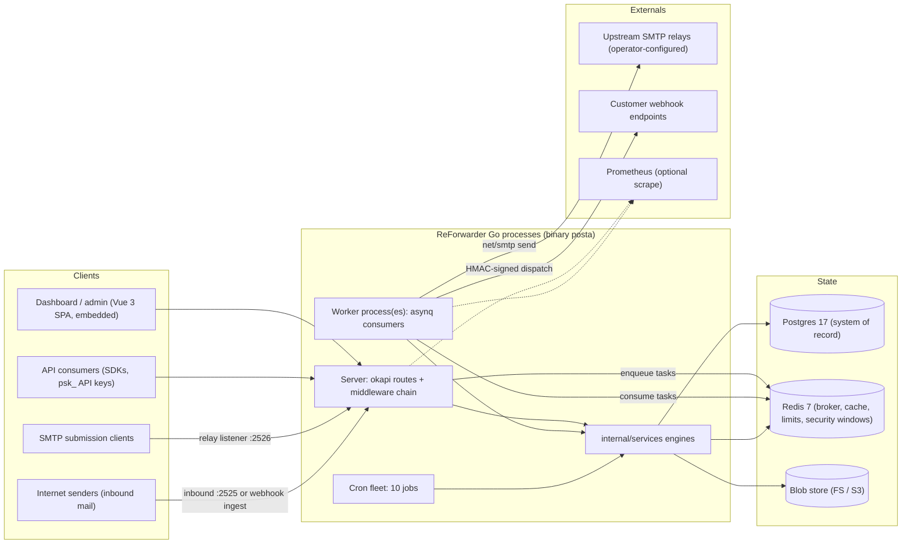
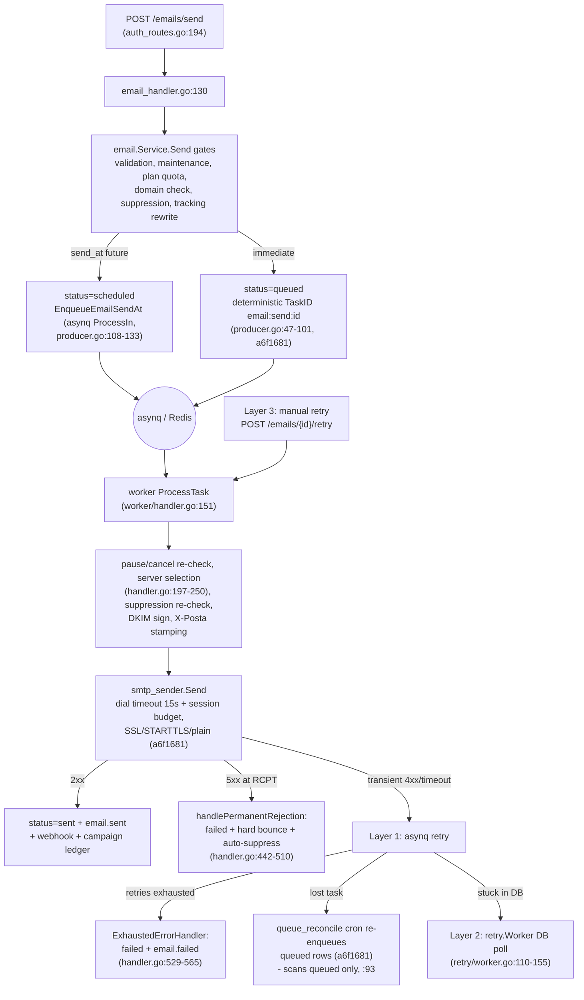
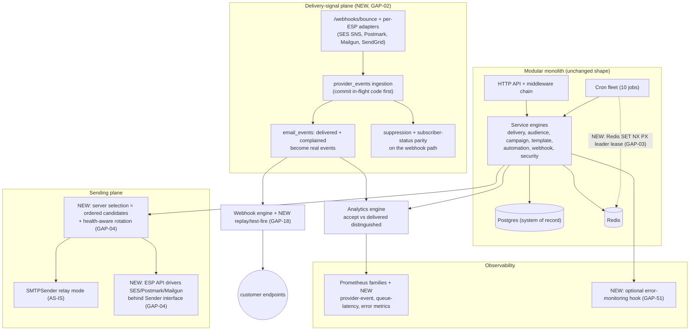
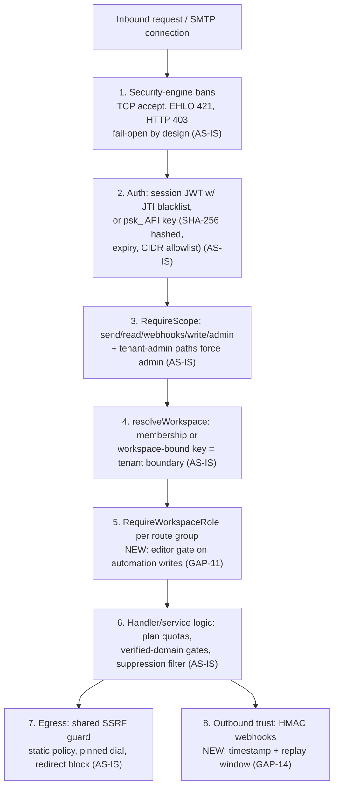

# 06 — Architecture Impact: Existing System, Target Architecture, and Migration Consequences

> **Doc 6 of 7** in the ReForwarder product-roadmap documentation suite. This document translates the roadmap (doc 05, built on `04-feature-gap-analysis.md` ← `03-existing-feature-audit.md`) into architecture terms: what the system looks like today, what the roadmap changes, what it deliberately does not change, and what each change costs in migration and compatibility terms.

- **Date:** 2026-11-05.
- **Baseline:** HEAD `a6f1681` ("Add SMTP timeouts, DKIM signing, and delivery-queue administration"); parent `347ebb4` ("Implement scheduled-campaign scheduler and fix list segment preview"). All AS-IS claims are evidence at this baseline; audits A-B and C-D were drafted at `347ebb4` + WIP and reconciled per synthesis §6.
- **Naming note:** the codebase binary and packages are named `posta` (`cmd/posta`, env prefix `POSTA_`, headers `X-Posta-*`); "ReForwarder" is the product name used throughout this suite. Same system.
- **Reading order:** `03-existing-feature-audit.md` for the current-state feature evidence, `04-feature-gap-analysis.md` for the gap register, doc 05 for the prioritized roadmap. Risk/gap IDs (`R1`–`R16`, `GAP-01`…`GAP-53`) and duplicate IDs (`D1`–`D9`) come from the synthesis register; registry feature IDs (`INF-001`…) are permanent IDs from the frozen registry (see `02-competitor-comparison.md` §0 for the competitor status-flag legend; registry status values are IMPLEMENTED / PARTIAL / MISSING / NEEDS_VERIFICATION / NOT_APPLICABLE).
- **Status legend used in this document:**
  - **AS-IS** — verified in committed code at `a6f1681`.
  - **IN-FLIGHT** — untracked/modified working-tree code at synthesis time; NOT shipped; excluded from registry statuses (synthesis §6.2).
  - **RECOMMENDED** — proposed change, tied to GAP/registry IDs; part of the roadmap.
  - **FUTURE** — explicitly *not recommended now*; documented with trigger conditions only (§12).
- **Evidence sources:** `synthesis.md`, `registry.md`, `audit-A-B.md`, `audit-C-D.md`, `audit-E-F.md`, `audit-G-H.md`, `audit-I-J.md` (in the audit working directory), plus repo spot-checks at HEAD on 2026-11-05. File:line citations are from the audit files; for files touched by working-tree WIP (campaign processor, migration constraints), cite the audit pointer, not a live grep (synthesis §6.6).

---

## 1. Architectural stance (read this first)

ReForwarder **is already a modular monolith**: one Go codebase, one binary family (`server`, `worker`, `doctor` subcommands), one Postgres system of record, one Redis, package-per-domain boundaries under `internal/` with route → handler → service → repository layering (audit-A-B §A; audit-I-J §2.1). The roadmap does **not** propose microservices. No gap in the register requires one: every proposed change is either a new package beside existing ones (`provider_events`), a new table, a middleware addition, or an interface extraction inside the same process. Splitting processes would add deployment and data-consistency cost against a 53-gap backlog that is overwhelmingly feature-shaped, not scale-shaped (synthesis §4 scoring: complexity penalties dominate the largest builds).

The three architecture-level themes of the roadmap are:

1. **Trust and correctness hardening** (Phase 0): close the authZ gaps and the cron/queue durability holes so multi-replica and multi-operator claims become true.
2. **Delivery-signal integrity** (Phase 0–1): build the provider-event ingestion pipeline so `delivered`/`complained` stop being dead constants and analytics measure delivery, not SMTP-accept.
3. **Seams, not rewrites** (Phase 1–2): extract a `Sender` interface for ESP integrations, consolidate the audience model, extend observability — all inside the monolith.

---

## 2. Existing architecture (AS-IS)

### 2.1 System context

Key facts behind the diagram: the server embeds the built Vue UI (`internal/web/embed.go`, 3-stage Dockerfile — audit-I-J §2.1); the relay listener (SASL PLAIN, per-credential IP allowlists, default-off) and the inbound SMTP receiver (verified-recipient-domains only, default-off) run in-process (audit-A rows 1–2); the worker is a separate process with its own health server (`POSTA_EMBEDDED_WORKER` split, audit-I-J OBS-001/002); metrics are Prometheus-format at `/metrics`, default-off (audit-E-F F.1).

### 2.2 Module boundaries and the de-facto engine map

There are no packages named "engine"; the engine roles the roadmap vocabulary uses map onto existing packages as follows (AS-IS):

| internal/ package(s) | Responsibility (evidence) | Engine role today |
|---|---|---|
| `cmd/posta` | `server`, `worker`, `doctor` entrypoints (audit-H: `main.go:37-53`) | Process topology; `doctor` is a workspace-integrity checker, not a CLI |
| `internal/routes`, `internal/handlers` | 340 route definitions across ~13 route files; okapi typed docs (audit-H) | **Core API engine** surface |
| `internal/middlewares` | JWT/session, `psk_` API keys, `resolveWorkspace`, `requireWorkspaceScope`, `RequireScope`, security HTTP gate, CORS (audit-I §1.1) | Core authZ + Security-engine HTTP enforcement |
| `internal/services/email` + `internal/worker/handler.go` | `Send`/`SendBatch` gates, `smtp_sender.go`, DKIM signer, stamper, timeouts (audit-A) | **Delivery engine** (outbound) |
| `internal/services/{inbound,smtprelay,messagescan,inbox,messages}` | Inbound SMTP + webhook ingest, 317-line MIME parser, 11-signal spam scanner (audit-A, audit-I) | Delivery engine (inbound/relay plane) |
| `internal/queues` + `internal/worker/producer.go` | asynq queues, deterministic TaskIDs, conflict resolution (audit-A; `queues.go:44-52`, `producer.go:47-101`) | **Queue engine** (producer side) |
| `internal/worker/campaign_processor.go` + `internal/cron/jobs/{campaign_scheduler,campaign_restart}.go` + `internal/handlers/campaign_handler.go` | Batch fan-out (batch=100), every-minute scheduler with atomic claim, stuck-campaign watchdog, CAS lifecycle (audit-C-D; audit-D rows) | **Campaign engine** |
| `internal/models/subscriber*.go`, `contact*.go`, `segment.go` + `internal/storage/repositories/segment_query.go` | Subscribers (real audience) + Contacts (read-only send ledger) + unrouted ContactLists; guarded segment SQL builder (audit-C architecture note) | **Audience engine** (currently split across 3 surfaces — see D1) |
| `internal/services/email/template_renderer.go` + `system_vars.go` + `html2text.go` + `internal/models/template*.go` | Go templates + Mustache-style normalization, reserved `{{ posta_* }}` vars, CSS inlining (premailer), versions/localizations/stylesheets (audit-E) | **Template engine** |
| `internal/services/automation` | Journey engine (SKIP LOCKED claims, CAS cursors, tick budgets), 9 node types, triggers, SSRF-guarded webhook node (audit-G; ~40 tests) | **Automation engine** |
| `internal/services/{tracking,emailhistory}` + `internal/storage/repositories/{tracking_repo,analytics_repo}.go` | Pixel/redirect capture with HMAC + dedup; 8-type event timeline (6 produced); daily-series analytics with arbitrary ranges (audit-E-F) | **Analytics engine** (capture + read models) |
| `internal/services/webhook` | 11-event registry, exponential backoff (2s×2^n, 60s cap, jitter), per-attempt persistence, HMAC-SHA256 signatures (audit-G-H) | **Webhook engine** |
| `internal/services/security` (16 files, 5,298 LOC) | Sliding-window ZSET detectors, weighted risk, ban tiers, CIDR pub/sub, fail-open; enforced at TCP accept / EHLO 421 / HTTP 403 (audit-I) | **Security engine** (clean-room fail2ban) |
| `internal/services/{auth,session,twofactor,oauth,emailverify,passwordreset}` + `internal/models/workspace.go` | Sessions/JTI, TOTP, OIDC + workspace SSO, verified-email gates (audit-I) | Core auth/identity |
| `internal/storage/{migration,repositories,blob,postgres,redis}` | GORM AutoMigrate + versioned upgrade steps; FS/S3 blob store (audit-I-J OBS-005/013) | Persistence **infrastructure layer** |
| `internal/{config,health,metrics,workermon,cron,dto,error_handlers}` + `internal/services/{cache,ratelimit,realtime,plan,settings,seeder,eventbus,notification}` | Config, health probes, 20 metric families, heartbeats, cron manager, settings/plan resolution, event bus (audit-I-J) | **Infrastructure layer** |
| `internal/web` | Embedded Vue dashboard dist | UI delivery |

Boundary quality is good for a monolith: dependencies flow routes → handlers → services → repositories → models, cross-engine calls go through services (e.g., the automation engine calls `SendAutomationEmail`, `nodes.go:143-167`), and new route groups inherit tenancy by construction (§8). The main structural debts are the audience split (D1), the dual segmentation engines (D3), and the analytics dual store (D7, kept deliberately — §4.2).

### 2.3 Delivery pipeline detail (AS-IS)

- **Outbound** path is the mermaid above (audit-A row "Transactional email"). Three retry layers (asynq MaxRetry → DB retry worker → manual retry) plus the `queue_reconcile` self-healing cron and deterministic-TaskID dedup committed at `a6f1681` (audit-A "Retry policies"; synthesis §6.1).
- **Inbound** path: SMTP receiver or `POST /webhooks/inbound` (shared secret + dedup) → store-first (250 before parse) → async MIME parse → blob attachments + SSE stream + webhook fan-out (audit-A rows 1, 5).
- **Relay** path: submission clients authenticate against `smtp_credentials` (one-way password hash, per-credential IP allowlist, per-IP rate limit, security-session guard) and are injected into the same email pipeline (audit-A row 2).
- **a6f1681 additions on this path:** SMTP dial timeouts + session budgets (`smtp_sender.go:94-134`, timeout→transient classification `:64-67`); managed DKIM signing with two-phase rotation and DNS publication re-check (`dkim_signer.go`, `workspace_resource_routes.go:813-872`); queue administration (cancel/run/archive, dead-letter inspection) + `queue_reconcile` (audit-I-J §4; synthesis §6.1).
- **Known coverage hole (RECOMMENDED, GAP-01):** `queue_reconcile` scans `status='queued'` only (`queue_reconcile.go:93`, re-verified at HEAD), so a Redis loss strands `scheduled` rows; there is also no cancel endpoint for a scheduled send (audit-A NV item 1; synthesis R5).

### 2.4 Multi-tenancy model (AS-IS — verified strong)

- **Workspaces** are the top-level isolation container; no nested "project" concept exists (audit-I). Members carry one of 4 roles (owner/admin/editor/viewer) with capability helpers (`workspace.go:24-31,91-108`).
- **Tenant resolution is enforced by construction:** `resolveWorkspace` (`middlewares/workspace.go:58-117`) makes a workspace-bound API key owner-equivalent *only inside its bound workspace*; JWT sessions must prove membership; the default-workspace fallback takes the role from the membership row, never a constant. Structural scope enforcement (`requireWorkspaceScope`, `middleware.go:312-341`) derives required scope from route+method (GET→read, mutations→write, tenant-admin paths→admin), so a new route group cannot fail open (audit-I §1.2).

| Mechanism | Evidence | Guarantee |
|---|---|---|
| `resolveWorkspace` middleware | `middlewares/workspace.go:58-117` | Every workspace-scoped route has a resolved tenant before the handler runs; keys bound to workspace A cannot act on workspace B |
| Workspace-bound API keys | `middleware.go:238-252`, `models/api_key.go:53` | Key is owner-equivalent only inside its bound workspace; `X-Posta-Workspace-Id` must match the binding |
| Structural scope derivation | `workspaceScopeFor`/`requireWorkspaceScope` (`middleware.go:312-341`) | Scope required is computed from route+method — a forgotten per-route check cannot fail open; tenant-admin paths (api-keys, members, settings, gdpr, …) force `admin` |
| `RequireWorkspaceRole` | `middlewares/workspace.go:149-176` | Server-side role floors per route group — currently missing only on automation writes (R1/GAP-11) |
| Admin credential class | `JWTAdminAuth` (`middleware.go:159-161`); API keys fail JWT parse | API keys structurally cannot reach `/admin/*` |
| Integrity doctor | `cmd/posta/doctor.go:52-149` | Detects NULL-`workspace_id` rows that would become unreachable, system-workspace presence, plan backfill |
| RBAC integration tests | `workspace_rbac_test.go:103,140,159`, `workspace_test.go`, `scope_test.go` | Privilege boundaries are pinned, not just intended |
- **Plans** resolve workspace plan → default plan → global settings (`plan/service.go:54-97`), feeding send quotas and attachment/batch limits.
- **Integrity tooling:** `cmd/posta/doctor.go:52-149` finds rows with NULL `workspace_id` that would become unreachable; RBAC integration tests pin privilege boundaries (`workspace_rbac_test.go:103,140,159`).
- The one intra-tenant authorization gap is R1 (automation editor gate, §3); no cross-tenant reach is supportable from any audit (synthesis R16).

### 2.5 Current strengths worth preserving (AS-IS)

| Strength | Evidence | Why the roadmap must not break it |
|---|---|---|
| SSRF guard, shared and layered | Static policy → pre-flight public resolution → pinned-dial transport → redirects blocked → save-time URL validation → `webhooks` scope gate (`webhook_client.go:59-149`, `automation_handler.go:275-286`; commit `7fd30eb`; audit-G calls the automation plane's use exemplary) | All new outbound HTTP (ESP drivers, GAP-04; webhook replay, GAP-18) must go through this guard |
| Security engine (clean-room fail2ban) | 16 files / 5,298 LOC; ZSET windows, weighted risk, ban tiers, CIDR pub/sub, fail-open; enforced at TCP/EHLO/HTTP (audit-I §1.1) | Keep fail-open semantics documented; new admin surfaces (GAP-16) must not widen its store unbounded (R7) |
| Webhook retry + delivery history | True exponential backoff with cap+jitter (`dispatcher.go:56-71`); `webhook_delivery_attempts` per-attempt persistence; payload-fingerprint dedup; 11-event registry pinned by test (synthesis §3.1.3) | GAP-18 (test-fire/replay) extends, does not replace, this machinery |
| Guarded segment SQL builder | Whitelisted columns, 14 operators, bindvar-only values, custom-key regex; injection + scoping + legacy-parity tests (`segment_query.go:408`, tests `:447,609,660,697`) | GAP-29 (tags) adds an operator inside this whitelist; D3 consolidation must land behind the same tests |
| Atomic scheduler claim | Every-minute sweep with CAS `TransitionStatus` claim, `ErrStatusConflict` skip, enqueue-failure rollback, TaskID double-fire collapse; 616-line test (commit `347ebb4`) | GAP-01 extends the same CAS pattern to scheduled *transactional* rows |
| Queue administration + self-healing | Cancel/run/archive, dead-letter (archived) inspection, managed-queue guard, `queue_reconcile`, deterministic TaskIDs (commit `a6f1681`) | GAP-03/48 build on it (leader lock, pause/throttle); do not bypass TaskID dedup in new producers |
| Crypto at rest | AES-256-GCM via `internal/services/crypto` (`enc:` prefix; `POSTA_ENCRYPTION_KEY` at `config.go:375`; initialized in both processes); SMTP passwords + DKIM keys encrypted (`smtp_server.go:76-100`, `dkim_signer.go:140,207`); relay creds one-way hashed (`smtp_credential.go:34`) — SEC-016 resolved (synthesis §6.4) | Caveat to document: without `POSTA_ENCRYPTION_KEY`, `crypto.Encrypt` falls back to base64 — production docs must require the key; ESP driver credentials (GAP-04) must reuse this service |
| Multi-tenancy by construction | Scope checks inside workspace resolution; workspace-bound keys; integrity doctor; RBAC tests (§2.4) | Every new route group (provider webhooks, exports, forms) must resolve a workspace, never trust a body-supplied one |
| Retention breadth + GDPR tooling | 10+ independent windows, blob-aware scrubbing, per-form windows, GDPR delete/export/import with safety rails (audit-I retention rows) | New event tables (§5) must register retention windows in the same cron |
| Operational hygiene | Worker heartbeats + version-mismatch detection; layered health checks; 10-job cron fleet visible at `/admin/crons`; workspace-integrity doctor; real-service CI (synthesis §3.1.10) | Leader lock (GAP-03) slots into the same cron manager |

---

## 3. Architecture risks & pressures (AS-IS)

All 16 risks from synthesis §3, regrouped. Severity and evidence are quoted from the synthesis table; "Blocks roadmap?" is decisive for sequencing doc 05.

### 3.1 Queue & scheduling reliability

| # | Risk | Sev | Evidence | Impact | Blocks roadmap? |
|---|---|---|---|---|---|
| R5 | Scheduled-email durability: no cancel + no reconcile coverage | MEDIUM | audit-A: scheduled rows "not covered by queue-reconcile (it scans `queued` only, `queue_reconcile.go:93`)"; no cancel endpoint (re-verified at HEAD) | Redis loss strands `scheduled` rows (never sent, never failed, invisible to reconcile); users cannot unsend future mail | No (GAP-01 closes it; correctness debt in the money path) |
| R3 | No cron leader lock — duplicate cron firing across replicas | HIGH | audit-J top gap: "No leader election for cron jobs… the one real multi-replica sharp edge"; re-verified: `internal/cron/manager.go` has in-process mutexes only | All 10 replicas run all 10 crons; `bounce_alert`, `daily_report`, `message_digest` risk double-send | **Partially** — multi-replica claims in docs 05/06 are gated on it (GAP-03) |
| R10 | Single Redis SPOF across 9 roles; mixed failure semantics | MEDIUM | audit-J Redis row: "Single Redis is a SPOF; no sentinel/cluster config docs"; roles: broker, cache, rate limits, security windows (fail-open), quotas (fail-closed), jti blacklist, nonces, heartbeats, pub/sub | Redis outage: queues stop (degrade), security detection silently degrades (fail-open by design), quotas fail closed (429/5xx) — mixed behavior is hard to reason about in incidents | No (GAP-49 is mostly documentation + compose profile) |
| R11 | Weighted queues are probabilistic, not strict — bulk can starve transactional | LOW | audit-A: "asynq *weighted* queues give probabilistic share, not strict priority"; starvation under sustained campaign load untested in-repo | Transactional latency bounded only statistically under bulk load | No (INF-011 stays not-proposed; benchmark + document, §12) |

### 3.2 Delivery-signal integrity

| # | Risk | Sev | Evidence | Impact | Blocks roadmap? |
|---|---|---|---|---|---|
| R4 | Relay-only classification; `delivered` + `complained` are dead constants | HIGH | audit-F: "two of the eight (`delivered`, `complained`) are never produced — the effective timeline is 6 types"; audit-J: provider_events classifier is untracked working-tree code | "Delivery-rate" is really SMTP-accept rate; complaint analytics empty in stock deployments; MessageHistory has a `delivered` filter "that will simply never match" | **Yes** — blocks GAP-06 (auto-pause), GAP-07 (soft-bounce trends), complaint-rate analytics, honest delivery reporting (all downstream of GAP-02) |
| R6 | Bounce webhook does not suppress or emit complained | MEDIUM | audit-G correction 4: "`/webhooks/bounce`… only marks the subscriber bounced (hard)… Suppression rows and `email.complained` are produced only by the authenticated `POST /bounces`"; complaint type rejected at `bounce_webhook_handler.go:89-92` | A stock deployment with a provider webhook has no automatic path from provider bounce to suppression — list hygiene degrades silently | **Yes** — undermines AUT-017's suppression guarantee in webhook-fed deployments (GAP-02) |

### 3.3 Authorization & API trust

| # | Risk | Sev | Evidence | Impact | Blocks roadmap? |
|---|---|---|---|---|---|
| R1 | Automation write endpoints lack a server-side editor gate | HIGH | audit-I RBAC row + correction 7; re-verified at HEAD: `automation_routes.go:35` group carries only `auth+workspace`; `workspace_rbac_test.go:101` itself notes "any member — including a viewer —"; commit `c0408dc` was UI-only | A viewer-role session can create/activate automations and ingest events server-side (privilege escalation within a tenant; no cross-tenant reach) | No (itself P0; GAP-11 is a one-middleware fix) |
| R2 | `two_factor_required` is dead code — never enforced at login | HIGH | audit-I: setting seeded (`seeder/settings.go:52`), getter (`provider.go:124`), zero consumers; login (`user_handler.go:459-510`) never reads it (re-verified) | Operators believe 2FA is mandatory when it is not — "a control that silently does nothing" | No (GAP-12) |
| R9 | Webhook signatures lack timestamp/replay protection | MEDIUM | audit-H: "HMAC-SHA256 `X-Posta-Signature` (`dispatcher.go:485`); no timestamp to prevent replay" | Captured payloads can be replayed indefinitely against customer endpoints | No (GAP-14; additive header) |

### 3.4 Retention, privacy & observability

| # | Risk | Sev | Evidence | Impact | Blocks roadmap? |
|---|---|---|---|---|---|
| R7 | `security_events` grows unbounded | MEDIUM | audit-I: `security_events_retention_days` declared (`security_handler.go:489`) + read (`security/rules.go:129`) but `DeleteOlderThan` (`security_event_repo.go:157-160`) has no caller (re-verified) | Table bloat degrades ban-engine queries over time; the advertised retention promise is false for this class | No (GAP-13 is one cron call) |
| R8 | Tracking toggle asymmetry (privacy) | MEDIUM | audit-F: campaign path injects the open pixel when `email_tracking_enabled` is off (`campaign_processor.go:392-396`; deliberate else-branch, comment `:319-321`); setting doc promises rewriting + pixel | Privacy claim false for campaign opens — compliance exposure (GDPR/ePrivacy reading) and trust risk | No (GAP-15; needs a product-intent decision first) |
| R13 | No backup/restore tooling | MEDIUM | audit-J: "No in-repo backup/restore tooling (seed R-11, still true); no Helm/k8s manifests" | Self-host operators without a documented path risk unrecoverable data loss (Postgres is the sole system of record) | No (GAP-50; trivial effort, existential value) |
| R14 | Observability blind spots: metrics default-off, no error monitoring, no per-queue latency, no app-log viewer | LOW | audit-J: metrics "default-off and not surfaced in the UI"; error monitoring grep-clean; OBS-009/010 partial | Incidents visible only via per-email failed states; no aggregate error signal | No (GAP-51/48/52/53) |

### 3.5 Provider ceiling

| # | Risk | Sev | Evidence | Impact | Blocks roadmap? |
|---|---|---|---|---|---|
| R15 | Provider abstraction ceiling: generic SMTP only | INFORMATIONAL | audit-A: "No direct-to-MX delivery… no provider registry"; no IP concept in code; `go.mod` only s3 | Structural ceiling: IP/PTR/reputation/VERP features are impossible, not merely missing | **Yes** — INF-025 (IP pools), DOM-013 (PTR), INF-020 (VERP) are excluded for this reason; GAP-04 (API-mode ESPs) partially lifts the ceiling without owning egress |

### 3.6 Verified-strong / other

| # | Risk | Sev | Evidence | Impact | Blocks roadmap? |
|---|---|---|---|---|---|
| R16 | Tenant isolation — verified strong (no finding) | INFORMATIONAL | audit-I: "Tenant resolution is enforced by construction" (`middleware.go:312-341`); workspace-bound keys; `doctor.go:52-149`; RBAC integration tests | No risk claim is supportable from the audits; the one intra-tenant gap is R1, tracked separately | — (keep the pattern for all new route groups) |
| R12 | Frontend test coverage: 2 spec files | LOW | Re-verified: only `SecurityEvents.spec.ts`, `SubscriberListPreview.spec.ts` under `web/src/` | Regressions in complex UI (SegmentDrawer preview guard, AutomationBuilder) reach production undetected; CI type-checks only | No (add specs as touched surfaces change) |

---

## 4. Recommended target architecture (RECOMMENDED)

Same process topology, same stores, same tenancy model. The changes are: a provider-event ingestion plane, a leader-locked cron, an extracted sender seam, an instrumented analytics spine, and a webhook testing surface.

### 4.1 Target system diagram

New/instrumented pieces are marked NEW; everything unlabeled is AS-IS.

### 4.2 Engine-by-engine recommendations

For each engine concept: current implementation, recommended changes (with roadmap IDs), and what NOT to change. "Consolidate" items trace to synthesis §2 duplicates.

| Engine | AS-IS implementation | Recommended changes (RECOMMENDED) | What NOT to change |
|---|---|---|---|
| **Delivery** | `services/email` + `worker/handler.go` pipeline (§2.3); relay-only, 3 retry layers, DKIM + timeouts at a6f1681 | GAP-04: extract `Sender` interface; ordered-candidate server selection with health rotation (failure counters exist, `handler.go:336-341`); per-campaign/per-message server pin. GAP-01: scheduled-row reconcile + cancel. GAP-07: soft-bounce rows on 4xx exhaustion (`handler.go:529-565` records only `failed` today) | The gate order in `Send` (validate → maintenance → quota → domain → suppression → tracking), suppression re-check in the worker, and the 5xx-RCPT auto-suppress path — all correct and tested |
| **Queue** | asynq + Redis; weighted tx=6/bulk=3/low=1 (`cmd/posta/worker.go:141-143`); deterministic TaskIDs; queue admin + reconcile (a6f1681) | GAP-03 leader lock (§4.3); GAP-48 per-queue latency metric + pause/throttle via Redis flags checked at pre-claim. GAP-05 caller `Idempotency-Key` store ahead of enqueue | The three-queue weighting (strict priority stays not-proposed, INF-011); deterministic TaskID scheme; dead-letter = archived-state model |
| **Audience** | Split: Subscribers (real audience) + Contacts (read-only send ledger) + dead ContactLists; two segmentation engines (`FilterRules` dynamic lists vs `SegmentCondition` segments) | **Consolidate (D1):** keep Subscribers canonical + Contacts as send ledger; delete ContactLists entirely (model + handler + views + API client + export/import paths) in a versioned step. **Consolidate (D3):** FilterRules→SegmentCondition converter; present dynamic lists as segments; deprecate new dynamic-list creation; keep worker compat one release. GAP-29 tags as a new segment operator; GAP-31 bulk ops; GAP-19 upsert | The guarded segment SQL builder and its test suite; `applyFilterRules` stays byte-identical until parity is proven (the pattern to reuse — §11); per-list unsubscribe caveat for segment audiences stays documented, not silently changed |
| **Campaign** | CAS state machine, every-minute scheduler with atomic claim, batch=100 self-re-enqueue, SendRate pacing, snapshot-on-delete reports | GAP-26 campaign test-send/preview (reuse `SendTestByTemplateID`, `service.go:1186-1215`); GAP-28 commit the in-flight A/B winner flow + create-form variant UI; GAP-33 duplication UI + campaign-level retry-failed; GAP-34 block/slot overrides applied post-`resolveTemplateContent` | The scheduler claim/rollback mechanics; snapshot-on-delete; XOR audience resolution |
| **Template** | Go templates + Mustache normalization layer; versions + localizations + stylesheets; GrapesJS builder; import/export round-trips | GAP-34 saved `template_blocks` entity surfaced as GrapesJS custom blocks; GAP-36 preheader field, optional Markdown part, media library over the blob store (verify-first) | The render pipeline (`normalizeTemplate` → html/template → premailer) and the reserved `{{ posta_* }}` namespace; no Liquid/MJML/React Email (not-proposed, §12) |
| **Automation** | Journey engine: SKIP LOCKED claims, CAS cursors, tick budgets, backoff, lost-nudge sweep; 9 node types; ~40 tests | GAP-11 server-side editor gate on all mutating routes incl. `/automations/events`; GAP-41 dry-run (no-op executors + `dry_run` journey flag); GAP-42 scheduled enrollment cron reusing segment-engine engagement subqueries; GAP-43 stop-on-reply via inbound matching; GAP-28 persist ab_test node outcomes | The engine core (claiming, cursors, tick budget) and static graph validation; enrollment never blocks the triggering action (panic-recovered `Enroll`) |
| **Analytics** | Two stores kept deliberately: `tracking_events` (campaign time series) + `email_events` (message timeline) — D7 says do NOT merge; daily-series repo, arbitrary ranges, per-variant analytics | **Build out on the existing spine:** GAP-02 makes `delivered`/`complained` real (accept vs delivered distinguished); GAP-40 device/geo parsed at record time into `tracking_events`; GAP-27 CSV exports via the existing 100k-cap streaming helper (`logs_handler.go:821-892`); GAP-32 per-subscriber activity read model | The D7 split (tracking_events vs email_events answer different questions); single-aggregation query style (fine at self-host scale — no aggregation tables needed yet) |
| **Webhook** | 11-event registry (test-pinned), exponential backoff + jitter, per-attempt history, HMAC signatures, scope/from/domain filters | GAP-18 commit the in-flight replay/redrive + add test-fire endpoint; GAP-14 signed timestamp + 5-min replay window folded into the HMAC input | The registry's enum-pinning test pattern (new events must extend it); per-attempt persistence; the shared SSRF guard for any outbound call |
| **Security** | Fail2ban-style engine (ZSET windows, weighted risk, ban tiers, CIDR pub/sub, fail-open) + spam scanner + nonces | GAP-13 retention caller (prune via existing `DeleteOlderThan`); GAP-11 editor gate; GAP-12 2FA enforcement + recovery codes; GAP-02 webhook-path suppression parity (hardening R6); GAP-16 optional admin IP allowlist middleware | Fail-open semantics (document, don't silently change); ban enforcement points (TCP accept / EHLO 421 / HTTP 403); the allowlist = detector-exemption distinction |
| **Core (API/auth/db/permissions)** | 340 routes, okapi OpenAPI + Scalar, hashed scoped `psk_` keys, structural tenancy, plans, settings | GAP-05 idempotency keys on send/batch; GAP-44 per-key rate limits beside `RequireScope`; GAP-17 registration toggle; scope model stays 5+`*` scopes (§7) | The `{success, data}` envelope; route-group scope enforcement structure; admin routes staying session-only (API keys structurally cannot reach `/admin/*`) |
| **Infrastructure** | Server/worker split, cron manager, metrics (20 families, default-off), health probes, heartbeats, compose + CI, FS/S3 blobs | GAP-03 leader lock in the cron manager; GAP-49 Redis HA guidance + sentinel compose profile; GAP-50 backup/restore runbook + scripts; GAP-51 error-monitoring slog handler; GAP-45 blob usage reporting + orphan GC | Postgres-only persistence; Redis-as-ephemeral design (Postgres is the system of record — reconcile crons depend on it); compose topology |

### 4.3 Worker & queue architecture evolution

- **AS-IS (already delivered):** worker scale-out is genuinely safe — stateless server + N workers, `FOR UPDATE SKIP LOCKED` journey claims, deterministic TaskIDs with `ErrTaskIDConflict` resolution, `queue_reconcile` healing lost `queued` tasks, dead-letter inspection via the archived state, worker heartbeats with version-mismatch detection (audit-I-J OBS-001/002; synthesis §3.1.5–6). `compose.yml` already runs a separate worker service.

| Capability | a6f1681 status | Remaining (RECOMMENDED) |
|---|---|---|
| Multi-worker task claims | Done — deterministic TaskIDs + SKIP LOCKED journey claims + Inspector visibility | Nothing structural |
| Lost-task healing | Done for `queued` rows (`queue_reconcile`, committed) | Extend to `scheduled` rows (GAP-01) |
| Dead-letter handling | Done — archived-state inspection + cancel/run/archive + gauge | GAP-48 pause/throttle + latency metric round it out |
| Admin-queue actions | Done — audited, managed-queue guard, Jobs.vue wired | Admin-scope test parity (audit-A NV 2) |
| Cron across replicas | **Not done** — in-process mutexes only | GAP-03 leader lease (see below) |
| Caller-level dedup | Internal TaskID dedup only (pre-enqueue retries unprotected) | GAP-05 `Idempotency-Key` store |

- **RECOMMENDED remaining work:**
  1. **Leader lock (GAP-03):** a Redis `SET NX PX` lease around the cron manager tick so exactly one replica executes the 10 crons; the pattern precedent is the form-nonce Redis usage (`form_ingest_handler.go:77,131`). Jobs keep their idempotent design; alert jobs (`bounce_alert`, `daily_report`) additionally guard per-recipient with a Redis dedup key. Lease loss must fail over within one interval. Until this lands, doc 05's multi-replica server claims stay qualified.
  2. **Queue durability (GAP-01):** extend `queue_reconcile` to claim `scheduled` rows past `scheduled_at` with the same deterministic-TaskID re-enqueue; add a cancel endpoint valid only while `status='scheduled'` (reuse the CAS pattern from `campaign_handler.go:391-464`).
  3. **Dead-letter handling:** already AS-IS (archived-state inspection + cancel/run/archive + `posta_queue_archived_tasks` gauge). GAP-48 adds the per-queue latency histogram (`posta_queue_latency_seconds` from task payload timestamps) and pause/throttle flags.
- **Durability model to document:** Redis is expendable (queues stop, then reconcile heals); Postgres is the sole system of record; nothing durable lives only in Redis except cache/limits/windows, whose failure semantics are enumerated in §6.

### 4.4 Provider abstraction seam

- **RECOMMENDED (GAP-04, pairs with GAP-02):** extract the interface already implicit in `smtp_sender.go` (`Send`, `TestConnection`) into a `Sender` seam over the current `smtp_servers` model. Relay SMTP remains the first driver; SES/Postmark/Mailgun API clients become additional drivers implementing the same interface, with credentials stored via `crypto.Encrypt` (reusing the SEC-016 service). Extend server selection (`handler.go:197-250`) from "first enabled workspace server, else shared-domain match" (`smtp_repo.go:119-125`) to an ordered candidate list with health-aware rotation (failure counters exist at `handler.go:336-341`). Failover = next candidate on transient failure within one retry; campaigns can pin a server.
- **Do NOT build an MTA / direct-to-MX.** Synthesis not-recommended list item 1: owning egress is a different product (IP reputation ops, PTR contracts, feedback loops); the relay-only design is a defensible product identity, and API-mode ESPs deliver most of the same value (better deliverability, real delivery/complaint signals) without it. Direct-to-MX would also unlock INF-025/DOM-013/INF-020 — that is a direction decision, not a coding gap (R15), and stays in §12 as FUTURE.
- ESP drivers are in-process packages behind the interface — **not** a separate "provider microservice". The abstraction seam is one interface plus a driver registry; if a driver needs its own runtime characteristics (long-poll APIs), it still runs inside the worker process, because asynq task isolation already provides the concurrency boundary.

---

## 5. Database considerations

- **AS-IS:** GORM AutoMigrate for schema + FK/index constraints (`migration/constraints.go`), plus versioned upgrade steps for data transformations under `internal/storage/migration/upgrade/` (step framework with smoke test; step files at HEAD: personal-workspaces, contact dedupe, API-key scopes, workspace types, email-sender decode — audit-I-J OBS-005 counts 6, the directory shows 5 step files; cite the directory). Postgres 17 is the sole durable store; Redis is ephemeral state; blobs live in FS/S3.
- **New tables/columns implied by the roadmap (kept generic; final shapes belong to doc 05):**

| Change | Storage impact | Notes |
|---|---|---|
| GAP-02 provider-event ingestion | New `provider_events` table (commit the in-flight `internal/services/provider_events/` first) + `delivered_at`/complaint writes already mapped in existing columns (`email_repo.go:170`) | Raw provider payloads capped (2 KB precedent from webhook attempts); dedup via payload fingerprint as in `bounce_webhook_handler.go:182` |
| GAP-28 A/B winner completion | Winner fields exist in the working tree (`campaign.go:109-118` `ABTestWinner/Sent/Stats`) — land via AutoMigrate with the commit | IN-FLIGHT, not shipped at HEAD |
| GAP-25 double opt-in | `pending` subscriber status + per-list DOI setting + confirmation token | Reuse the HMAC token pattern (`tracking.go:273-355`); no new token table needed |
| GAP-29 subscriber tags | `subscriber_tags` join table + tag CRUD | Segment access via a new whitelisted operator in `segment_query.go`, not raw SQL |
| GAP-12 recovery codes | `user_recovery_codes` table (hashed, single-use burn) | Mirrors the hashed API-key pattern |
| GAP-05 idempotency keys | `(workspace_id, key) → email_id/result` store with unique index; TTL via the existing retention cron | Replay returns the stored result |
| GAP-35 preference center | **No new schema** — a token-authenticated UI over existing `SubscriberListUnsubscribe` + suppression kinds | Keep generic; `SuppressionKind` already names the future preference center (`suppression.go:26`) |
| D1 ContactLists removal | Versioned upgrade step dropping tables/rows; stop GDPR export of ContactLists one release earlier (audit-C NV 5) | Data-migration cost acknowledged; release note required for `contact_list_members.Data` |

- **Indexes for event volume:** the provider/analytics event tables need `(workspace_id, created_at)`, `(email_uuid, created_at)`, and type-prefixed indexes mirroring `email_events`/`tracking_events` usage; verify with the analytics repo's actual range queries (`analytics_repo.go:49-330`) before adding more.
- **Retention strategy:** every new event table registers a window in the retention cron (the `retention.go:416-437` email-events pattern); raw payloads inherit the incoming-webhook window; GAP-13 fixes the one existing hole (`security_events`).

## 6. Redis considerations

- **AS-IS — nine verified roles** (audit-I-J), with the failure semantics that matter during an outage:

| Redis role | Evidence | Behavior when Redis is down |
|---|---|---|
| asynq broker | `internal/queues`, `worker/producer.go` | New sends still persist to Postgres (`queued`); workers idle; `queue_reconcile` heals the backlog on recovery (GAP-01 extends to `scheduled`) |
| Generic cache (dashboard) | `internal/services/cache` | Cache misses; recompute from Postgres |
| Rate limits (hourly/daily, login) | `internal/services/ratelimit` | Quotas **fail closed** on public paths (`quota.go:24-27`) — senders see 429/5xx |
| Security sliding windows | `security/detector.go:117-151` | Detection **fails open** by design — protection silently degrades; confirm scope via fault-injection test (audit-I-J NV 5) |
| Session JTI blacklist | `middleware.go:132-139` | Revoked sessions may authenticate until Redis returns (blacklist is a deny-list) |
| SSE pub/sub fanout | `internal/services/realtime` | Live admin feeds stop; no data loss (re-snapshot on reconnect) |
| Form nonces / time-trap | `form_ingest_handler.go:77,131` | Nonce issuance fails — inbound form ingestion degrades |
| Worker heartbeats | `workermon/heartbeat.go:34-54` | Presence/version-mismatch detection blind |
| Verifier/analytics caches + CIDR propagation | `verifier.go:298-322`, `security/propagate.go` | Recompute; ban propagation across replicas pauses |
- **RECOMMENDED additions:** the cron leader lease (GAP-03) — recommend `SET key token NX PX <ttl>` with compare-and-delete release (Lua) so a stalled leader cannot be evicted and then release someone else's lease; TTL sized to several cron intervals; per-job Redis dedup keys for alert jobs. GAP-48 pause/throttle flags (plain keys checked at producer/pre-claim). Both are pattern-consistent with existing usage.
- **Durability caveats (document, do not fix in code):** losing Redis stops queues (reconcile heals rows afterward, GAP-01 extends this to `scheduled`), silently degrades security detection (fail-open by design — confirm scope with a fault-injection test, audit-I-J NV 5), and fails quotas closed (senders get 429/5xx). Nothing durable may live only in Redis. GAP-49 ships the Sentinel/managed-Redis guidance and a failure-mode matrix instead of code changes.

## 7. API compatibility & versioning

- **AS-IS:** 340 route definitions with generated OpenAPI (okapi) + Scalar UI at `/docs` (`POSTA_OPENAPI_DOCS` default true) and a webhook payload-docs endpoint generated from the test-pinned registry (audit-H). The `{success, data}` envelope is documented in the SDK overview (6 language SDKs; Go/Node/PHP/Java repos confirmed, Python/.NET unverified — GAP-23).
- **Additive-evolution precedent (observed at `347ebb4`):** `send_at` on `POST /emails/send` and the `scheduled` status were added without breaking existing callers; `a6f1681` added whole new surfaces (`/admin/queues*`) rather than mutating old ones. This additive policy should be stated as the rule.
- **RECOMMENDED policy:**
  1. Additive endpoints/fields only within the current major version; new capabilities get new routes (the GAP-02 ESP adapters and GAP-18 replay follow this).
  2. Behavior changes that callers can observe get a documented transition (GAP-15 tracking-toggle alignment: either match the documented promise or codify the exception — the decision is product-intent, audit-E-F NV 1).
  3. Removals follow a one-release deprecation window (the D5 Emails-view retirement and D1 ContactLists removal are the first exercises).
  4. Scope model extension points: new capability areas reuse `RequireScope` route groups; GAP-44 (per-key limits) slots beside `RequireScope` rather than inventing a parallel gate; ESP-integration management rides the `write` scope unless a dedicated scope earns its place.
  5. The webhook event registry stays enum-pinned by test so docs cannot drift (audit-H); SDK coverage of new endpoints becomes a CI-checkable note (GAP-23).

| Change type (roadmap examples) | API-visible effect | Policy |
|---|---|---|
| New endpoint (GAP-02 adapters, GAP-18 test-fire/replay, GAP-27 exports) | Additive route, no existing contract touched | Ship in a minor; document in OpenAPI (automatic via okapi) |
| New request field (GAP-05 `Idempotency-Key`, GAP-19 `upsert` flag, GAP-28 winner config) | Old callers unaffected (field optional) | Accept-and-default; validate with dry-run where present (the `dry_run=true` precedent, INF-027) |
| Response field addition (`delivered_at` becoming populated, GAP-02) | Callers see new values in existing fields | Additive; note in release notes that analytics semantics sharpen (accept → delivered) |
| Behavior alignment (GAP-15 tracking toggle, GAP-10 campaign strict mode) | Observable change for opt-in users only | Documented transition; keep warn-only/legacy defaults unless the operator enables the new semantics |
| Deprecation/removal (D1 ContactLists, D5 Emails views) | Removed surface | One-release deprecation window + release note; keep backing APIs when SDKs use them |

## 8. Multi-tenancy & isolation

- **Keep (AS-IS, verified strong — R16):** workspace resolution enforced by construction; workspace-bound API keys owner-equivalent only inside their workspace; structural scope derivation (`requireWorkspaceScope`); integrity doctor; RBAC integration tests. Every new route group in the roadmap (provider-event webhooks, exports, signup forms, replay) must resolve a workspace the same way and must never trust a body-supplied `workspace_id`.
- **RECOMMENDED fix inside the existing permission seam (GAP-11):** add `RequireWorkspaceRole(models.RoleEditor)` (or a write-scope requirement) to the automation write subgroup and `/automations/events` — one middleware per route group — and extend `workspace_rbac_test.go` with viewer-denied cases (the pattern exists at `:103,140,159`). No schema or tenancy change.
- **Plans:** the workspace-plan → default-plan → settings resolution is the right place for new quota surfaces: GAP-44 per-key limits inherit plan defaults; GAP-10 per-domain caps consume the existing Redis limiter (`ratelimit/quota.go:44`). Billing stays out of scope (self-host).

## 9. Scalability & observability

| Concern | AS-IS | RECOMMENDED |
|---|---|---|
| Server scale-out | Stateless server; `POSTA_EMBEDDED_WORKER` split; separate worker service in compose | Safe multi-replica only after the GAP-03 leader lock; doc 05 sequencing should reflect that gate |
| Worker scale-out | N workers; SKIP LOCKED claims; deterministic TaskIDs; heartbeats + version detection | Nothing structural; GAP-48 adds latency visibility and pause/throttle |
| Cron | 10 jobs, in-process mutexes only, visible at `/admin/crons` (no last-run/duration columns) | GAP-03 leader lease; optionally last-run/duration columns when the cron handler is next touched |
| Metrics | 20 Prometheus families, default-off (`POSTA_METRICS_ENABLED`), not UI-surfaced | Extend with provider-event counters (accepted vs delivered vs complained), `posta_queue_latency_seconds`, `posta_errors_total` (GAP-51/48); keep default-off posture; sample Grafana dashboard JSON (GAP-52) is the cheap integration surface |
| Error monitoring | None — errors slog'ed only (grep clean) | GAP-51: minimal Sentry-compatible `slog` handler (DSN-gated, sampled, PII-scrubbed) or at minimum the error-rate counter; unset = zero behavior change |
| Logs | Rich business-event surfaces (email_events, webhook attempts, audit) but no stdout viewer; `system.status` SSE has goroutines+MemStats only | GAP-53 optional bounded ring buffer + 24h resource samples; deployments normally own log aggregation |
| Backups / Redis HA | None in-repo (R13, R10) | GAP-50 runbook + `make backup/restore` scripts (Postgres dump, Redis expendable, blob sync, RPO/RTO expectations); GAP-49 sentinel guidance + compose profile |

## 10. Security architecture

Defense-in-depth map (AS-IS, with the fixes marked NEW):

- **Fixes needed (RECOMMENDED, each mapped):** R1 → GAP-11 editor gate (server-side, §8); R2 → GAP-12 enforce-or-remove `two_factor_required` + hashed single-use recovery codes + the existing audited admin reset; R7 → GAP-13 retention caller; R6 → GAP-02 webhook-path suppression parity (the webhook path must perform the same suppression + `bounces` row + `email.complained` emission as the authenticated `POST /bounces`, `bounce_handler.go:91-138`); R9 → GAP-14 signed timestamp + 5-minute tolerance.
- **Keep:** the ban-engine allowlist is a detector exemption, not admin-access control (audit-I); GAP-16 adds an optional, fail-open CIDR middleware on `/admin/*` (reusing `IPAllowed`, `middleware.go:263-279`) without conflating the two.
- **Document (not code):** production deployments must set `POSTA_ENCRYPTION_KEY` — without it `crypto.Encrypt` falls back to reversible base64 (synthesis §6.4); security-engine fail-open scope deserves a fault-injection test (audit-I-J NV 5).

## 11. Data migration & backward compatibility

- **Migration strategy (AS-IS):** schema via AutoMigrate; behavior-preserving data transformations via versioned upgrade steps (`internal/storage/migration/upgrade/`, with smoke test). New roadmap tables follow the same split (§5).
- **Per-change migration notes:**

| Change | Schema change | Data migration | Backward-compatibility note |
|---|---|---|---|
| GAP-02 provider events | New `provider_events` table | None (delivery history starts at commit) | Existing `email.sent` semantics unchanged; `delivered`/`complained` become *additionally* observable |
| GAP-01 scheduled cancel/reconcile | None | None | `DELETE` semantics restricted to `status='scheduled'` |
| GAP-11/12/13/14 | None (GAP-12 adds recovery-code table) | None | GAP-14 adds a signed header — receivers ignoring it still verify the body HMAC; document the 5-min window |
| GAP-25 DOI | `pending` status + per-list setting | None | Single-opt-in lists unchanged (DOI is opt-in per list) |
| GAP-29 tags | `subscriber_tags` join table | None | New segment operator is additive to the whitelist |
| D1 ContactLists removal | Versioned step drops dead surface | Stop GDPR export first, then drop (audit-C NV 5) | Redirect the dead `ContactListMembers.vue` link; release note for `contact_list_members.Data` |
| D3 FilterRules→segments | None (segments exist) | Converter for existing `FilterRules` rows; translators are half-proven (`segment_query_test.go:660,697`) | **Pattern to reuse:** `applyFilterRules` is kept byte-identical as the legacy path while segments become canonical — worker compatibility one release, legacy evaluation dropped only after parity is confirmed (synthesis D3). Apply the same legacy-path-preserved-then-removed cadence to any future consolidation |
| D5 Emails/Logs view merge | None | None | `/emails` API stays (it serves the SDKs); only the UI views retire after a transition release |

- **Byte-compatibility guarantees to preserve:** the `applyFilterRules` legacy path (above); the `{success, data}` envelope; the webhook registry enum (test-pinned); existing HMAC token formats (`/t/*`) — GAP-09's custom tracking domain must keep per-message tokens unchanged.

## 12. Future possibilities (explicitly NOT recommended now)

Each item below is excluded from the roadmap (synthesis §1.0 / §5 not-recommended list) with the trigger that would justify revisiting:

| Future item | Why not now | Trigger to revisit |
|---|---|---|
| Direct-to-MX / built-in MTA | Different product identity: IP reputation ops, PTR contracts, FBLs; relay-only is defensible; API-mode ESPs (GAP-04) deliver most value first | Sustained operator demand for owned egress + explicit willingness to run reputation operations |
| IP pools / warm-up / PTR guidance (INF-025, DOM-013) | Structurally impossible without owning egress (no IP concept in code) | Only after a direct-to-MX decision |
| VERP / bounce-mailbox ingestion (INF-020) | Relay-only architecture has no return-path ownership | Same MTA decision |
| Prometheus/Grafana packaging (bundles, operators, Helm) | `/metrics` is the integration surface; self-hosters bring their own monitoring | Operator demand beyond the GAP-52 sample dashboard JSON |
| MCP server beyond GAP-24 / CLI beyond GAP-22 / marketplace connectors (API-018) | P3 long-tail; API completeness already high (340 routes) | Demonstrated agent/automation demand after Phase 3 |
| Strict priority queues (INF-011) | Weighted fair-share is adequate; no competitor ships strict priority | A load benchmark showing real transactional starvation (R11) |
| Liquid/MJML/React Email/AI-assisted/spintax; recurring campaigns (CAM-003); SAML/SCIM; DMARC rua ingestion | Verified absent across all 12 competitors; license risk on NU code (BSL) and LM code (AGPL — study behavior, never copy) | Demonstrated user demand per item; recurring campaigns could host on the scheduler cron |
| Full mail server (IMAP/JMAP/webmail, INF-003) | BillionMail-only shape; out of product scope | Permanent unless product direction changes |

## 13. Summary: change → risk mitigated → migration impact

| # | Change (RECOMMENDED) | Roadmap IDs (registry) | Risk mitigated | Migration impact |
|---|---|---|---|---|
| 1 | Automation editor gate (server-side) | GAP-11 (SEC-002, AUT-003) | R1 | None — middleware + tests |
| 2 | Enforce-or-remove 2FA + recovery codes | GAP-12 (SEC-005) | R2 | New `user_recovery_codes` table |
| 3 | Cron leader lock | GAP-03 (OBS-019) | R3 | None — Redis lease in cron manager |
| 4 | Scheduled-email cancel + reconcile coverage | GAP-01 (INF-014) | R5 | None — extends `queue_reconcile` |
| 5 | Delivery/complaint signal ingestion (commit in-flight first) | GAP-02 (ANA-003/005, INF-021, API-014) | R4, R6 | New `provider_events` table; webhook-path behavior parity; per-ESP adapters |
| 6 | Sender seam + ESP drivers + failover + server selection | GAP-04 (INF-022/023/024, API-015) | R15 (partial lift) | `Sender` interface; server-config extension; credentials via crypto service |
| 7 | Caller idempotency keys | GAP-05 (INF-031) | Caller-retry double-sends | Keyed dedup store + unique index |
| 8 | Auto-pause circuit breaker | GAP-06 (INF-016, DOM-011, ANA-010) | R4 downstream | Campaign settings + audit events; blocked on #5 |
| 9 | Soft-bounce classification | GAP-07 (ANA-004, INF-034) | R4 fidelity | Bounce rows on 4xx exhaustion; suppression stays hard-only |
| 10 | Webhook timestamp + replay window | GAP-14 (API-010) | R9 | Additive signed header |
| 11 | `security_events` retention caller | GAP-13 (SEC-008) | R7 | None — cron call to existing method |
| 12 | Tracking-toggle symmetry | GAP-15 (ANA-012) | R8 | Behavior change + doc alignment; product-intent decision first |
| 13 | Backup/restore runbook + Redis HA guidance | GAP-50, GAP-49 (OBS-017, OBS-004) | R13, R10 | Docs + scripts + compose profile |
| 14 | Audience consolidation (ContactLists removal; segments canonical) | D1, D3 (CON-001, CON-007) | Structural debt D1/D3 | Versioned removal step; converter + legacy-parity tests; one-release compat window |
| 15 | Webhook test-fire + commit in-flight replay | GAP-18 (API-013) | Operability gap | Commit reviewed in-flight code |
| 16 | Queue latency metric + pause/throttle | GAP-48 (OBS-009) | R14 | New metric + Redis flags |
| 17 | Error-monitoring hook | GAP-51 (OBS-011) | R14 | Optional slog handler + counter; zero change when unset |
| 18 | Observability tail (Grafana sample, log viewer, queue ops docs) | GAP-52, GAP-53 | R14 | Additive files/features |

**Net architectural verdict:** the monolith stands. Phase 0 hardens it (tenancy gate, dead control, cron correctness, queue durability, signal integrity); Phase 1–2 add two seams (Sender, provider-events) and two consolidations (audience, webhook testing) — all in-process, all behind existing test patterns, none requiring a new runtime boundary.

---

*Every claim traces to `synthesis.md` (§1–§6), `registry.md`, `audit-A-B/C-D/E-F/G-H/I-J.md`, or a repo spot-check at HEAD `a6f1681` on 2026-11-05. IN-FLIGHT items (provider_events, webhook replay, A/B winner, timezone tests, migration edits) are not counted as shipped (synthesis §6.2).*
