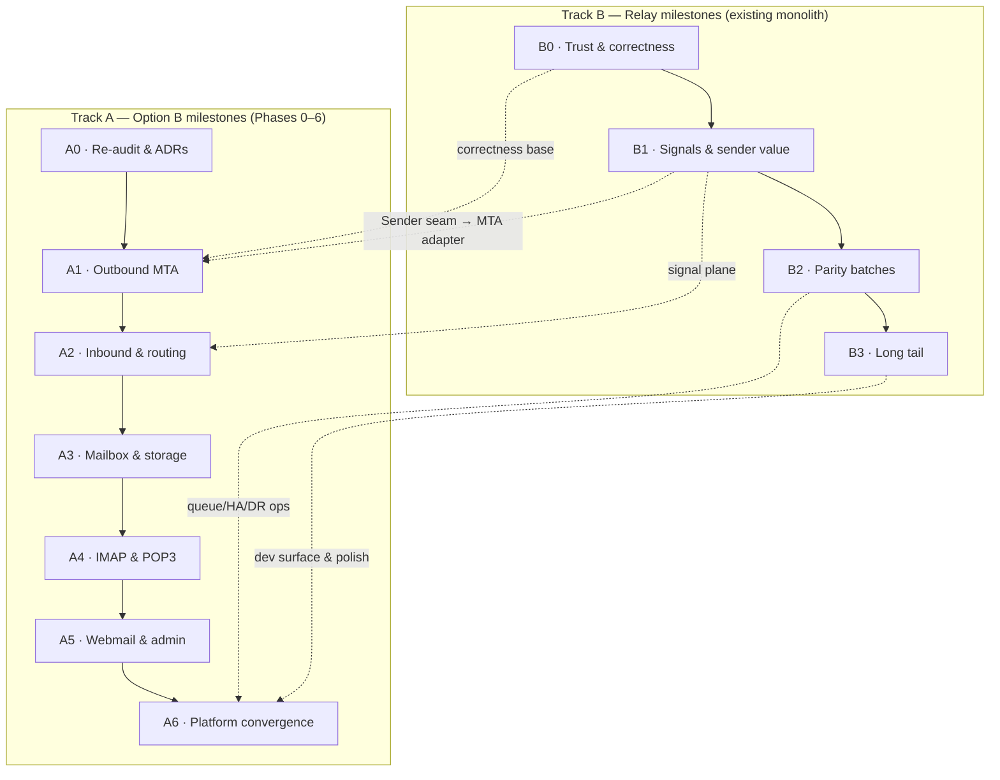

# ReForwarder — Roadmap

> **Directional development direction — groupings, not statuses.** This file says *what belongs together and in what order the architecture allows it*; it deliberately carries no checkboxes, no completion claims, and no per-item state. Current status lives in `todo.md` (working checklist) and `FEATURE_INVENTORY.md` (registry); per-gap detail lives in `FEATURE_GAP_ANALYSIS.md`.
>
> The phase structure is **not invented here**: it is `todo.md`'s two-track structure verbatim — **Track A** = the Option B mail-infrastructure programme (`docs/product-roadmap/upcomming-convo.md` §7, Phases 0–6) and **Track B** = the relay roadmap (`docs/product-roadmap/05-implementation-roadmap.md`, P0–P3). Where a Track B item is marked `→ OB Phase n` in `todo.md`, it lands inside the Track A phase named there.

## The shape in one view

Two tracks run over one dependency lattice:

- **Track B hardens and completes the product that exists today** (relay-based ESP + marketing platform) inside the modular monolith.
- **Track A extends it into complete email infrastructure** (direct-to-MX outbound, inbound routing, hosted mailboxes, IMAP/POP3, webmail) — architecture-first, protocol planes added around the control plane, never thirteen microservices (`upcomming-convo.md` §3–§5).
- Track A **Phase 0 is a gate, not a suggestion**: no large feature implementation before approved ADRs, data-ownership, and a migration plan exist (`upcomming-convo.md` §7: "Do not start by implementing IMAP or building a webmail UI").
- The original relay P0 work is **retained inside the programme, not discarded** — its findings on queue durability, cron leadership, authorization, delivery-signal integrity, and the `Sender` seam remain relevant (`upcomming-convo.md` §7 closing note).

---

## Guiding principles (every milestone)

Non-negotiable design rules (`upcomming-convo.md` §8 / `todo.md` Track A):

1. **Never expose an open relay** — authenticated submission and local inbound delivery are separate trust paths.
2. **Never trust client-supplied tenant ID or recipient domain** as authorization — resolve ownership server-side.
3. **Never report successful delivery** just because a message entered a queue.
4. **Never accept inbound mail** without a durable path to deliver, route, quarantine, or reject it.

Preserve the verified strengths and make new integrations build on them, never bypass them (`upcomming-convo.md` §8): layered SSRF guard, clean-room security engine, tenant isolation, encrypted credentials, queue reconciliation, webhook attempt history, retention/GDPR tooling, operational hygiene.

Compatibility rules for all Track A work (`upcomming-convo.md` §9): existing REST/SDK contracts keep working; SMTP submission credentials keep working through a compatibility layer; campaigns and transactional sending keep functioning while the MTA adapter is introduced; the `{success, data}` envelope, HMAC tracking-token formats, and workspace isolation/RBAC rules are preserved; new schema is additive where possible; transactional `Email` records are never auto-migrated into mailbox storage.

License discipline (from the research suite): clean-room behavioral research only for AGPL projects (Listmonk et al. — study behavior, never port code); Notifuse ≥v40 code is BSL license-risk (documentation only); the AGPL carve-out directories (Keila `extra/`, Wraps EE) are off-limits.

---

# Track B — Relay milestones (P0–P3)

> Source: `05-implementation-roadmap.md` §3–§8 (52 remaining items at the research baseline; several have since landed — see `FEATURE_INVENTORY.md` for the live state). Phase shape: **B0 → B1 → B2 → B3**, with six parallel tracks inside B1 and five batches inside B2.

## Milestone B0 — Trust & correctness hardening

**Theme:** close the correctness defects in live money/security paths before building anything on top of them. These items are small-to-medium, fully parallel (no intra-phase edges), and every later milestone silently depends on them.

**Contents (grouped):**

- *Send-path durability* — scheduled transactional email cancel + reconcile coverage (GAP-01 / RF-F048).
- *Delivery-signal integrity* — legacy `/webhooks/bounce` parity: suppression, bounce rows, complaint semantics (GAP-02 residual / RF-F053); true delivered state: `email.delivered`/`email.complained` emission, delivered analytics, dead UI paths (GAP-02 residual / RF-F099).
- *Authorization & 2FA* — server-side editor role gate on automation write + event-ingest routes (GAP-11); enforce or remove `two_factor_required` at login (GAP-12 / RF-F006).
- *Multi-replica correctness* — cron leader election via a Redis lease (GAP-03).

**Structural edges leaving B0:** the signal-integrity pair is the source for the auto-pause gates (GAP-06) and the bounce-classification analytics surface (GAP-07) in later milestones; the 2FA-enforcement decision pairs with recovery-code completion (B1).

## Milestone B1 — Signals & sender value

**Theme:** the highest-value capability cluster — honest delivery signals, the sender abstraction that unlocks ESP integrations and later the MTA adapter, consent foundations, and campaign operability. Six parallel tracks; the XL item (GAP-04) starts here early because everything downstream leans on the seam.

**Contents (grouped by track, per doc 05 §8):**

- *Security track* — `security_events` retention caller (GAP-13) → webhook signature timestamp/replay protection (GAP-14) → tracking-toggle symmetry (**product-decision gate before code**, GAP-15).
- *Deliverability track* — auto-pause circuit breaker on failure/complaint thresholds (GAP-06; unblocked by the B0 signal work).
- *API track* — caller-supplied `Idempotency-Key` on send endpoints (GAP-05).
- *Marketing track* — double opt-in confirmation flow (GAP-25 — blocks signup forms and the preference center), campaign test-send + campaign-scoped preview (GAP-26 — blocks blocks/slots), CSV exports (GAP-27).
- *Auth completions* — recovery codes consume/regeneration/admin reset (RF-F005); passkeys/WebAuthn enrollment + login completion with service-layer tests (RF-F014).
- *Ops track* — dead Contact Lists surface removal (RF-F101 / D1 consolidation).
- *Early start, capacity permitting* — the `Sender` interface extraction + ESP API clients with failover and per-send server selection (GAP-04, XL): begin the abstraction here, ESP-specific surface runs into B2.

**Structural edges leaving B1:** `Sender` seam → ESP value and (in Track A) the MTA adapter; DOI → signup forms + preference center; test-send/preview → blocks/slots.

## Milestone B2 — Parity batches

**Theme:** bring the remaining feature classes to competitor parity in five independent batches; platform hardening rounds out operability. Batches are parallel with each other; the named intra-batch edges hold.

**Contents (grouped by batch, per doc 05 §8):**

- *Batch A — Deliverability & DNS:* domain-health completion (RF-F026) and DMARC-report trend surfacing (RF-F028); DNS drift re-verification + SPF/DMARC parsing depth (GAP-08 / RF-F023) → **then** strict verified-domain campaign-path parity + per-domain caps (GAP-10 / RF-F027); custom tracking domain (GAP-09); bounce-classification analytics surface (GAP-07 residual / RF-F057).
- *Batch B — Audience:* subscriber tags (GAP-29), bulk contact operations (GAP-31), contact upsert/sync (GAP-19), contact activity timeline + unsubscribe-reason reporting (GAP-32), subscriber signup forms (GAP-30 — **after DOI**).
- *Batch C — Campaign operability:* automation `ab_test` outcome persistence (GAP-28 residual), duplication UI + campaign-level failed-recipient retry (GAP-33 / RF-F104), reusable blocks/sections + content slots (GAP-34 — **after GAP-26**), segmentation consolidation onto `SegmentCondition` with a FilterRules converter and deprecation (D3).
- *Batch D — Automation:* workflow dry-run/test tooling (GAP-41), re-engagement + scheduled enrollment triggers (GAP-42), stop-on-reply (GAP-43).
- *Batch E — Platform & ops:* per-queue latency metric + pause/throttle (GAP-48), blob usage reporting + orphan GC (GAP-45), Redis HA guidance (GAP-49), admin-console IP allowlisting (GAP-16), error-monitoring hook (GAP-51), webhook test-fire endpoint (GAP-18 residual / RF-F056).
- *Integration & verification hygiene:* dead admin client methods removed or wired (RF-F102); backend-only endpoints exposed in the UI after re-verification (RF-F103); system-info feature-flag completion (RF-F081); API route contract gate completion (RF-F082 / R-21); runtime authorization verification tests (A-B NV-2, G-H NV-4).

**Structural edges inside B2:** GAP-08 → GAP-10; GAP-26 → GAP-34; GAP-30 after GAP-25; GAP-04's ESP clients complete here if started in B1.

## Milestone B3 — Long tail

**Theme:** developer surface, marketing/admin tails, observability polish, and the documentation/consolidation batches that make the codebase legible. No hard edges into B3; two gates apply (GAP-35 builds on GAP-25's hosted pages; GAP-36 is verify-first).

**Contents (grouped, per doc 05 §8):**

- *Developer surface:* SMTP diagnostics deepening (GAP-20 — also folds into OB Phase 1 ops), message tagging/correlation (GAP-21), operator CLI (GAP-22), SDK completeness verification (GAP-23 — coordinate with GAP-14's header change), MCP server (GAP-24).
- *Marketing tail:* preference center (GAP-35), UTM auto-tagging (GAP-37), template authoring completeness (**verify-first gate** — GAP-36), newsletter archive + publications (GAP-38), device/geo breakdowns (GAP-40 — privacy decisions explicit).
- *Admin tail:* global registration control (GAP-17), admin impersonation completion — guardrails, audit depth, UI flag (RF-F015 / GAP-46), antivirus hook (GAP-47 — folds into OB Phase 2 malware scanning).
- *Docs & observability tail:* Grafana sample dashboard (GAP-52), runtime log viewer + resource history (GAP-53), closing the open NEEDS_VERIFICATION register (doc 04 §5 — including the provider-events/replay re-audit at current HEAD, I-J NV-6).
- *Consolidation & documentation:* frontend consolidation batch — audit-UI scope switcher, MessageDetail merge, ChangePassword removal, Suppressions nav (D2/D5/D6/D8); documenting the intentional dualities (D4/D7/D9).

---

# Track A — Option B milestones (Phases 0–6)

> Source: `upcomming-convo.md` §7 + `todo.md` Track A. Architecture-first: prove the data plane, storage, and operational model before building user-facing mail features on top of them.

## Milestone A0 — Repository re-audit and architecture decisions (must happen first)

**Theme:** turn the seven audit docs into an approved, evidence-checked target architecture for the complete-infrastructure product. Architecture-only: no feature implementation, no production-code changes, no schema changes, no new dependencies.

**Contents:**

- Re-audit HEAD against the audit suite (reconcile with `7f445f2`, `f5f0e92`, `346eb67`, `0f52636` and the RF-F registry); verify existing SMTP relay, inbound receiver, queue, DKIM, provider-event ingestion, and webhook behavior; record migrations, message models, event contracts, tenant boundaries; identify reusable vs must-isolate.
- Write the nine ADRs: outbound MTA (ADR-001), inbound SMTP (ADR-002), mailbox storage (ADR-003), IMAP/POP3 (ADR-004), webmail (ADR-005), spam & malware (ADR-006 — a separate content-filtering boundary from the network security engine), DNS & deliverability (ADR-007), data & event ownership (ADR-008), deployment topology (ADR-009).
- Produce the architecture set: `OPTION-B-ARCHITECTURE.md`, `COMPONENT-MATRIX.md` (candidates, licenses, maturity, trade-offs), `DATA-OWNERSHIP.md`, `MESSAGE-LIFECYCLE.md` (all 14 lifecycle designs), `MIGRATION-PLAN.md`, `IMPLEMENTATION-ROADMAP.md` (dependency-aware tickets), `RISK-REGISTER.md` (`upcomming-convo.md` §11).

**Exit criteria:** approved architecture, component-selection criteria, protocol boundaries, data ownership, migration plan. **No large feature implementation yet.**

## Milestone A1 — Outbound MTA foundation

**Theme:** controlled outbound delivery with traceable, recoverable message state — direct-to-MX and upstream-relay as two modes behind one adapter. This is where relay-only stops being a ceiling (it reinstates bounce-mailbox ownership, IP pools, and PTR guidance as buildable).

**Contents:** MTA adapter + lifecycle manager; direct-to-MX and upstream-relay modes; outbound queue visibility, retry, hold, release; delivery-attempt records + durable transport events; IP binding, per-domain sending policy, rate limits; TLS, DKIM signing, SPF/DMARC alignment, PTR guidance; test harnesses (SMTP responses, transient/permanent failures, remote throttling). Flow requirements: stable message identifier across systems; distinguish API acceptance / MTA queue acceptance / remote SMTP acceptance / final delivery evidence; idempotency + duplicate protection + durable retry; per-domain/per-IP rate limits; held queues + manual release; campaign traffic must not starve transactional; record the MTA's **actual** response.

**Folds in from Track B:** GAP-04 (the `Sender` seam is the adapter's seam), GAP-05 (idempotency), GAP-48 (queue ops), GAP-01 (durable record), GAP-20 (SMTP diagnostics, ops).

**Exit criteria:** controlled outbound delivery with traceable, recoverable message state. **No production direct-to-MX launch until operational readiness gates pass.**

## Milestone A2 — Inbound mail and routing

**Theme:** accept, validate, and route inbound mail with observable outcomes — the "never accept then silently lose" milestone. Spam/malware filtering is a distinct content-filtering boundary (ADR-006), separate from the network security engine.

**Contents:** inbound SMTP service integration; recipient and domain validation **before** accepting responsibility; aliases, forwarding, routing rules, catch-all policy; spam and malware filtering interfaces; bounce and return-path processing; quarantine and manual review; inbound event and audit trails. Flow requirements: explicit handling of unknown users/aliases/catch-all/forwarding; idempotent inbound delivery; quarantine + operator review; per-mailbox and per-domain quotas; forwarding loop + abuse protection; mailbox delivery kept separate from marketing subscriber state.

**Folds in from Track B:** GAP-02 residual (bounce/return-path), GAP-47 (antivirus hook), and the per-domain routing-rules slice (RF-F040).

**Exit criteria:** accepted inbound messages durably routed, rejected, or quarantined with observable outcomes.

## Milestone A3 — Mailbox and storage foundation

**Theme:** a mailbox-oriented storage backend — message identity, MIME storage, folders, flags, quotas, concurrent access — deliberately **not** the transactional `Email` model, and with no auto-migration of transactional records.

**Contents:** choose and prototype the storage backend (prototype proves compatibility with the selected IMAP implementation before the choice is final — `upcomming-convo.md` §4); mailbox, folder, quota, message metadata; MIME/attachment storage + retention; append, fetch, copy, move, flags, expunge, search; concurrent-access and synchronization behavior; backup, restore, migration tooling.

**Adjacent from Track B:** blob usage reporting/orphan GC (GAP-45) is the storage-hygiene neighbor.

**Exit criteria:** mailbox data survives restarts, supports concurrent clients, backs up/restores without corruption.

## Milestone A4 — IMAP and POP3

**Theme:** standard mail clients securely using hosted mailboxes with consistent state — the first consumer of the A3 foundation.

**Contents:** IMAP integration against the selected backend; authn/authz tied to ReForwarder identities; folder and message synchronization; POP3 as a separate access mode with correct deletion semantics; standard-client + protocol compatibility testing; connection limits, TLS enforcement, rate limits, audit logs.

**Exit criteria:** standard mail clients securely use hosted mailboxes with consistent state.

## Milestone A5 — Webmail and mailbox administration

**Theme:** the user-facing and admin-facing surface of hosted email — built last among the mail milestones so no UI is written against an unproven storage/protocol stack.

**Contents:** mailbox provisioning and lifecycle management; inbox, folders, compose, reply, forwarding, attachments; search, read/unread state, mailbox settings; password changes, sessions, device management; mailbox quotas and usage reporting; admin tools for mailbox suspension and recovery.

**Exit criteria:** users manage hosted email without a third-party webmail deployment.

## Milestone A6 — Full platform convergence

**Theme:** one supported self-hosted platform — mailboxes, campaigns, transactional sending, and inbound routing in one control plane, with the platform-operations surface completed.

**Contents:** control-plane integration of all mail planes; DNS automation + certificate lifecycle management (the reinstated DOM-007/DOM-010 scope); IP pools, warm-up controls, reputation monitoring (with GAP-06 auto-pause as the sending-side complement); event, analytics, and webhook coverage completion; deployment, upgrade, backup, and disaster-recovery tooling (extending the landed pg_dump backups + restore runbook and the Redis-HA guidance); revisit JMAP and advanced integrations **on validated demand** — separately evaluated, never silently assumed (`upcomming-convo.md` §4).

**Folds in from Track B:** GAP-08 (DNS health), GAP-49 (Redis HA), GAP-50/backup-DR tooling, plus the B2/B3 ops items (GAP-48, GAP-45, GAP-52, GAP-53) as the observability surface.

**Exit criteria:** one supported self-hosted platform; coherent administration; documented deployment; end-to-end operational testing.

---

## Cross-track dependency lattice

The architectural dependencies that decide what can start when:

| Dependency | Direction | Consequence |
|---|---|---|
| Track B B0 correctness work | B0 → everything | Scheduled-send durability, cron leadership, authorization, 2FA, and signal integrity are the base the whole programme trusts; run B0 alongside A0. |
| `Sender` seam (GAP-04) | B1 → A1 | Extract the seam in B1; the A1 MTA adapter implements it. Building the MTA without the seam means rewriting the send path twice. |
| Delivery-signal plane (GAP-02 residual + RF-F052) | B0/B1 → A1/A2 | Transport events, bounce/return-path processing, and reputation monitoring all consume the same event pipeline; land the pipeline shape before the MTA and inbound planes multiply it. |
| Cron leader election (GAP-03) | B0 → A1+ | Multi-node mail planes multiply cron-sensitive work; leader election must exist before the topology grows. |
| Mailbox storage (A3) | A3 → A4 → A5 | Storage → protocols → UI, strictly in that order; the IMAP implementation choice is validated by the A3 prototype. |
| Queue operations (GAP-48) + Redis HA (GAP-49) + DR tooling | B2 → A6 | Queue observability and HA guidance are prerequisites for converged-platform operations. |
| DNS health (GAP-08) → strict policy (GAP-10) | B2 Batch A → A1 per-domain policy | Policy enforcement on owned egress presumes healthy, drift-checked records. |
| Consent layer (GAP-25 DOI) | B1 → B2/B3 marketing items | Signup forms and the preference center stand on the DOI foundation. |

**Recommended concurrency:** A0 and B0 start together (A0 is read/architecture-only, B0 is code). B1 tracks follow as B0 items close; A1 begins after A0's ADRs are approved, reusing the B1 seam work. B2 batches are independent of the A-track and proceed when B1 unblocks them. A2–A5 are strictly sequential on their storage/protocol dependencies. B3 fills any capacity gaps and closes before/with A6.

## Decision gates and guardrails

| Gate | Rule |
|---|---|
| GAP-15 tracking-toggle symmetry | **Product decision before code** — decide intent (align doc or code), record it, then change one side. |
| GAP-36 template authoring | **Verify before build** — TPL-016 (preheader) and TPL-022 (media library) may partially exist; resolve the NV rows first. |
| GAP-12 `two_factor_required` | **Enforce or remove — explicitly.** The silent state must not survive either way. |
| JMAP / advanced integrations | **Demand-gated evaluation only** — written evaluation before any build (A6). |
| Direct-to-MX launch | **Operational-readiness gates before production** (A1 exit criterion), regardless of code completeness. |

**Keep dead** (per `todo.md` "Not recommended" + doc 05 §9 — these do not re-enter via this roadmap): strict priority send queues; multi-channel messengers; import-cleaning heuristics; recurring campaigns; Liquid/Handlebars; MJML; React Email; AI-assisted creation; spintax; Zapier/platform connectors; SAML SSO; SCIM; per-subscriber ML send-time optimization; SPF flattening; MTA-STS/DANE; retention legal-hold; web2-adjacent products; license-gated source copies. The only exclusions Option B lifts are the mail-infrastructure ones (direct-to-MX, IP pools, bounce mailbox/VERP, PTR guidance, full mail server/IMAP/JMAP/webmail, automated DNS provisioning, per-domain TLS/ACME) — they re-enter as Track A candidates above. DMARC rua ingestion's original exclusion was superseded by the `f5f0e92` implementation, not by decision.

---

## Where the living detail lives

| Question | File |
|---|---|
| Is item X done? What landed? | `todo.md` (working checklist), `FEATURE_INVENTORY.md` (RF-F registry with evidence) |
| Why does gap X matter; acceptance criteria? | `FEATURE_GAP_ANALYSIS.md`, `docs/product-roadmap/04-feature-gap-analysis.md` |
| Sequence, sizes, scores for Track B | `docs/product-roadmap/05-implementation-roadmap.md` |
| Option B architecture rationale and phases | `docs/product-roadmap/upcomming-convo.md`, `docs/product-roadmap/06-architecture-impact.md` |
| Architecture programme deliverables (A0 outputs) | `upcomming-convo.md` §11 → `docs/architecture/*` (to be created in A0) |
