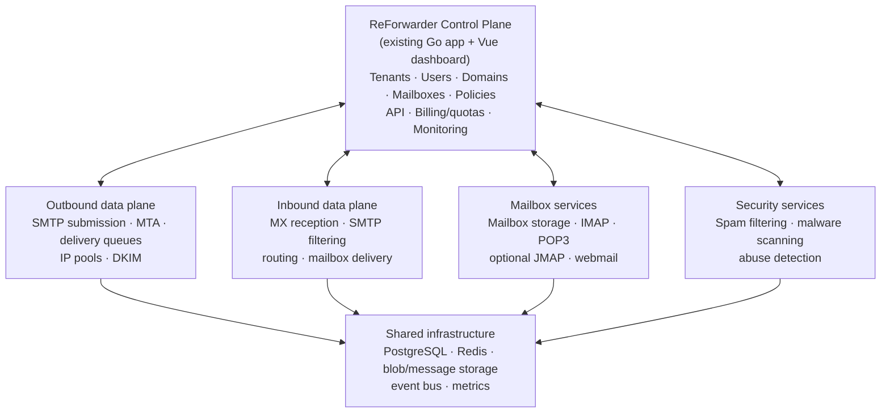
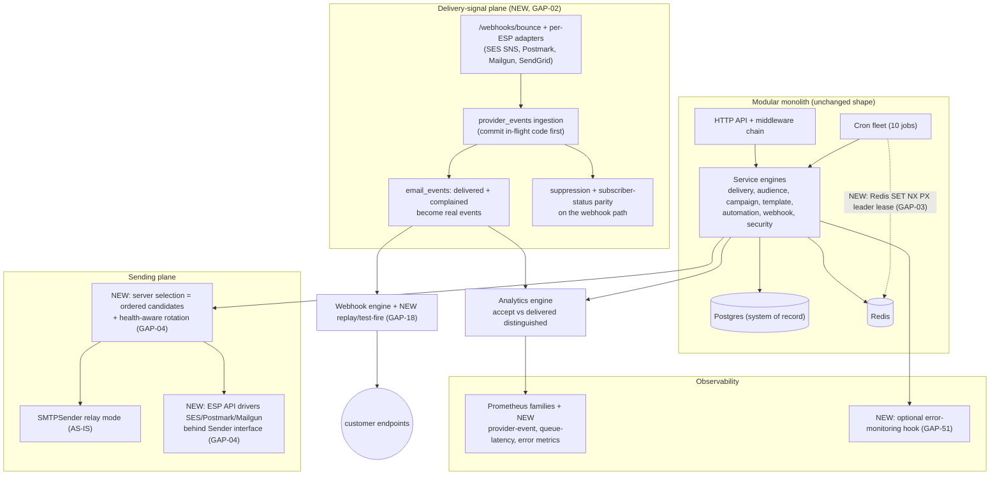
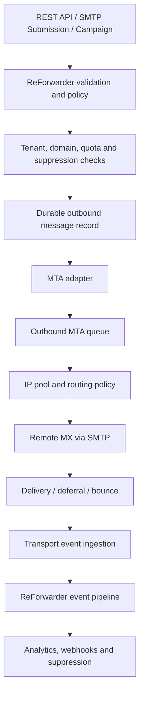
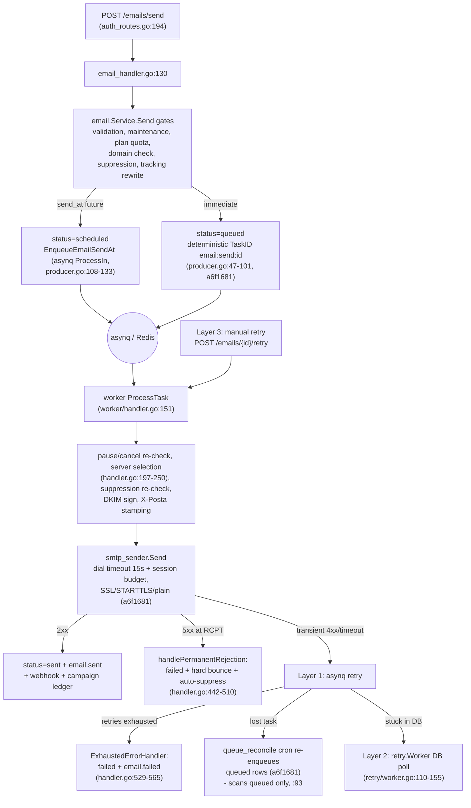
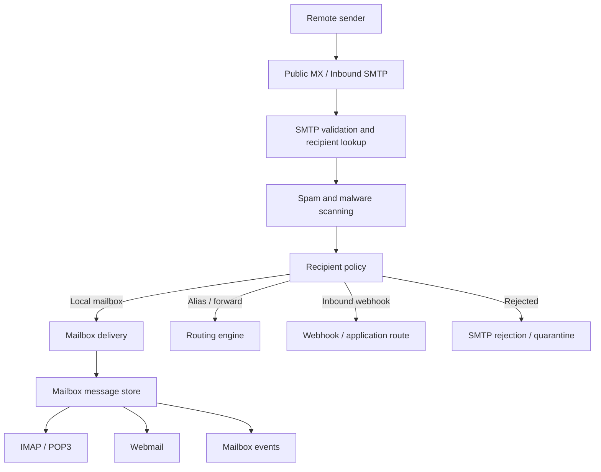
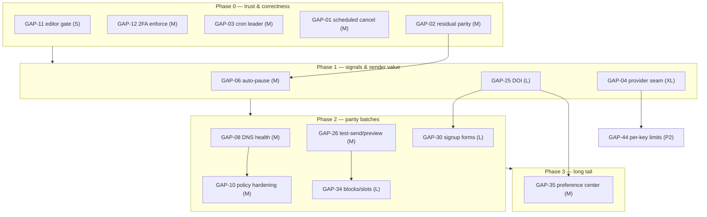
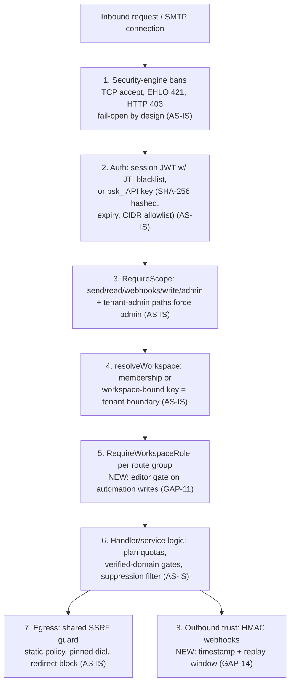

# ReForwarder — Master Todo

> Generated **2026-11-06** from the `docs/product-roadmap/` suite (research dated **2026-11-05**) plus the **Option B** decision in `upcomming-convo.md`. This file is the working checklist; where a sibling doc disagrees with it, **the sibling governs** (README §11 governance). Registry IDs, GAP-01…53, D1–D9 and R1–R16 are permanent — never renumber.

**How to use this file**
- **Track A** = Option B mail-infrastructure programme (the chosen product direction) — architecture-first, Phases 0–6.
- **Track B** = the 52-item relay roadmap (P0–P3) kept as its own track; items marked `→ OB Phase n` fold into Track A phases when their phase arrives.
- Before starting **any** item, re-verify its current state at HEAD — the audit statuses are historical (see §0).

## Sources

| File | Role |
| --- | --- |
| `docs/product-roadmap/README.md` | Index & executive overview; count governance |
| `docs/product-roadmap/01-oss-feature-inventory.md` | 199-feature registry (permanent IDs), 12 project profiles |
| `docs/product-roadmap/02-competitor-comparison.md` | Capability matrices; architectural references (Postal, BillionMail, Listmonk, useSend) |
| `docs/product-roadmap/03-existing-feature-audit.md` | Current-state audit at baseline `a6f1681` → `6d2d7c0` |
| `docs/product-roadmap/04-feature-gap-analysis.md` | 53 gaps, D1–D9 duplicates, NV register, exclusions |
| `docs/product-roadmap/05-implementation-roadmap.md` | **Track B source** — 52 remaining items, phases, scores, sequence |
| `docs/product-roadmap/06-architecture-impact.md` | AS-IS/TO-BE architecture, risks R1–R16, diagrams |
| `docs/product-roadmap/upcomming-convo.md` | **Track A source** — Option B decision (note: filename misspelled on disk) |

## Status legend

- `[ ]` open · `[x]` done (with commit)
- `[P0–P3]` relay-roadmap priority · size `S/M/L/XL` · score in parentheses
- `◆ residual` — core landed in `6d2d7c0`, only the remainder is listed
- `⚠ verify` — possibly (partially) closed after the audit baseline; reconcile at HEAD before starting
- `→ OB Phase n` — folds into Option B Phase *n*

---

## 0. Context & reconciliation (read first)

### 0.1 Where the baseline stands

- Audit suite frozen at research baseline `a6f1681` (2026-11-05); `6d2d7c0` landed during research (provider-event ingestion, A/B winner, timezone sending, webhook replay — 36 new tests) and is the current audited HEAD-of-record.
- Registry v1.0.0: **199 features** → 109 IMPLEMENTED / 2 NV / 46 PARTIAL / 38 MISSING / 4 N/A (after SEC-016 reconciliation).
- 53 gaps (P0×5, P1×10, P2×22, P3×16) → **52 items remain** (GAP-39 closed outright; GAP-02/07/18/28 reduced to residuals). Sizes: S×15, M×32, L×4, XL×1 (GAP-04).
- Option B (in `upcomming-convo.md`) **supersedes** the relay-only exclusions for direct-to-MX, IP pools, PTR guidance, bounce-mailbox/return-path and full mailboxes/IMAP/webmail — they become Track A candidates, not dead items (see §Not-recommended for what stays dead).

### 0.2 Post-audit commit `7f445f2` — reconcile these before starting

| Landed | Tracker | Affects |
| --- | --- | --- |
| Atomic send/campaign claims: CAS transitions (`queued→processing`, `failed→queued`), TaskID dedup, `FOR UPDATE SKIP LOCKED` batch claims + concurrency test | R-26 | **GAP-01** (partially — cancel + reconcile coverage still to verify) |
| TOTP recovery codes: bcrypt-hashed single-use, atomic consume, regeneration gated on current TOTP | R-10 | **GAP-12** (enforcement landed 2026-11-07 — Wave P3-4; RF-F005 full completion remains the open half) |
| `pg_dump` backup CronJob (gzip + retention) + restore runbook (`POSTA_BACKUP_ENABLED`) | R-11 | **GAP-50** (⚠ verify acceptance criteria, likely closeable) |
| Domain deliverability health endpoint (GET + diagnose): SPF/DKIM/DMARC status, DKIM key state, per-domain bounce/complaint rates, live DNS re-verification persisted | R-07 | **GAP-08** (⚠ large chunk landed; verify remaining depth) |
| `require_domain_verification` platform setting actually enforced | R-23 | **GAP-10** (partial progress) |
| CR/LF/NUL header-injection hardening; SMTP relay credentials → bcrypt + rehash-on-success | R-24, R-25 | (new hardening, no GAP) |

### 0.3 In-flight (uncommitted working tree)

- New `internal/handlers/api_key_usage_handler.go` + `internal/storage/repositories/api_key_usage_repo.go`, edits to api-key handler/model/routes/middleware/migration, `retry/worker.go` + `internal/worker/retry_bound_test.go` → **API-key usage tracking + retry bounding — likely GAP-44 groundwork**. Do not discard; reconcile when committed.

---

## 1. Target product definition (Option B)

> Source: `upcomming-convo.md` §2. **ReForwarder — self-hosted email infrastructure and communication platform.**

| Pillar | Scope |
| --- | --- |
| **Outbound email** | SMTP, direct-to-MX, queues, delivery and IP pools |
| **Inbound email** | MX reception, routing, filtering and storage |
| **Hosted mailboxes** | Mailbox provisioning, IMAP, POP and webmail |
| **Email marketing** | Contacts, campaigns, automation and analytics |
| **Developer platform** | REST API, SMTP credentials, SDKs and webhooks |
| **Infrastructure security** | Abuse controls, reputation, DNS and TLS |

Two distinct use cases, **without mixing their policies**:

1. **Email service provider** — applications/businesses send transactional and marketing email through API or SMTP.
2. **Hosted email provider** — organisations create domains, mailboxes and users, then send and receive ordinary mailbox email.

They share domain management, authentication, delivery infrastructure and administration — but need **separate sending policies, storage rules, quotas and abuse controls**.

---

## 2. Target architecture — control plane / data plane

> Source: `upcomming-convo.md` §3. Preserve the Go modular monolith + Vue dashboard as the control plane; add dedicated mail-data-plane components for protocols and message transport. **Not** thirteen microservices — logical ownership boundaries.



**Boundary rules**

- Control plane owns tenant configuration, identities, domains, mailbox metadata, credentials, policies, API and orchestration.
- Dedicated protocol services own SMTP transport, inbound reception, mailbox access and message transfer.
- PostgreSQL remains the **control-plane** system of record — not every message body belongs in the relational schema.
- Explicit service interfaces + durable events between components; protocol services never depend on private Go app internals.
- Tenant identity/ownership consistent across **all** data-plane services.
- Protocol services independently restartable and observable without taking down the dashboard/API.
- Reuse mature protocol software where safer than building from scratch; ReForwarder owns integration, configuration, lifecycle and operator experience.

### 2.1 New domain boundaries (13)

| Domain | Core responsibilities |
| --- | --- |
| `mailserver` | Mail-server lifecycle, server configuration and orchestration |
| `mta` | Outbound transport adapter, delivery status and queue integration |
| `inbound` | Inbound SMTP acceptance, validation and routing |
| `mailbox` | Mailbox, folder, quota and message metadata |
| `mailstore` | Message body and MIME storage abstraction |
| `imap` | IMAP service integration and mailbox synchronization |
| `pop3` | POP3 service integration |
| `mailrouting` | Local delivery, aliases, forwarding and routing rules |
| `reputation` | IP reputation, warm-up, throttling and abuse signals |
| `dnsmanager` | Domain verification, MX, SPF, DKIM, DMARC and PTR guidance |
| `spamfilter` | Spam scoring, quarantine and filtering integration |
| `malware` | Attachment scanning and scanning policy |
| `webmail` | User-facing mailbox application integration |

**Data ownership:** control plane = tenant/domain/mailbox config, credential metadata, policy · MTA = transport queue, remote attempts, transport status · mailbox store = message content, membership, folder state, IMAP sync metadata · filtering = verdicts, quarantine decisions, scan records · event layer = durable lifecycle events for analytics/webhooks/dashboard. Every cross-component operation has an explicit correlation identity.

### 2.2 Relay-plane target (current programme, unchanged shape)

> Source: `06-architecture-impact.md` §4.1 — what Track B builds inside the existing monolith before/alongside Track A.



---

# TRACK A — Option B: Complete Email Infrastructure (Phases 0–6)

> Source: `upcomming-convo.md` §7 + master prompt §12. Architecture-first: **do not start by implementing IMAP or building a webmail UI.** The original relay roadmap's P0 trust/correctness work (Track B Phase 0) is retained, not discarded.

## Phase 0 — Repository re-audit and architecture decisions (must happen first)

> **DONE 2026-11-07** (Option B programme authorized by the user; ADRs Accepted). ADRs live flat at `docs/architecture/ADR-001-outbound-mta.md` … `ADR-009-deployment-topology.md` (no `ADRs/` subfolder — noted deviation from the original path sketch). Repository re-audit evidence: `docs/audits/REFERENCE-PLATFORM_FEATURE_PARITY_AUDIT.md` (115-record ledger, verification waves in flight) + `docs/audits/REFERENCE-PLATFORM_SOURCE_REGISTER.md`.

- [x] Inspect current branch, HEAD, working tree; reconcile the 7 audit docs with actual code (evidence-backed current-state matrix; include `7f445f2` + in-flight work per §0) — pre-flight `482d10b` recorded; reconciliation live in the parity register
- [x] Verify existing SMTP relay, inbound receiver, queue, DKIM, provider-event ingestion, webhook behavior at HEAD — 2026-11-07 acceptance audit (commit `27c418a`) + verification waves V-B1/V-B2 at `482d10b`
- [x] Record current migrations, message models, event contracts, tenant boundaries — `docs/architecture/DATA-OWNERSHIP.md` + source register
- [x] Identify what is reusable vs must be isolated — `docs/architecture/COMPONENT-MATRIX.md` §2
- [x] ADR-001 — Outbound MTA (direct-to-MX + upstream relay modes, transport queues, retries, rate limits, IP pools, DKIM, TLS, deferrals, delivery events, ops admin)
- [x] ADR-002 — Inbound SMTP (acceptance, recipient validation, domain routing, aliases, forwarding, catch-all, spam/malware, quarantine, durable local delivery)
- [x] ADR-003 — Mailbox storage (message identity, MIME storage, folders, flags, quotas, concurrent access, expunge, search, attachments, retention, backup — **not** the transactional `Email` model)
- [x] ADR-004 — IMAP and POP3 (implementations, auth, TLS, connection limits, sync, client compatibility)
- [x] ADR-005 — Webmail (frontend boundaries, auth integration, compose/send, attachments, folders, search, sessions)
- [x] ADR-006 — Spam and malware (content-filtering boundary, quarantine, abuse detection — **distinct from the existing network security engine**)
- [x] ADR-007 — DNS and deliverability (MX, SPF, DKIM, DMARC, PTR, FCrDNS, TLS certificates, verification, warm-up, reputation)
- [x] ADR-008 — Data and event ownership (source of truth per entity/store)
- [x] ADR-009 — Deployment topology (single-node + future multi-node, health, restarts, upgrades, backups, DR)
- [x] Create `docs/architecture/OPTION-B-ARCHITECTURE.md` — target architecture and system boundaries
- [x] Create the nine ADR files (see path note above)
- [x] Create `docs/architecture/COMPONENT-MATRIX.md` — candidates, licenses, maturity, maintenance, integration costs, trade-offs
- [x] Create `docs/architecture/DATA-OWNERSHIP.md` — source of truth for every entity and store
- [x] Create `docs/architecture/MESSAGE-LIFECYCLE.md` — outbound, inbound, bounce, quarantine, mailbox-delivery flows (14 designs below)
- [x] Create `docs/architecture/MIGRATION-PLAN.md` — compatibility, migrations, rollback
- [x] Create `docs/architecture/IMPLEMENTATION-ROADMAP.md` — dependency-aware tickets + acceptance criteria
- [x] Create `docs/architecture/RISK-REGISTER.md` — reliability, security, deliverability, operational, licensing risks

**Exit criteria:** approved architecture, component-selection criteria, protocol boundaries, data ownership, migration plan. **No large feature implementation yet.**
**Architecture-only rules:** no feature implementation, no production-code changes, no schema changes, no new dependencies, no destructive commands; cite exact files/symbols for current-state claims; label facts vs recommendations vs assumptions.

## Phase 1 — Outbound MTA foundation

Target flow (source: `upcomming-convo.md` §6 / screenshots):



Current AS-IS pipeline for comparison (source: `06-architecture-impact.md` §2.3):



- [ ] MTA adapter and lifecycle manager
- [ ] Direct-to-MX delivery and upstream-relay modes
- [ ] Outbound queue visibility, retry, hold and release
- [ ] Delivery attempt records + durable transport events
- [ ] IP binding, per-domain sending policy, rate limits
- [ ] TLS, DKIM signing, SPF/DMARC alignment checks, PTR guidance
- [ ] Test harnesses: SMTP responses, transient failures, permanent failures, remote throttling
- [ ] Flow requirements: stable message identifier across systems · distinguish API acceptance / MTA queue acceptance / remote SMTP acceptance / final delivery evidence · idempotency + duplicate protection + durable retry · per-domain and per-IP rate limits · held queues + manual release · campaign traffic must not starve transactional traffic · record the MTA's **actual** response (queue acceptance ≠ delivery)

**Exit criteria:** controlled outbound delivery with traceable, recoverable message state. No production direct-to-MX launch until operational readiness gates pass.
**Folds in from Track B:** GAP-04 (Sender seam), GAP-05 (idempotency), GAP-48 (queue ops), GAP-01 (durable record).

## Phase 2 — Inbound mail and routing

Target flow (source: `upcomming-convo.md` §6 / screenshots):



- [ ] Inbound SMTP service integration
- [ ] Recipient and domain validation
- [ ] Aliases, forwarding, routing rules, catch-all policy
- [ ] Spam and malware filtering interfaces
- [ ] Bounce and return-path processing
- [ ] Quarantine and manual review
- [ ] Inbound event and audit trails
- [ ] Flow requirements: validate recipients **before** accepting responsibility · handle unknown users/aliases/catch-all/forwarding explicitly · inbound delivery idempotent · never accept then silently lose a message · quarantine + operator review · per-mailbox and per-domain quotas · forwarding loop + abuse protection · mailbox delivery kept separate from marketing subscriber state

**Exit criteria:** accepted inbound messages durably routed, rejected or quarantined with observable outcomes.
**Folds in from Track B:** GAP-02 residual (bounce/return-path), GAP-47 (antivirus hook).

## Phase 3 — Mailbox and storage foundation

- [ ] Choose and prototype the mailbox storage backend
- [ ] Mailbox, folder, quota and message metadata
- [ ] MIME storage, attachment storage, retention
- [ ] Append, fetch, copy, move, flags, expunge, search
- [ ] Concurrent-access and synchronization behavior
- [ ] Backup, restore, mailbox migration tooling

**Exit criteria:** mailbox data survives restarts, supports concurrent clients, backs up/restores without corruption. Do **not** reuse the transactional `Email` model; do not auto-migrate transactional records into mailbox storage.

## Phase 4 — IMAP and POP3

- [ ] IMAP integration against the selected mailbox backend
- [ ] Authentication/authorization tied to ReForwarder identities
- [ ] Folder and message synchronization
- [ ] POP3 as a separate access mode with correct deletion semantics
- [ ] Standard-client + protocol compatibility testing
- [ ] Connection limits, TLS enforcement, rate limits, audit logs

**Exit criteria:** standard mail clients securely use hosted mailboxes with consistent state.

## Phase 5 — Webmail and mailbox administration

- [ ] Mailbox provisioning and lifecycle management
- [ ] Inbox, folders, compose, reply, forwarding, attachments
- [ ] Search, read/unread state, mailbox settings
- [ ] Password changes, sessions, device management
- [ ] Mailbox quotas and usage reporting
- [ ] Admin tools for mailbox suspension and recovery

**Exit criteria:** users manage hosted email without a third-party webmail deployment.

## Phase 6 — Full platform convergence

- [ ] Integrate mailboxes, campaigns, transactional sending, inbound routing into one control plane
- [ ] DNS automation + certificate lifecycle management
- [ ] IP pools, warm-up controls, reputation monitoring
- [ ] Event, analytics, webhook coverage completion
- [ ] Deployment, upgrade, backup, disaster-recovery tooling
- [ ] Revisit JMAP + advanced integrations on validated demand

**Exit criteria:** one supported self-hosted platform; coherent administration; documented deployment; end-to-end operational testing.
**Folds in from Track B:** GAP-08 (DNS health), GAP-49 (Redis HA), GAP-50 (backups/DR).

### Non-negotiable design rules (all phases)

1. **Never expose an open relay.** Authenticated submission and local inbound delivery are separate trust paths.
2. **Never trust client-supplied tenant ID or recipient domain** as authorization — resolve ownership server-side.
3. **Never report successful delivery** just because a message entered a queue.
4. **Never accept inbound mail** without a durable path to deliver, route, quarantine or reject it.

### Critical operational requirements

| Area | Required protection |
| --- | --- |
| IP reputation | Warm-up, throttling, reputation monitoring, abuse response, blacklist alerts |
| DNS | MX, SPF, DKIM, DMARC, PTR + FCrDNS guidance |
| SMTP security | STARTTLS, auth policy, rate limits, connection limits, relay restrictions |
| Mailbox security | Secure credential storage, session controls, per-mailbox authorization, quotas |
| Spam | Scoring, greylisting policy, quarantine, suppression |
| Malware | Attachment scanning, safe file handling, quarantine |
| Tenant isolation | Workspace isolation across SMTP, inbound routing, mailbox access, storage, events |
| Data durability | Persistence, backup, restore, replication, recovery testing |
| Abuse prevention | Account limits, suspicious-sending detection, compromised-account response, suspension |
| Operations | Queue visibility, delivery tracing, service health, logs, alerts, upgrade safety |

Preserve existing strengths: SSRF guard, security engine, tenant isolation, encrypted credentials, queue reconciliation, webhook attempt history, retention/health tooling. New integrations build on them, never bypass them.

### Message-lifecycle designs to document (→ `MESSAGE-LIFECYCLE.md`)

- [ ] API transactional send · [ ] Authenticated SMTP submission · [ ] Direct-to-MX outbound delivery · [ ] Upstream relay delivery · [ ] Remote delivery deferral and retry · [ ] Hard bounce and soft bounce · [ ] Complaint ingestion and suppression · [ ] Inbound SMTP acceptance · [ ] Inbound mailbox delivery · [ ] Alias and forwarding · [ ] Spam quarantine · [ ] IMAP mailbox access · [ ] POP3 mailbox access · [ ] Mailbox deletion and retention

---

# TRACK B — Relay roadmap: 52 remaining items (P0–P3)

> Source: `05-implementation-roadmap.md` §3–§8. Sequence below; sizes and scores verbatim from that doc.



## Phase 0 — P0: Trust & correctness hardening (5 items, fully parallel)

Security layers these items plug into (source: `06-architecture-impact.md` §10):



- [ ] **GAP-11** — Server-side editor gate on automation write & event-ingest routes · S (2.85) — smallest, highest certainty
- [x] **GAP-12** — Enforce or remove `two_factor_required`; recovery codes · M (2.85) — **enforcement landed 2026-11-07 (Wave P3-4)**: policy read at login (`internal/handlers/user_handler.go:129-134`), forced-enrollment marker + dashboard redirect to 2FA setup, admins not exempt, 8-case test matrix (`internal/handlers/login_enforcement_test.go`); recovery codes themselves (R-10) landed `7f445f2`; residual: middleware-layer refusal for un-enrolled sessions (documented `user_handler.go:566-571`)
- [ ] **GAP-03** — Multi-replica cron leader election · M (3.15) — Redis `SET NX PX` lease; all 10 cron jobs currently run on every replica
- [ ] **GAP-01** — Scheduled transactional email: cancel + reconcile coverage · M (3.40) — top of register · ⚠ atomic claims landed `7f445f2` (R-26); verify cancel/reconcile remainder · → OB Phase 1
- [ ] **GAP-02** ◆ residual — Delivery & complaint signal ingestion · M (2.85) — core landed `6d2d7c0`:
  - [ ] Legacy `/webhooks/bounce` parity
  - [ ] Complaint → suppression with complaint kind
  - [ ] Outbound `email.delivered` / `email.complained` webhook emission
  - [ ] Analytics + automation integration
  - [ ] Retention wiring
  - [ ] Optional per-workspace provider-config UI
  - [ ] (stretch) ARF/FBL
  
  → OB Phase 2 (bounce/return-path). **Blocks GAP-06, GAP-07.**

## Phase 1 — P1: Signals & sender value (10 items, 6 parallel tracks)

- **Security track:** GAP-13 → GAP-14 → GAP-15
- **Deliverability track:** GAP-06 (after GAP-02 residual)
- **API track:** GAP-05
- **Marketing track:** GAP-25, GAP-26, GAP-27
- **Ops track:** GAP-50
- **Early start:** GAP-04 (XL — the register's biggest build)

- [ ] **GAP-06** — Circuit breaker / auto-pause on failure & complaint thresholds · M (3.15) — blocked by GAP-02 · → OB Phase 1 (reputation)
- [ ] **GAP-50** — Backup/restore tooling & guidance · S (3.00) — ⚠ `pg_dump` CronJob + restore runbook landed `7f445f2` (R-11); verify acceptance criteria, likely closeable · → OB Phase 6 (DR)
- [ ] **GAP-25** — Double opt-in (DOI) · L (2.95) — blocks GAP-30, GAP-35
- [ ] **GAP-05** — Caller-supplied idempotency keys · M (2.85) — → OB Phase 1
- [ ] **GAP-14** — Webhook signature replay protection · S (2.75) — signed timestamp + 5-minute tolerance
- [ ] **GAP-04** — Native ESP sending integrations, failover, per-send server selection · XL (2.55) — `Sender` interface + drivers; seam reused by OB MTA adapter · → OB Phase 1. **Blocks GAP-44 + ESP value.**
- [x] **GAP-13** — `security_events` retention caller · S (2.50) — landed 2026-11-07 (uncommitted working tree, P3-3 ops/settings wave, dwfrun-65ae252f): `RetentionCleanupJob` purges via `SecurityEventRepository.DeleteOlderThan` under `security_events_retention_days` (default 90, 0 = keep forever); wiring `internal/cron/jobs/retention.go:424-433` + `cmd/posta/server.go:829-832`; tests `internal/cron/jobs/retention_security_test.go` (4 named tests); battery PASS
- [ ] **GAP-27** — Data export completeness · M (2.00)
- [ ] **GAP-15** — Tracking toggle symmetry (privacy) · S (2.00) — ⚠ **product-decision gate: decide intent before code**
- [ ] **GAP-26** — Campaign test-send + campaign-scoped preview · M (1.95) — top usability gap; blocks GAP-34

## Phase 2 — P2: Parity batches (22 items, 5 groups)

Email status lifecycle (source: `docs/docs/email-sending/single-email.md`):

```
pending → queued → processing → sent
                        → failed (with error_message)
```

### Batch A — Deliverability & DNS

- [ ] **GAP-07** ◆ residual — Soft-bounce classification & greylist/transient refinement · S (2.30) — core landed `6d2d7c0`:
  - [ ] Classification-counts endpoint
  - [ ] Hard/soft bounce analytics surface
  
  → OB Phase 2
- [ ] **GAP-08** — DNS record health: drift re-verification + SPF/DMARC depth · M (2.30) — ⚠ domain-health endpoint landed `7f445f2` (R-07); verify remaining depth · blocks GAP-10 · → OB Phase 6
- [ ] **GAP-10** — Domain-sending policy enforcement hardening · M (2.20) — after GAP-08 · ⚠ `require_domain_verification` enforcement landed `7f445f2` (R-23) · → OB Phase 1
- [ ] **GAP-09** — Custom tracking domain · M (1.40)

### Batch B — Audience

- [ ] **GAP-29** — Subscriber tags · M (1.50)
- [ ] **GAP-31** — Bulk contact operations · M (1.80)
- [ ] **GAP-19** — Contact upsert/sync API · S (1.30)
- [ ] **GAP-32** — Contact activity timeline (+ unsubscribe-reason reporting) · M (1.50)

### Batch C — Campaign operability

Campaign state machine (source: `docs/docs/campaigns/sending.md`):

```
draft → sending (immediate send)
draft → scheduled (future send)
scheduled → sending (when scheduled time arrives)
sending → paused
paused → sending (resume)
sending → cancelled
paused → cancelled
scheduled → cancelled
sending → sent (all messages processed)
```

- [ ] **GAP-28** ◆ residual — A/B winner selection, end-to-end · S (2.05) — campaign scope landed `6d2d7c0`:
  - [ ] AUT-008 automation `ab_test` node outcome persistence
- [ ] **GAP-33** — Campaign operability: duplication UI + failed-recipient retry · M (1.75)
- [ ] **GAP-34** — Reusable blocks/sections library + campaign content slots · L (1.15) — after GAP-26

### Batch D — Automation

- [ ] **GAP-41** — Workflow testing / dry-run · M (1.80)
- [ ] **GAP-42** — Re-engagement & scheduled enrollment · M (1.65)
- [ ] **GAP-43** — Stop-on-reply · M (1.15)

### Batch E — Platform & ops

- [ ] **GAP-44** — Per-API-key rate limits · M (2.15) — ⚠ in-flight uncommitted (api-key-usage tracking, §0.3); verify when committed
- [ ] **GAP-45** — Blob usage reporting & orphan GC · M (1.45) — adjacent to OB Phase 3/6 (message storage)
- [ ] **GAP-48** — Queue operations: per-queue latency metric + pause/throttle · M (2.40) — → OB Phase 1
- [ ] **GAP-49** — Redis HA guidance & SPOF mitigation docs · M (2.40) — → OB Phase 6 / ADR-009
- [ ] **GAP-51** — Error-monitoring hook · S (2.05)
- [ ] **GAP-16** — Admin-console IP allowlisting · S (1.80) — fail-open CIDR middleware on `/admin/*` via `IPAllowed`
- [ ] **GAP-18** ◆ residual — Webhook test-fire endpoint · S (1.40) — replay landed `6d2d7c0`:
  - [ ] `POST /webhook-endpoints/{id}/test`

## Phase 3 — P3: Long tail (15 items, 4 groups)

### Developer surface

- [ ] **GAP-20** — SMTP diagnostics deepening · M (1.30) — → OB Phase 1 ops
- [ ] **GAP-21** — Message tagging/correlation · M (0.85)
- [ ] **GAP-22** — CLI client · M (0.65)
- [ ] **GAP-23** — SDK completeness verification · S (0.85)
- [ ] **GAP-24** — MCP server · M (0.85)

### Marketing tail

- [ ] **GAP-36** — Template authoring completeness: preview text, Markdown part, media library · M (0.95) — ⚠ **verify-first gate: verify TPL-016/TPL-022 before build**
- [ ] **GAP-37** — UTM auto-tagging · S (1.05)
- [ ] **GAP-38** — Newsletter archive & publications · L (0.75)
- [ ] **GAP-40** — Device/geo breakdowns (`ANA-015`) · M (0.75) — privacy trade-off needs explicit decisions
- [ ] **GAP-35** — Preference center · M (0.80) — builds on GAP-25

### Admin tail

- [ ] **GAP-46** — Admin impersonation · M (1.35)
- [ ] **GAP-47** — Antivirus hook · M (1.25) — → OB Phase 2 (malware scanning)
- [ ] **GAP-17** — Global registration control · S (1.50)

### Docs & observability tail

- [ ] **GAP-52** — Grafana sample dashboard · S (1.20)
- [ ] **GAP-53** — Runtime log viewer & resource history · M (0.90)

## Already delivered (record — do not re-implement)

- **GAP-39** — Timezone-aware sending — **done**, committed `6d2d7c0`
- `347ebb4` — R-01 scheduled-campaign scheduler · R-21 list segment preview fix
- `a6f1681` — R-22 SMTP dial timeouts · R-02 DKIM signing + key lifecycle · R-03 delivery-queue admin + `queue_reconcile` + deterministic TaskIDs
- `6d2d7c0` — R-04 provider-event ingestion · R-05 bounce/failure classification (14 classes) · R-06 webhook delivery replay · R-08 campaign A/B winner · R-09 timezone-aware sending
- `7f445f2` — R-24 CRLF/NUL header-injection hardening · R-25 bcrypt relay credentials · R-26 atomic claims · R-10 TOTP recovery codes · R-11 pg_dump backups + restore runbook · R-23 `require_domain_verification` enforcement · R-07 domain deliverability health

## Hard blockers & decision gates

| Edge | Meaning |
| --- | --- |
| GAP-02 residual → GAP-06 / GAP-07 | Signal integrity precedes auto-pause and soft-bounce analytics |
| GAP-04 seam → GAP-44 + ESP value | `Sender` interface is the precondition |
| GAP-08 → GAP-10 | DNS health before policy hardening |
| GAP-26 → GAP-34 | Test-send/preview before blocks/slots |
| GAP-25 → GAP-30 / GAP-35 | DOI before signup forms and preference center |
| GAP-15 | **Product decision before code** |
| GAP-36 | **Verify before build** |

### D1–D9 duplicates (consolidation work, fold into adjacent items)

D1 keep Subscribers canonical, delete ContactLists (versioned step) · D2 one audit UI w/ scope switcher · D3 segments canonical + FilterRules converter, deprecate new dynamic lists · D4 keep both analytics (document) · D5 merge retry/status into MessageDetail, retire Emails views · D6 delete `ChangePassword.vue`, keep redirect · D7 do **not** merge `tracking_events`/`email_events` (document) · D8 promote Suppressions to own nav entry · D9 three SSE channels acceptable (note only).

---

## Not recommended — keep dead

> Source: `04-feature-gap-analysis.md` §6 + `05-implementation-roadmap.md` §9. **Option B supersedes** the first block only; the rest stays dead.

**Reinstated as Track A candidates by Option B** (were excluded under relay-only strategy): direct-to-MX/MTA (INF exclusion) · IP pools/multiple sending IPs (INF-025) · bounce mailbox/VERP ingestion (INF-020) · PTR/rDNS guidance (DOM-013) · full mail server / IMAP / JMAP / webmail (INF-003) · automated DNS provisioning (DOM-007) · per-domain TLS/ACME (DOM-010).

**Still dead (all 12 competitors verified absent or rejected):** strict priority send queues (INF-011) · multi-channel messengers (INF-036) · import cleaning heuristics (CON-020) · recurring campaigns (CAM-003) · Liquid/Handlebars (TPL-006) · MJML (TPL-007) · React Email (TPL-008) · AI-assisted creation (TPL-020) · spintax (TPL-021) · Zapier/platform connectors (API-018) · SAML SSO · SCIM · DMARC rua ingestion · per-subscriber ML send-time optimization · SPF flattening · MTA-STS/DANE · retention legal-hold · web2-adjacent products (ANA-016, API-019) · license-gated source copies (AGPL/BSL — clean-room behavioral research only).

---

## Appendix — diagram index

| # | Diagram | Source | In this file |
| --- | --- | --- | --- |
| D1 | Control plane / data planes (target) | `upcomming-convo.md` §3 | ✅ §2 |
| D2 | Relay-plane TO-BE (GAP-02/03/04/18/51 marked) | `06-architecture-impact.md` §4.1 | ✅ §2.2 |
| D3 | Outbound delivery flow (target) | `upcomming-convo.md` §6 | ✅ Track A Phase 1 |
| D4 | Outbound delivery pipeline (AS-IS detail) | `06-architecture-impact.md` §2.3 | ✅ Track A Phase 1 |
| D5 | Inbound mail & mailbox delivery (target) | `upcomming-convo.md` §6 | ✅ Track A Phase 2 |
| D6 | Roadmap implementation sequence | `05-implementation-roadmap.md` §8 | ✅ Track B header |
| D7 | Security defense-in-depth layers | `06-architecture-impact.md` §10 | ✅ Track B Phase 0 |
| D8 | Campaign state machine | `docs/docs/campaigns/sending.md` | ✅ Track B Phase 2 |
| D9 | Email status lifecycle | `docs/docs/email-sending/single-email.md` | ✅ Track B Phase 2 |
| D10 | Overall architecture (README) | `README.md` §Architecture | path only |
| D11 | Same architecture, docs-site variant | `docs/docs/getting-started/architecture.md` | path only |
| D12 | AS-IS system context | `06-architecture-impact.md` §2.1 | path only |
| D13 | SMTP relay session → send pipeline | `docs/docs/security/smtp-relay.md` | path only |
| D14 | Inbound webhook flow (AS-IS) | `docs/docs/inbound/overview.md` | path only |
| D15 | Website form → scan → store | `docs/docs/messages/overview.md` | path only |
| D16 | the reference platform detection-to-ban flow (security reference) | `docs/security-research/reference-platform-issue-820-commit-581533b-analysis.md` §5 | path only |
